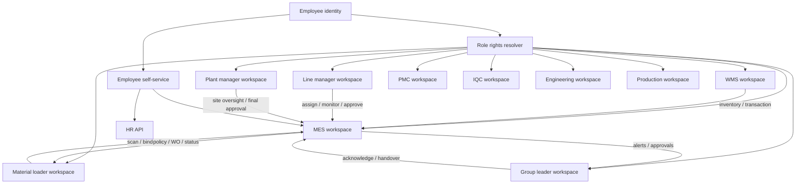

# Unified PDA role and task graph

This is the shared contract for the unified PDA. MES/HR remain authoritative; the PDA
only presents an allowed task and records the operator's action.

## Entity and event contract

| Node | Required identity | Events owned by the authority |
|---|---|---|
| Employee | `employeeId`, role, line/domain | profile, attendance, leave, grievance |
| PDA session | `deviceId`, employee, role, line | login, heartbeat, permission snapshot |
| Work order | `woId`, line, machine, active flag | created, activated, completed, cancelled |
| Material roll | `materialSn`, part number, lot, quantity | issued, scanned, bound, consumed |
| Binding | machine, channel, feeder, material SN | validated, rejected, released |
| Alert | eventId, source, severity, recipients | raised, acknowledged, resolved, escalated |

## Ralph loop stop rule

Each change runs this loop before it is considered complete:

1. Inspect the current screen, route, API and tests.
2. Change one bounded slice using shared UI tokens.
3. Run unit tests and build the affected variant.
4. Check the failure, empty, offline and unauthorized states.
5. Repeat only while a required acceptance gate is failing; stop when all gates pass.

The current PDA acceptance gates are: role boundary, HR/MES API sync, 48dp actions,
visible processing/error feedback, and a successful `UnifiedManagement` build.

## Role functions and closed loops

Every action below is an MES/WMS request; the list is re-read after each accepted
write so the PDA shows the authority's state, never a local guess.

| Role | Functions (permission key) | Loop endpoints | Decision authority |
|---|---|---|---|
| EMPLOYEE (all roles) | clock in/out (`employee.attendance.view`), leave request + status (`employee.leave.submit`), grievance + outcome acknowledgement, employee QR | `/hr/employees/*/attendance`, `/hr/employees/leave-requests`, `/hr/employee/grievances`, `/hr/employee/grievances/{id}/acknowledge` | HR/MES decides leave and grievance resolution |
| MATERIAL_LOADER / SMT / AUTO / MANUAL | scan machine/channel/feeder/reel, BOM lock and complete, return material (`smt.loading.view/bind`, `wms.transaction`) | `/pmc/work-orders/{code}/lock|unlock|complete`, `/mes/feeder-validate`, `/mes/feeder-binding/validate|confirm`, `/mes/feeder-loading` | MES validates every bind; operator cannot override |
| GROUP_LEADER | NG pickup acknowledge, alert acknowledge/assign, team message, shift handover confirm (`ng.pickup.ack`, `manager.alert.assign`, `manager.team.message`, `manager.handover.confirm`) | `/api/manager/alerts/{id}/acknowledge|assign`, `/api/manager/channels`, `/api/manager/handover/{id}/confirm` | Acknowledge only; line manager decides |
| LINE_MANAGER | alerts, decisions approve/reject/ask, targets + recovery action, team message, audit, daily assignments, hiring request, grievance explanation, handover | `/api/manager/alerts`, `/decisions/{id}/approve|reject|request-information`, `/targets`, `/audit`, `/line-assignments`, `/hiring-requests`, `/grievance-cases`, `/handover` | Approves line-level exceptions; final plant release is senior-only |
| PLANT_MANAGER | site exceptions authorize/revoke/close, loading approval, final release, staff communication (`plant.*`, `approval.final.release`) | `/api/manager/alerts`, `/api/manager/decisions/{id}/*`, `/api/plant-manager/authorizations/{id}/*`, `/api/pda/events` | SENIOR only; JUNIOR is review/co-sign |
| WAREHOUSE | receiving (OCR + box commit/revoke), inbound/outbound/requisition/return/replenishment, count, shelf in/out, inventory query (`wms.receiving.execute`, `wms.document.edit`, `wms.shelf.move`, `wms.count.execute`) | `/api/wms/receiving/*`, `/api/pda/events`, `/api/wms/storage-locations`, `/api/wms/inventory` | WMS commits inventory; PDA drafts are not stock |
| WAREHOUSE_MANAGER | shortage resolution, stock inquiry, rack detail (`wms.shortage.resolve`, `wms.stock.view`) | `/api/wms/shortage`, `/api/wms/inventory` | WMS closes shortage |
| MATERIAL_FETCHER / COLLECTOR / PICKER | picking, issue, return, shelf out, fetching (`wms.fetch.execute`, `wms.collect.execute`, `wms.pick.claim`) | `/api/wms/pick-requests/*/accept`, `/api/wms/collect`, `/api/wms/issue`, `/api/wms/return` | WMS owns allocation and claims |
| IQC | WMS pending receipts → inspection document → defect records → AQL completion → queue refresh (`iqc.task.view`, `iqc.result.submit`) | `GET /api/wms/incoming`, `GET/POST /api/wms/iqc/inspections`, `POST /api/wms/iqc/inspections/{id}/defects`, `POST /api/wms/iqc/inspections/{id}/complete` | WMS computes sampling/AQL and updates the lot; supplier publication is reported back |
| PMC | work-order list, lock/unlock, controlled completion, BOM view (`pmc.workorder.view`, `pmc.workorder.control`) | `/pmc/work-orders`, `/pmc/work-orders/{code}/lock|unlock|complete` | MES enforces plan state |
| MES | alerts, decisions, approvals, line/loading status, work-order overview (read + approve) | `/api/manager/*` | MES |
| ENGINEERING / PRODUCTION | alert/repair/line/target read surfaces | `/api/manager/alerts`, `/mes/lines/{lineCode}` | Read-only; MES decides |

Authority rules enforced in code: `RuntimeRights` merges the MES-issued permission list
and role-definition actions over the local catalog; a 401 clears the cached session; the
session is re-read at app start; and every route is gated by `canAccessRoute` before its
body composes.
