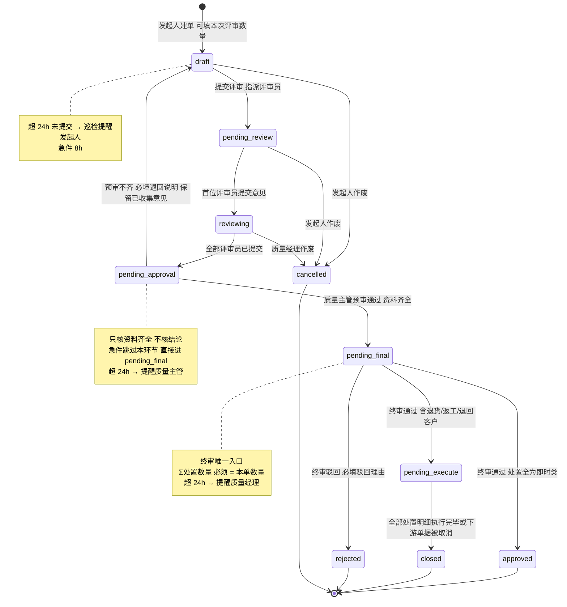

# MRB v2 增量 PRD —— 对齐帮助文档口径

> 版本：v2.1（增量对齐）
> 基线：2026-10-18 上午已上线的 MRB v2（拆量处置 + 下游单据）
> 作者：许清楚（产品经理）
> 语言：简体中文；术语一律沿用系统帮助文档 MRB 章节（特采 / 退货 / 返工 / 报废 / 其他）
> 本文档为**增量**文档：不重复描述已实现功能，只写「目标口径 → 现状差距 → 改法 → 可测试断言」。

---

## 一、版本与范围

### 1.1 本次要解决的唯一问题

帮助文档已经把 MRB 的业务逻辑写死了。本次**不修改帮助文档**，而是让代码对齐帮助文档：

- 帮助文档承诺 10 个状态，代码只实现了 7 个（`pending_review / reviewing / pending_final / approved / pending_execute / closed`，缺 `draft / pending_approval / rejected / cancelled` 的完整链路）。
- 帮助文档承诺「发起时可评价部分数量、剩余可再次发起」，代码把数量写死为系统算出来的可评审量。
- 帮助文档承诺「其他处置按备注说明处理」，代码里「其他」是一条**静默结案**的死路（单据直接 closed，库存零变动，无明细）。
- 帮助文档承诺「库存查询显示特采标记 + 关联 MRB 单号」，代码写了字段但前端与库存 API 完全没暴露。

### 1.2 本期做（In Scope）

| 编号 | 范围 | 为什么本期做 |
|---|---|---|
| S1 | 状态机补全：`draft` / `pending_approval` / `rejected` / `cancelled` 全链路打通 | 帮助文档第 1 条口径，也是权限分离（预审/终审）的载体 |
| S2 | 发起时可填「本次评审数量」，剩余量回到待发起 | 决策 2A；直接决定「同批次多次评审」是否真的可用 |
| S3 | 「其他」处置收窄为三类（退回客户 / 转留样·样品 / 待定暂存）+ 必填去向 | 决策 3A；同时修掉 G4 静默结案 |
| S4 | 质量主管预审（只核资料齐全，不核结论），急件可跳过 | 决策 1A |
| S5 | 超时巡检的**数据与呈现**（停留时长、3 天升级 / 7 天报经理、角标与筛选） | 决策 4A |
| S6 | 库存查询露出 `is_special_admit` / `special_admit_ref` | 帮助文档「特采放行后续影响」明确承诺 |
| S7 | 写操作的角色校验补齐（403 边界） | 预审/终审分离无法靠前端保证 |

### 1.3 本期不做（Out of Scope）

1. **不做特批流程**。「其他」三类之外的情形 → 直接拒绝并提示走特批，特批单本身不在本期。
2. **不做发料拦截特采件**。这是帮助文档刻意声明的事实（特采件就是普通可用库存），任何"好心"的拦截都是需求偏差。
3. **不做消息推送 / 邮件 / 企微通知**。系统无消息中心，本期巡检只做「页面能看见 + 能筛」。
4. **不改帮助文档**（用户明确：按文档改代码）。
5. **不改下游模块业务规则**（供应商退货单、返工单的既有流程原样复用，只补「取消 → MRB 结案」的回归验证）。
6. **不做 MRB 统计看板、不做 MRB 批量审批**。
7. **不新增业务角色**（见 Q2；预审暂由 `iqc_manager` 承担）。

### 1.4 术语对齐（务必与帮助文档一字不差）

| 代码值 | 中文 | 越文 | 英文 |
|---|---|---|---|
| `special_admit` | 特采 | Chấp nhận đặc biệt | Special admit |
| `return` | 退货 | Trả hàng | Return |
| `rework` | 供应商返工 | Làm lại tại nhà cung cấp | Supplier rework |
| `scrap` | 报废 | Tiêu hủy | Scrap |
| `other` + `customer_return` | 其他 - 退回客户 | Khác - Trả khách hàng | Other - Return to customer |
| `other` + `sample` | 其他 - 转留样/样品 | Khác - Lưu mẫu | Other - Sample retention |
| `other` + `hold` | 其他 - 待定暂存 | Khác - Tạm giữ chờ quyết | Other - Pending hold |

> 注意：`return` 是「退给供应商」，`other/customer_return` 是「退回客户」，两者不是一回事，UI 文案必须写全，禁止都简写成"退货"。

---

## 二、目标状态机

### 2.1 状态图



### 2.2 状态迁移表

| # | 从 | 到 | 操作者 | 触发条件 | 副作用 |
|---|---|---|---|---|---|
| T1 | — | `draft` | 发起人（`sqe` / `iqc_manager` / `quality_manager`） | 对「待发起」列表某批次建单 | 写 `quantity`=本次评审数量（默认全量）、`status_since` |
| T2 | `draft` | `cancelled` | 发起人本人 / `quality_manager` / `admin` | 作废，必填 `cancel_reason` | 写 `cancel_reason`/`cancel_by`/`cancel_time`；库存不动 |
| T3 | `draft` | `pending_review` | 发起人本人 | 提交：指派 ≥1 名评审员 | 评审员记录落库；`status_since` 重置 |
| T4 | `pending_review` | `reviewing` | 任一被指派评审员 | 首次提交意见（四选一：特采/退货/返工/报废） | 写该评审员 `review_result`/`review_opinion`/`review_time` |
| T5 | `pending_review` / `reviewing` | `cancelled` | 发起人本人 / `quality_manager` / `admin` | 作废，必填 `cancel_reason` | 同上；已提交意见保留 |
| T6 | `reviewing` | `pending_approval` | 系统 | **全部**评审员都已提交 | 若 `is_urgent = true` → 直接落 `pending_final` 并记 `skipped_approval` 标记 |
| T7 | `pending_approval` | `pending_final` | 质量主管（`iqc_manager`）/ `admin` | `completeness_result = 'complete'` | 写 `completeness_by/time/remark` |
| T8 | `pending_approval` | `draft` | 质量主管 / `admin` | `completeness_result = 'incomplete'`，必填 `completeness_remark` | 退回发起人补资料；**评审员意见保留不清空**；再次提交时若评审员已全部提交 → 直接回 `pending_approval`（不重复评审） |
| T9 | `pending_final` | `approved` | 质量经理 / `admin` | 终审通过，处置明细**全部**为即时类（特采 / 报废 / 其他-留样 / 其他-暂存） | 即时类处置立即改库存；`final_decision`/`final_approval_time` |
| T10 | `pending_final` | `pending_execute` | 质量经理 / `admin` | 终审通过，处置明细含 `return` / `rework` / `other-customer_return` | 生成供应商退货单 / 返工单；明细 `exec_status='pending'` |
| T11 | `pending_final` | `rejected` | 质量经理 / `admin` | 驳回，必填 `final_remark`（驳回理由） | 库存不动、无下游单；本单进「已处理」 |
| T12 | `pending_execute` | `closed` | 系统 | 该 MRB 下 `mrb_disposition` 中 `exec_status='pending'` 的数量 = 0（下游单据完成 **或** 被取消） | 写 `closed`；现有 `syncExecutionStatus()` 已具备 |

### 2.3 `rejected` / `cancelled` 之后，批次如何回到「待发起」

三个事实必须同时成立：

1. **终态不计入进行中**。`rejected` / `cancelled` 与 `approved` / `closed` 同属 `DONE_MRB_STATUSES`，因此不会阻塞同批次再次发起（`initiateMrb()` 的 Conflict 校验已按此实现）。
2. **重新出现的条件只看库存**。批次回到「待发起」上半区，唯一条件是：
   - 无进行中的 MRB（`status NOT IN (closed, approved, rejected, cancelled)`）；且
   - 不良品仓存在**未被占用**的库存（`stock_status='defective' AND quantity>0` 且 `lock_reason` 不以 `SAMPLE:` / `HOLD:` / `CUSTOMER_RETURN:` 开头）；或首次发起且良品仓有锁定库存。
   > 若 `rejected`/`cancelled` 时不良品仓已无库存（例如实物已被领走），批次**不会**回到待发起——这是正确行为，不是 bug。
3. **已处理视图不丢行**。该批次在「已处理」折叠行上仍可见（评审次数不含 `rejected`/`cancelled`，与现状一致），行状态展示为「已驳回 / 已作废」，并提供「重新发起」按钮（P1）。

**断言**：某批次发起 → 作废 → 待发起列表 1s 内应重新出现该批次；「评审次数」仍为 0；已处理视图出现 1 行状态=已作废。

---

## 三、角色权限矩阵

### 3.1 先说清楚：系统里到底有哪些角色

`server/scripts/init-db.ts` 与 `client/src/auth/AuthContext.tsx` 的 16 个角色里，**没有** `quality_engineer`、`quality_supervisor`、`warehouse`。任务书里的角色名是中台口径，落到本系统必须映射：

| 任务书叫法 | 本系统实际角色码 | 说明 |
|---|---|---|
| 质量工程师 / SQE | `sqe` | 角色描述就是「MRB发起」 |
| 质量主管（预审） | `iqc_manager`（IQC主管） | **推荐映射**，不新增角色。见 Q2 |
| 质量经理（终审） | `quality_manager` | 唯一终审人 |
| 各专业评审员 | `mrb_reviewer`、`sqe`、`engineer`、`iqc_inspector` 等 | 谁被指派谁评审，不做角色白名单 |
| 仓管 | `wh_keeper` / `wh_manager` | 退货出库、MRB 实物提走 |
| 管理员 | `admin` | 兜底 |

### 3.2 动作 × 角色

| 动作 | sqe | iqc_manager | quality_manager | mrb_reviewer 等被指派者 | wh_keeper / wh_manager | admin |
|---|---|---|---|---|---|---|
| 查待发起批次 / 进行中 / 已处理 | ✔ | ✔ | ✔ | ✔（只读） | ✔（只读） | ✔ |
| 看 MRB 详情 | ✔ | ✔ | ✔ | ✔（仅被指派的单，其余只读） | ✔ | ✔ |
| 建单 `draft` | ✔ | ✔ | ✔ | ✘ 403 | ✘ 403 | ✔ |
| 提交评审 T3 | 仅本人创建的单 | 仅本人创建的单 | 仅本人创建的单 | ✘ 403 | ✘ 403 | ✔ |
| 指派评审员 | ✔ | ✔ | ✔ | ✘ 403 | ✘ 403 | ✔ |
| 提交评审意见 | 仅在被指派列表中 | 仅在被指派列表中 | 仅在被指派列表中 | 仅在被指派列表中，否则 **403 / 404** | ✘ 403 | 仅在被指派列表中 |
| 质量主管预审 T7/T8 | ✘ 403 | ✔ | ✘ 403（**不得自审自批**） | ✘ 403 | ✘ 403 | ✔ |
| 终审通过 / 驳回 T9–T11 | ✘ 403 | ✘ 403（**建议收窄，见 Q3**） | ✔ | ✘ 403 | ✘ 403 | ✔ |
| 作废 T2/T5 | 仅本人创建的单 | 仅本人创建的单 | ✔ | ✘ 403 | ✘ 403 | ✔ |
| 退货单出库确认 / 取消 | ✘ | ✘ | 只读 | ✘ | ✔ | ✔ |
| 返工完成 / 重检 | ✘ | 重检 ✔ | 重检 ✔ | ✘ | 完成 ✔ | ✔ |
| 巡检超时清单 | ✔ | ✔ | ✔ | 只读 | 只读 | ✔ |
| 库存查询看特采标记 | ✘（无库存菜单） | ✔ | ✘（见 Q5 备注） | ✘ | ✔ | ✔ |

### 3.3 403 边界的实现要求（G7）

- 现状：`mrb.controller.ts` 只有 `final-approve` 带 `@NeedRoles('quality_manager','iqc_manager','admin')`，`initiate / assign-reviewers / submit-review / list / detail` 全部只要求登录。
- 要求：`initiate`（含建草稿、提交）、`assign-reviewers`、`pre-approve`（新）、`final-approve`、`reject`、`cancel` 六个写端点必须加 `@NeedRoles(...)`，且**服务层再做一次归属校验**（"我是不是这张单的发起人/被指派评审员"），不能只靠注解。
- `my-tasks` 的 `reviewerId` 查询参数必须废弃（否则可越权查看他人工单）；现状已优先取 `req.userContext.userId`，需彻底移除查询参数回退。

---

## 四、需求池

> 每条格式：**现状 → 期望 → 验收断言**。断言必须可被测试同学直接转成测试用例。

### P0（不做则本期不成立）

#### P0-1 `pending_approval` 预审环节接入状态机

- **现状**：`mrb.service.ts` `submitReview()` 在"评审员全部提交"后直接 `.set({ status: 'pending_final' })`（约 1026 行）；`completeness_result / completeness_by / completeness_time / completeness_remark` 四个字段在 `mrb-v2-20261018.sql` 里已建，但**代码从未读写**。`finalApprove()` 只接受 `status === 'pending_final'`。
- **期望**：
  1. 评审员全部提交 → `pending_approval`；`is_urgent = true` 时直接 `pending_final` 并在详情返回 `skippedApproval: true`。
  2. 新增 `POST /api/mrb/pre-approve`，入参 `{ mrbId, result: 'complete'|'incomplete', remark }`；`@NeedRoles('iqc_manager','admin')`。
  3. `complete` → `pending_final`；`incomplete` → `draft` 且 `completeness_remark` 必填（≥5 字），评审员意见保留。
  4. `GET /api/mrb/detail/:id` 返回 `completeness: { result, by, byName, time, remark }`。
- **验收断言**：
  - A1：2 名评审员，第 1 名提交后状态仍 `reviewing`；第 2 名提交后状态 = `pending_approval`（不是 `pending_final`）。
  - A2：`pending_approval` 状态下调 `final-approve` → 400，文案含「尚未完成资料齐全性预审」。
  - A3：`sqe` 身份调 `pre-approve` → 403。
  - A4：`incomplete` 不填 remark → 400；填了 → 状态 `draft`，`mrb_reviewer` 的 `review_opinion` 一条不少。
  - A5：退回 `draft` 后仅补传资料、重新提交，状态直接回 `pending_approval`（不重新评审）。
  - A6：`is_urgent=true` 的单，最后一名评审员提交后状态 = `pending_final`，详情 `skippedApproval=true`，且 `completeness_result` 为 `null`。

#### P0-2 `draft` / `rejected` / `cancelled` 三个入口

- **现状**：`initiate` 直接落 `pending_review`（约 723 行），无草稿；controller 无作废端点；终审只有通过没有驳回。
- **期望**：
  1. `POST /api/mrb/initiate` 增加 `submit: boolean`（默认 `true` 保持兼容）。`submit=false` → 落 `draft`，此时 `assignReviewers` 可不传。
  2. `POST /api/mrb/submit`（`{ mrbId }`）：`draft` → `pending_review`，校验至少 1 名评审员，校验发起人本人。
  3. `POST /api/mrb/cancel`（`{ mrbId, reason }`）：允许 `draft / pending_review / reviewing`，写 `cancel_reason / cancel_by / cancel_time`。
  4. `POST /api/mrb/reject`（`{ mrbId, reason }`）：仅 `pending_final`，`@NeedRoles('quality_manager','admin')`，`reason` 必填。
  5. `status` 字段长度 20 已够，`cancelled`（9 字符）无需改列。
- **验收断言**：
  - A1：`submit=false` 建单 → 详情 `status='draft'`；该批次**不在**「进行中 MRB」列表（`scope=pending` 应包含它？**应包含**，因为有进行中单，上半「待发起」不应再出现该批次）。
  - A2：`draft` 单其他用户点提交 → 403「仅发起人可提交」。
  - A3：`draft` 无评审员点提交 → 400「请先指派评审员」。
  - A4：`pending_final` 点驳回 → 状态 `rejected`，`final_remark` = 驳回理由，`mrb_disposition` 无新增行，`inventory` 数量**完全不变**（前后对账差值 0）。
  - A5：`rejected` 后该批次立即重新出现在「待发起」列表；已处理视图出现该行。
  - A6：`closed` 状态下点作废 → 400「已结案单据不可作废」。
  - A7：作废后 `mrb_disposition` 与库存均无变动（作废不是"撤销处置"）。

#### P0-3 发起时可填「本次评审数量」

- **现状**：`initiateMrb()` 入参只有 `iqcLotId/initiatorId/initiatorName/reason`，`quantity` 由系统算 `defectiveQty + (首次 ? lockedGoodQty : 0)` 写死（约 704 行）。
- **期望**：入参新增 `quantity?: number`，规则见第五章。终审守恒基准 = 本单 `quantity`。
- **验收断言**：
  - A1：可评审量 100，不填数量 → 单据 `quantity = 100`。
  - A2：可评审量 100，填 60 → 单据 `quantity = 60`；终审只能拆 60（拆 100 → 400）。
  - A3：填 0 / 负数 / 101 → 400，文案含可评审量具体数字。
  - A4：填 60 结案后，剩余 40 立即可再次发起，第二次单据 `quantity` 默认 = 40。
  - A5：并发两次发起同一批次 → 第二次 409。

#### P0-4 「其他」处置收窄为三类 + 必填去向（同时杀掉 G4）

- **现状**：`EXECUTABLE_DISPOSITIONS = ['special_admit','return','rework','scrap']` 不含 `other`；`finalApprove()` 里 `finalResult==='other'` 且无明细时 `lines=[]` → `finalStatus='closed'`，**单据结案、库存零变动、无明细记录**（约 1072–1104 行）。
- **期望**：
  1. `disposition_type='other'` 纳入可执行集合，新增强制子类型 `other_type ∈ {customer_return, sample, hold}`。
  2. 删除「`lines.length === 0 → closed`」分支，改为 `lines.length === 0 → 400「请填写处置明细」`。
  3. 明细必填校验见第六章。
- **验收断言**：
  - A1：`finalResult='other'` 且不传 dispositions → 400，不再出现"结案但库存没动"。
  - A2：`other_type` 缺失 → 400「其他处置必须选择具体去向」。
  - A3：`hold` 不填 `hold_until` → 400；`hold_until` 早于明天 → 400。
  - A4：`customer_return` 不填 `ref_no` → 400。
  - A5：任意处置组合，`Σ明细数量 ≠ 本单数量` → 400，文案同时给出两个数字。
  - A6：终审成功后，`Σ(mrb_disposition.quantity)` 恒等于 `mrb_review.quantity`（SQL 对账 0 差异）。

#### P0-5 库存查询露出特采标记与关联 MRB 单号（G6）

- **现状**：`inventory.is_special_admit` / `special_admit_ref` 由 MRB 写入，但 `server/modules/inventory` 与库存查询页**完全未暴露**（全仓 grep 为空）。
- **期望**：
  1. `GET /api/inventory/list`（及查询/导出接口）返回 `isSpecialAdmit`、`specialAdmitRef`。
  2. 库存查询表格新增「特采」列：`true` 显示标签「特采」+ 悬浮/次行显示 `specialAdmitRef`（MRB 单号）；`false` 显示 `-`。
  3. 筛选器新增「仅看特采」开关。
  4. **发料选料逻辑一字不改**（帮助文档明示：发料不识别特采标记）。
- **验收断言**：
  - A1：特采放行 60 后，库存查询该行 `isSpecialAdmit=true`、`specialAdmitRef` = MRB 单号。
  - A2：该行 `stockStatus='good'`、`locked=false`，可被正常发料选中（发料单能带出该批次）。
  - A3：发料流程中**不出现**任何"特采件"提示或阻断（反向断言：拦截即为 bug）。
  - A4：报废/退货/返工处置产生的库存行 `isSpecialAdmit=false`。

#### P0-6 终审数量守恒硬校验（回归 + 补强）

- **现状**：已实现 `sumScaled !== totalScaled` 报错；但 `lines=[]` 可以绕过（见 P0-4），且 `finalResult='other'` 时 `final_decision` 与明细 `disposition_type` 语义不一致。
- **期望**：守恒校验不可绕过；`final_decision` 在拆量场景下取「主处置」（数量最大的一行），并在详情同时返回完整明细供展示。
- **验收断言**：
  - A1：60 特采 + 30 退货 + 10 报废 = 100 → 成功，`final_decision='special_admit'`（最大行）。
  - A2：59 + 30 + 10 = 99 → 400，文案含「99」与「100」。
  - A3：三行数量为负或 0 → 400。

#### P0-7 写端点权限补齐（G7）

见第三章 3.3。**验收断言**：矩阵中每个 ✘ 格子对应一条 403 用例；`sqe` 调 `final-approve` → 403；`iqc_manager` 调 `pre-approve` → 200；`iqc_manager` 调 `final-approve` → 403（若采纳 Q3 建议）。

#### P0-8 两视图「按批次折叠」回归（已具备，需固化）

- **现状**：`GET /api/mrb/lot-groups` 已按批次折叠，`reviewCount` / `latest` / `history` 已返回；分页按批次（`total` = 批次数）。
- **期望**：不退化。本次只补两个字段：`remainingDefectiveQty`（该批次不良品仓未被占用余量）、`canReinitiate`（是否可再次发起）。
- **验收断言**：
  - A1：同批次 3 张已结案单 → 已处理视图 1 行，`reviewCount=3`，展开见 3 行子单。
  - A2：`pageSize=20`，共 25 批次 / 60 张单 → 返回 20 行、`total=25`（不是 60）。
  - A3：`rejected` / `cancelled` 单不计入 `reviewCount`。

### P1（本期做，可延后一个迭代）

#### P1-1 超时巡检（G5）

- **现状**：全模块无「停留时长」概念，`is_urgent` 字段闲置。
- **期望**：`status_since` 落库 + `stuckHours`/`slaLevel` 计算 + 列表角标与筛选。规则见第七章。
- **验收断言**：
  - A1：`pending_review` 停留 80h 的单，`slaLevel='warn'`（超 3 天升级）。
  - A2：停留 170h → `slaLevel='overdue'`（超 7 天报经理）。
  - A3：状态变更后 `status_since` 立即重置，`stuckHours` 从 0 重新计。
  - A4：`overdue=1` 筛出的行数 = 角标数字。

#### P1-2 待定暂存到期巡检

- **期望**：`hold_until` 到期当日进入「巡检清单 - 暂存到期」，逾期未转正式处置标红。
- **验收断言**：`hold_until = 今天` 出现 1 条；`= 明天` 不出现；逾期 3 天 `slaLevel='overdue'`。

#### P1-3 急件标记 UI

- **期望**：发起/建单时可勾「急件」并必填 `urgent_reason`；列表与详情展示急件角标；时限压缩见第七章。
- **验收断言**：勾急件不填原因 → 400；急件单在列表排最前；详情 `isUrgent=true`。

#### P1-4 待发起列表补「剩余未处理量 / 可评审量」双列

- **期望**：现有 `defectiveQty` / `reviewableQty` 已在 SQL 算出，但两列语义易混。改为「本次可评审量」（可填上限）+「仓内剩余未处理」（用于判断还有多少没评审），并在发起弹窗内实时回显。
- **验收断言**：可评审 100、发起 60 后，列表该行「剩余未处理」= 40、「可评审量」= 40。

#### P1-5 「其他」三类与 `rejected/cancelled` 的三语文案

- **期望**：`zh/vi/en` 三份 locale 补齐 4 个新状态 + 3 个其他子类型 + 2 个新按钮文案，禁止硬编码中文。
- **验收断言**：切到 vi/en，MRB 列表与详情不出现任何中文字符。

### P2（本期不做，登记备查）

- P2-1 两视图 CSV 导出（现有 MRB 页无导出；可复用 `client/src/pages/iqc/IqcPending.tsx` 的写法，导出当前筛选结果）。
- P2-2 「班次」筛选（口径见 Q5）。
- P2-3 MRB 处置结构月度看板（特采率 / 报废率 / 平均滞留时长）。
- P2-4 `mrb_disposition.exec_status` 增加 `cancelled` 值用于审计（现在下游取消后直接视作已完成）。

---

## 五、「本次评审数量」完整规则

| 编号 | 规则 | 说明 |
|---|---|---|
| R1 | 默认值 = 可评审量 M | 保持「点开会就填满」的习惯，减少输入 |
| R2 | M 的计算 | 首次发起：`M = 不良品仓未占用量 + 良品仓锁定库存量`；重新发起（该批次已有非 rejected/cancelled 的历史单）：`M = 不良品仓未占用量`（良品锁定量不再参与）——与现有 `initiateMrb()` 第 4 步一致 |
| R3 | 「未占用」的定义 | `stock_status='defective' AND quantity>0 AND (lock_reason IS NULL OR lock_reason NOT LIKE 'SAMPLE:%' AND NOT LIKE 'HOLD:%' AND NOT LIKE 'CUSTOMER_RETURN:%')`。**这是本期唯一需要改 SQL 的地方**：否则已留样/暂存的量会被反复算成可评审量 |
| R4 | 输入范围 | `1 ≤ N ≤ M`，支持 3 位小数（与 `toScaled` 一致）。越界返回 400，文案必须带具体上限：`本次评审数量需在 1 ~ 100 之间（当前不良品仓可评审 100）` |
| R5 | N < M 的后果 | 单据 `quantity = N`；库存**当场不动**（库存在终审时才流转）；剩余 `M-N` 留在原状态 |
| R6 | 与终审守恒的关系 | 守恒基准是 **N**，不是 M。`Σ(处置明细数量) = N`。错误文案：`处置数量合计 99 必须等于本次评审数量 60`——数字必须取自单据，不能用批次总量 |
| R7 | 剩余量回到待发起 | 本单进入 `approved` / `closed` / `rejected` / `cancelled` 中任一终态后，若 `M-N > 0`，批次**立刻**（同一次事务后）重新出现在待发起列表；`评审次数` 只统计 `approved`/`closed` 的单，因此 `rejected`/`cancelled` 不会让次数虚增 |
| R8 | 分配顺序（终审时） | 沿用现有分配器：先消耗不良品仓行，再消耗良品仓锁定行。**不因 N 改分配逻辑**。若出现"锁定量长期悬空"，登记为 P2 观察项，不在本期处理 |
| R9 | 拆量后仍可再审 | 例：M=100，本单 N=100，终审 60 特采 + 40 退货。退货单被取消 → 库存 returned→defective 40 → 批次重新出现在待发起，可对 40 再审。这是帮助文档场景一，**必须有测试用例覆盖** |
| R10 | 数量精度 | 全链路用 `toScaled/fromScaled`（×1000 整数）；禁止在前后端用浮点直接比较 |

**前端交互（发起弹窗）**

```
批次：MAT-001 / 批次 B20261001 / 送检 100 PCS
不良品仓未处理：100    良品仓锁定：0
本次评审数量：[ 100 ] ▲▼   （默认全量，上限 100，下限 1）
预计剩余：0（评审后仍留在不良品仓，可再次发起）
[取消] [存草稿] [提交评审]
```
> 填 60 时「预计剩余」实时变 40；超过上限时输入框标红且提交按钮禁用。

---

## 六、「其他」处置：三类字段与校验

### 6.1 数据表达

`mrb_disposition.disposition_type = 'other'`，新增 `other_type varchar(20)`：

| `other_type` | 中文 | 必填字段 | 库存处理 | `exec_status` | MRB 落点 | 到期巡检 |
|---|---|---|---|---|---|---|
| `customer_return` | 退回客户 | `ref_no`（客户退货单号/提货单号） | 留在不良品仓，`lock_reason = 'CUSTOMER_RETURN:<ref_no>'` | `pending` | `pending_execute` | 超 72h 提醒 |
| `sample` | 转留样/样品 | `ref_no`（留样编号，需唯一） | 留在不良品仓，`lock_reason = 'SAMPLE:<ref_no>'` | `done` | `approved`（若本单全为即时类） | 无 |
| `hold` | 待定暂存 | `hold_until`（复核日期，≥ 明天，≤ 今天+90 天） | 留在不良品仓，`lock_reason = 'HOLD:<hold_until>'` | `done` | `approved`（若本单全为即时类） | 到期进入「暂存到期」清单 |

**为什么三类都不搬库存**：`inventory.stock_status` 是自由字符串（现用 `good/defective/returned/rework/scrapped`），新增 `sample`/`hold` 会污染发料选料与所有库存统计口径。用 `lock_reason` 前缀表达占用，是零侵入方案；代价是「待发起」SQL 必须排除这些占用（见 R3）。

### 6.2 校验清单（全部服务端必须实现，前端同步做）

| 校验 | 失败码 | 文案 |
|---|---|---|
| `disposition_type='other'` 但 `other_type` 为空 | 400 | 其他处置必须选择具体去向：退回客户 / 转留样·样品 / 待定暂存 |
| `other_type` 不在三类内 | 400 | 其他处置仅支持退回客户 / 转留样·样品 / 待定暂存；其它情形请走特批（本期未开放） |
| `customer_return` 缺 `ref_no` | 400 | 退回客户必须填写关联单号 |
| `sample` 缺 `ref_no` | 400 | 转留样/样品必须填写留样编号 |
| `sample` 的 `ref_no` 已被占用 | 409 | 留样编号 xxxx 已存在 |
| `hold` 缺 `hold_until` | 400 | 待定暂存必须填写复核日期 |
| `hold_until` < 明天 | 400 | 复核日期至少为明天 |
| `hold_until` > 今天+90 天 | 400 | 复核日期不得超过 90 天 |
| 明细全空 | 400 | 请填写处置明细（**禁止落 closed**） |

### 6.3 「退回客户」的完成动作

- 仓管在 MRB 详情该明细行点「确认已提走」→ `POST /api/mrb/disposition/:id/confirm-out`（`@NeedRoles('wh_keeper','wh_manager','admin')`）。
- 效果：该行库存按数量核销为 0（复用报废路径的 `setZero` + 库存流水 `mrb_other_customer_out`），`exec_status='done'`，若全部明细 done → MRB `closed`。
- **未提走前库存不得消失**：这是与 G4 的差别所在——单据不会自己结案。

---

## 七、超时巡检规则

### 7.1 阈值表

| 状态 | 业务含义 | 常规目标 | 急件目标 | 升级线（常规 / 急件） | 责任人 |
|---|---|---|---|---|---|
| `draft` | 建单未提交 | 24h | 8h | 48h / 8h | 发起人 |
| `pending_review` | 待指派/待开始评审 | 24h | 4h | 72h / 24h | 发起人 |
| `reviewing` | 评审员给意见中 | 48h | 8h | 72h / 24h | 各评审员 |
| `pending_approval` | 待质量主管预审 | 24h | — （跳过） | 72h / — | 质量主管 |
| `pending_final` | 待质量经理终审 | 24h | 4h | 72h / 24h | 质量经理 |
| `pending_execute` | 下游单据未完成 | 72h | 24h | 72h / 24h | 仓管 / 采购 |
| `hold` 到期 | 暂存复核到期 | 到期当日 | — | 逾期即 overdue | 发起人 + 质量主管 |

**升级规则（决策 4A）**：
- `stuckHours > 72`（3 天）→ `slaLevel = 'warn'`：行标黄，进「超时」筛选，责任人 + 其上级在列表可见。急件用 24h。
- `stuckHours > 168`（7 天）→ `slaLevel = 'overdue'`：行标红，进角标计数，需在质量周会上报质量经理。急件用 72h。
- 时钟基准：`mrb_review.status_since`（**需新增字段**），而不是 `_updated_at`（任何字段更新都会刷新，含改备注，会掩盖真实滞留）。

### 7.2 页面呈现

1. **待处理 Tab 标题右侧角标**：数字 = `slaLevel IN ('warn','overdue')` 的进行中单数，红色。
2. **进行中列表新增列「停留」**：显示 `12h` / `3.2天`；`warn` 黄底、`overdue` 红底。
3. **筛选器「仅看超时」**：`overdue=1` 只看 warn+overdue；`level=overdue` 只看红。
4. **急件角标**：`is_urgent` 在列表最左列显示「急」红标；排序优先级：急件 > overdue > warn > 其余按 `status_since` 升序（越早越靠前）。
5. **暂存到期清单**：`GET /api/mrb/disposition-holds?due=1`，在待处理 Tab 底部作为第三个小区块（可折叠），列：MRB 单号、物料、批次、数量、留样/暂存编号、复核日期、逾期天数、操作[转正式处置]。
6. **API 契约**：`GET /api/mrb/list` 每行返回 `stuckHours: number`、`slaLevel: 'ok'|'warn'|'overdue'`、`isUrgent: boolean`；新增 `GET /api/mrb/overdue-summary` 返回 `{ warn: n, overdue: n, holdDue: n }`。

### 7.3 本期刻意不做

- 不做定时任务/邮件/企微推送（无消息中心）。巡检是「打开页面就能看见」，不是"系统主动找人"。若后续要做推送，需要独立需求。

---

## 八、两视图交互细节

### 8.1 待处理 · 上半「待发起评审的 IQC 批次」

**列**：物料编码 / 物料名称 / 供应商 / 批次号 / 检验单号 / 检验时间 / 送检数量 / **本次可评审量** / **仓内剩余未处理** / 历史评审次数 / 最近单号 / 最近结论 / 最近终审时间 / 操作

- 默认排序：检验时间升序（最老的先处理）。
- 历史评审次数 > 0 的行显示「重新评审 ×N」徽标（已有）。
- 操作：`[发起评审]` → 弹窗（第五章），底部三按钮 `取消 / 存草稿 / 提交评审`。
- 可评审量为 0 的行不应出现（SQL 已保证），若出现则按钮置灰并提示「不良品仓已无未处理库存」。

### 8.2 待处理 · 下半「进行中的 MRB」

**列**：MRB 单号 / 批次号 / 物料 / 供应商 / 本单数量 / 状态（中文） / 当前待办 / 急件 / **停留** / 操作

- 「当前待办」= 按状态推导：`draft`→发起人、`pending_review`→发起人（待指派）、`reviewing`→未提交的评审员姓名（多人显示"等 N 人"）、`pending_approval`→质量主管、`pending_final`→质量经理、`pending_execute`→下游单号。
- 操作按角色与状态动态出现：`提交` / `作废` / `评价`（评审员自己的单） / `预审` / `终审` / `查看`。
- 「进行中」的定义必须与帮助文档一致：`status NOT IN (closed, approved, rejected, cancelled)`，**包含 `draft`**。

### 8.3 已处理 · 按批次折叠

**折叠行**：批次号 / 物料 / 供应商 / **评审次数** / **最近评审时间** / 最近结论 / 累计已处置数量 / 剩余不良品量 / 操作 `[展开] [重新发起]`

- 同一 IQC 批次只 1 行；`reviewCount` 不含 `rejected`/`cancelled`。
- 「最近评审时间」取 `final_approval_time`，为空（如驳回单）回退 `_updated_at`。
- 「重新发起」仅在 `canReinitiate=true` 时可点（= 无进行中单 + 有未占用不良品库存）。
- **分页按批次**：`lot-groups` 的 `total` 是批次数；前端不得用 `history.length` 参与分页计算。

**展开子表**：序号（#1 最早） / MRB 单号 / 建单时间 / 终审时间 / 结论 / 处置明细摘要（`特采 60 / 退货 30 / 报废 10`） / 状态 / 操作 `[查看]`

- 默认展开最近一单；子表按建单时间升序（体现"第几次评审"）。

### 8.4 筛选与导出

- 已有筛选保留：单号 / 物料编码 / 批次号 / 状态 / 日期区间。
- 新增：`仅看超时`、`仅看急件`（P1）。
- 班次筛选：P2，口径见 Q5。
- 导出：P2。现有 MRB 页无 CSV 导出，不要假装"沿用"；若做，导出**当前筛选结果**（含折叠行或子单由产品指定为「子单粒度」）。

---

## 九、需新增 / 需同步的字段与配置

| # | 对象 | 变更 | 状态 |
|---|---|---|---|
| 1 | `mrb_review` | 新增 `status_since timestamptz(3)`（状态进入时间，巡检基准）；迁移时回填 `_updated_at` | **需新增** |
| 2 | `mrb_review` | 新增 `cancel_reason text`、`cancel_by user_profile`、`cancel_time timestamptz(3)` | **需新增** |
| 3 | `mrb_review` | `completeness_result / completeness_by / completeness_time / completeness_remark` | SQL 已加，**`server/database/schema.ts` 未同步（必须补否则 Drizzle 查不到）** |
| 4 | `mrb_review` | `is_urgent / urgent_reason` | SQL 已加，**schema.ts 未同步**；代码零使用 |
| 5 | `mrb_disposition` | 新增 `other_type varchar(20)` | **需新增** |
| 6 | `mrb_disposition` | `ref_no varchar(50)`、`hold_until date` | SQL 已加，schema.ts 未同步 |
| 7 | `inventory` | `is_special_admit` / `special_admit_ref` | 已有，需在 inventory API + 页面暴露 |
| 8 | 索引 | `idx_mrb_status_updated(status, _updated_at)` 用于巡检；建议改为 `(status, status_since)` | 已有索引，**建议重建** |
| 9 | 系统参数 | 巡检阈值（24/48/72/168、急件系数）建议进 `sys_param` 而非硬编码 | **建议新增**（P1） |
| 10 | i18n | 4 个新状态 + 3 个 other 子类型 + 6 个新按钮/提示，zh/vi/en 三份 | **需新增** |

---

## 十、待确认问题（5 条，均给出推荐值）

| # | 问题 | 推荐值（可直接采纳） | 影响 |
|---|---|---|---|
| Q1 | 任务书说「11 个状态」，但帮助文档的状态表只有 **10 行**（draft / pending_review / reviewing / pending_approval / pending_final / approved / pending_execute / closed / rejected / cancelled），代码现有 6 个 + `pending_execute` = 7 个。第 11 个状态是什么？ | **按 10 个实现**，不臆造第 11 个状态。若确有第 11 个（例如"执行中 executing"），补充口径后作为 v2.2 增量 | 状态机实现范围；Mermaid 图与枚举 |
| Q2 | 「质量主管」在系统里没有对应角色（16 个角色中无 `quality_supervisor`） | **由 `iqc_manager`（IQC主管）承担预审**，不新增角色。理由：新增角色要动 `sys_role`、菜单权限、三语角色名、所有角色下拉，收益不抵成本 | 权限矩阵、403 用例 |
| Q3 | 现有 `final-approve` 注解是 `@NeedRoles('quality_manager','iqc_manager','admin')`，若预审也归 `iqc_manager`，则同一人可预审 + 终审，决策 1A 的"只核资料不核结论"分离失效 | **收窄终审为 `quality_manager` + `admin`**，移除 `iqc_manager`。这是本期唯一会改变现有行为（可能有人用不了）的改动，需在发版说明里写明 | 上线后 IQC主管 无法终审 |
| Q4 | 「转留样/样品」「待定暂存」是否占用「可评审量」？若不占用，同一批货会永远出现在待发起列表，被反复发起 | **占用**（`lock_reason` 前缀 `SAMPLE:` / `HOLD:` / `CUSTOMER_RETURN:`，待发起 SQL 排除）。否则 G4 换个形式复发 | 待发起 SQL、发起数量上限 |
| Q5 | 班次筛选口径：是否需要？按什么字段？ | **P2 不做**。若做：白班 08:00–20:00 / 夜班 20:00–08:00，按终审时间落入区间，不新增字段 | 已处理视图筛选 |

---

## 十一、三条最高风险（给架构师/测试的提前预警）

1. **`schema.ts` 与 SQL 已脱节**：`mrb-v2-20261018.sql` 给 `mrb_review` 加了 4 + 2 个字段、给 `mrb_disposition` 加了 2 个字段，但 `server/database/schema.ts` 里一个都没有。若直接写 Drizzle 代码，会在运行时抛 "column does not exist" 或静默查不到。**动手前第一件事是同步 schema.ts**。
2. **「其他」处置是整个模块最容易出错的地方**：它同时牵动 `EXECUTABLE_DISPOSITIONS`（不含 other）、`finalStatus` 推导（`lines=[] → closed`）、库存流转分支（else 分支默认走报废 `setZero`）、以及新增的 `lock_reason` 占用语义。任何一处漏改都会产生"单据结案、库存消失/滞留、无审计痕迹"。建议这一条单独写集成测试，覆盖 9 种处置组合。
3. **数量守恒 + 部分评审 + 多次评审三者叠加的边界**：`N < M`、终审拆量、下游取消回滚（returned→defective）三条路径会交错。典型陷阱：用批次总量而非单据数量做守恒校验（会一直报"数量不符"）；或取消退货后剩余量没回到待发起（批次永久卡死）。必须有用例：M=100 → 发起 100 → 60 特采 + 40 退货 → 取消退货 → 40 回到待发起 → 再发起 40 → 报废 40 → 结案，全链路库存对账差值为 0。
