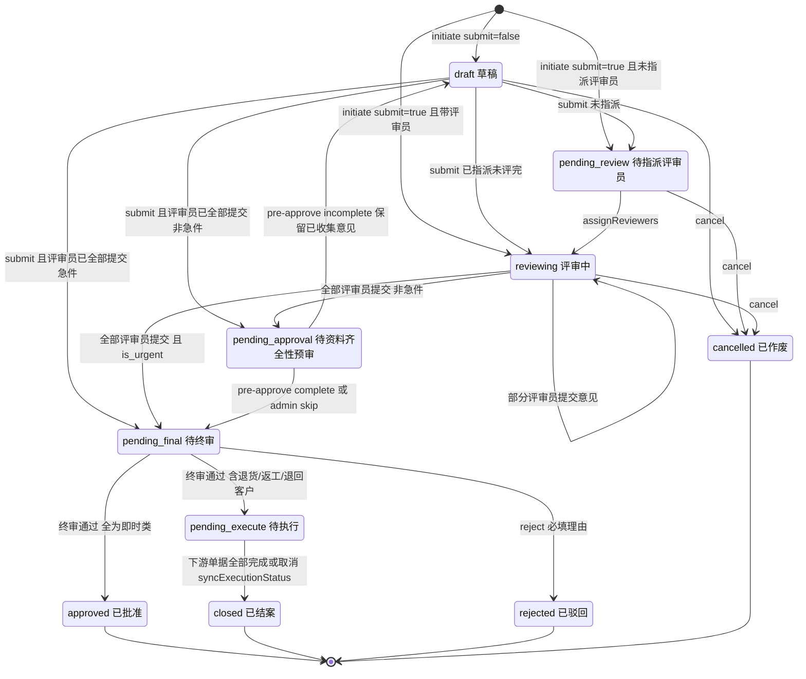
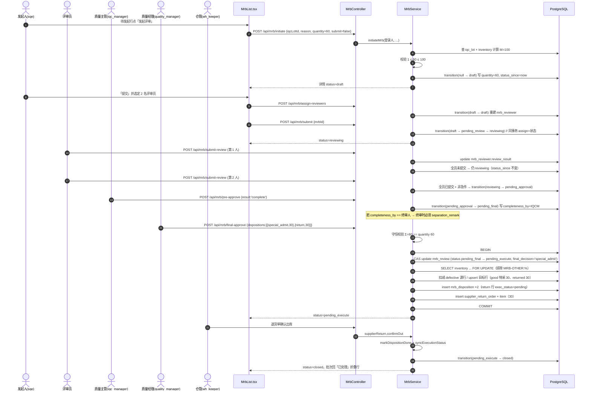
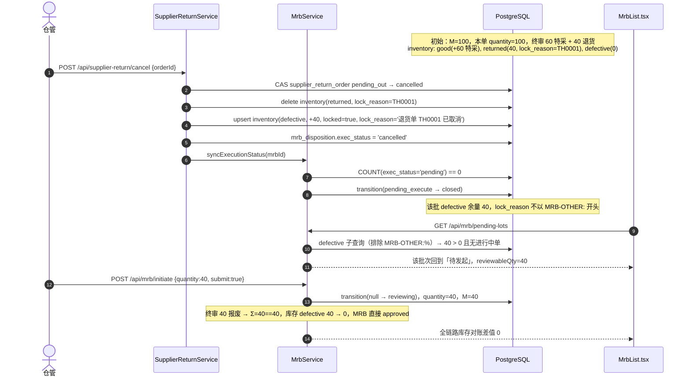
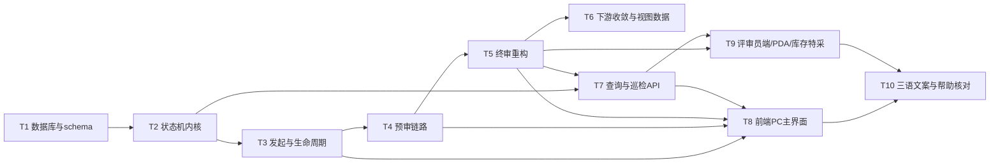

# MRB v2 增量架构设计与任务分解

> 版本：v2.1-arch.6（对应产品文档 `docs/MRB-v2增量PRD-20261018.md` v2.1）
> 作者：高见远（架构师）
> 语言：简体中文；术语一律沿用帮助文档 MRB 章节（特采 / 退货 / 供应商返工 / 报废 / 其他）
> 本文档为**设计文档**：本轮不改任何代码与数据库，只给出落地方案与任务分解。

### 修订记录

| 版本 | 日期 | 变更 |
|---|---|---|
| v2.1-arch | 2026-10-18 | 初版：10 态状态机、数量守恒、占用语义、10 条任务 |
| **v2.1-arch.1** | 2026-10-18 | **修正占用语义（P0 设计缺陷）**：原方案"全库共用一条保留库位 + `lock_reason` 带去向"在 `inventory` 4 列唯一键下会把同一 MRB 的多条 `other` 明细 upsert 合并成一行、`lock_reason` 后写覆盖前写，`confirm-out` 必然错账（QA 实测反例：退回客户 50 + 留样 50 → 合并成 100，核销要么少核 50 虚增、要么整行删 100 让留样消失）。现改为**一张 MRB 一个保留库位** + `lock_reason='MRB-OTHER:<mrbNo>'`（不带去向）+ **按明细数量扣减式核销**；同步补 §6 T5 断言 5b/5c/5d、T6 断言 1b/1c/1d、§7 共享知识第 5 条、§8 R2 入口清单与 R2b。**任务划分不变（仍 10 条）**，T5/T6 的验收断言加严 |
| **v2.1-arch.2** | 2026-10-18 | 按 QA 第二轮 5 条补齐实现细则：① 守卫**调用顺序**固定为「参数校验 → `assertNotMrbReserved` → 写入」，`intra-transfer/batch` 按 items 逐条判源库位；② 核销流水 `balance_after` 必须写**扣减后真实余额**、`qty` 取负；③ 余额不足的异常码由 400 统一为 **409**（与"状态冲突"语义一致）；④ `GET /api/warehouse/location` 分页列表仍会显示保留库位 → 靠 `description` 拦运维，写入 §7-5；⑤ 迁移脚本新增第 6 步：停用 v1.0 遗留的 `<不良品仓>-MRB-RSV-01`（仅当无库存行）；新增 R2c 观察项（库龄/呆滞/盘点口径）。**任务数仍 10 条** |
| **v2.1-arch.3** | 2026-10-18 | ① §7 新增第 **13** 条「保留量守恒不变量」可执行巡检 SQL，并明确口径：`sample`/`hold` 虽为 `done` 但量仍在保留行，**无条件计入**；`customer_return` 仅 `pending` 时计入（因此不能用 `exec_status != 'done'` 之和，会 100% 误报）；② §8 新增 **R2d**：保留库位随单据线性增长（≈240 个/年）登记为**已接受的已知成本**，含否决替代方案的理由与 P1-2 池化治理路径。**任务数仍 10 条** |
| **v2.1-arch.4** | 2026-10-18 | 按 team-lead 定稿收口状态码：① 余额不足**统一 409 `ConflictException`**（§4.3 / §6 T6-1b / §7-5 / §8 R2b 四处全部由 400 改为 409，文案统一为 `保留库存不足：本明细需核销 {X}，实际可核销 {Y}（批次 {batchNo}）…`）；② §7 新增第 **14** 条「状态码语义约定」表（400/403/404/409 判定口诀），供后续同类分歧直接援引。**任务数仍 10 条** |
| **v2.1-arch.5** | 2026-10-18 | **补死库存缺口**：留样/暂存的货在结案后原来无路可走（被可评审量排除 + 库存守卫拦截 + 库位不可选 = 只能改库）。新增**「进入终态即释放」**规则：`approved` **与** `closed` 两个终态都在同一事务内释放保留量（搬回正常不良品库、解锁、清 `lock_reason`、写 `mrb_reserve_release` 流水、库位置 `inactive`）。⚠️ 只挂 `closed` 会漏掉"全留样"单据（它们直接 `approved`，永不经过 `closed`）。同步改：§1.1 占用语义、§7-5 释放实现细则、§7-13 改为**两段口径**（进行中 = Σ求和；终态 = 0）+ 终态残留快速计数 SQL、T5 断言 5b④/5d 改写（原"结案后保留行必须仍在"被废止，红线改为"数量不得凭空消失"）、T6 新增 1e/1f/1g、R2d 成本口径、附录 A 增一条偏离。**任务数仍 10 条** |
| **v2.1-arch.6** | 2026-10-18 | 🔴 **硬约束补齐（实现事故驱动）**：工程师把 `inventory` 的 4 列唯一索引改成**两个部分唯一索引**（`... WHERE lock_reason IS NULL OR lock_reason NOT LIKE 'MRB-OTHER:%'` + `inventory_mrb_other_reserve_key`），而全仓 20+ 处 `onConflictDoUpdate` 的 `target` 都指向那 4 列且**不带 `targetWhere`** → PostgreSQL 无法匹配部分索引，抛 **42P10**，**全仓库存写入 500**。本版在 §3.2 第 5 步（索引）与 §7-5 增加**明文禁止**：`inventory` 的 `(material_id, location_id, batch_no, stock_status)` 唯一索引**一行都不许改**，保留库位的隔离由 `location_id` 承担、不靠 `lock_reason` 参与唯一键；并给出误改后的**回滚 SQL**。**设计其余部分不变，任务数仍 10 条** |

---

## 0. 读代码后必须先说的三件事（与 PRD 有出入，已按实际代码修正）

| # | PRD/任务书说法 | 代码事实 | 本设计的处理 |
|---|---|---|---|
| F1 | `toScaled` 为 ×1000（3 位小数，R10） | `mrb.service.ts:1418` 实际是 `Math.round(n * 10000)`，即 4 位小数 | **全链路继续用现有 `toScaled/fromScaled`（×10000）**，不新写一套。任何按"3 位小数"另写换算的地方都会产生 1e-4 级尾差，导致守恒校验偶发报错 |
| F2 | 迁移脚本 `mrb-v2-20261018.sql` 已生效 | `server/scripts/init-db.ts` 的 `SUPPLEMENTAL_SQL_FILES` **未包含该文件**，全仓无任何引用。它只在人工执行过的库里存在 | T1 必须把 `mrb-v2-20261018.sql` 与新迁移一并注册进 init-db，并在新迁移里对 mrb-v2 的列做 `ADD COLUMN IF NOT EXISTS` 兜底 |
| F3 | 取消退货单后库存 `returned → defective` | `supplier-return.service.ts:351-362` 回写时 `locked=true, lock_reason='退货单 xx 已取消'` | 该 lock_reason 不匹配 `MRB-OTHER:%` 前缀，**不影响**批次重新出现在待发起；`finalApprove` 的候选池也照旧能选中它。无需改下游模块 |

另外两处与现状不一致，需在实现时顺手修正（否则验收过不了）：

- `getMrbLotGroups()` 的 `reviewCount = count(mrbReview.id)` 统计了全部终态，**含 rejected/cancelled**，与 P0-8 A3 冲突。
- `PdaMrb.tsx` 提交评审用 `accept/reject/deviation`，服务端 `submitReview` 只接受四项枚举 → PDA 提交 100% 400。属存量 bug，本期必须一并修。

---

## 1. 实现方案总述

### 1.1 一句话方案

把这套 MRB 从"七个状态的线性流程"改成"**一个状态机 + 一个数量账本 + 一个占用语义**"：

1. **状态机**：所有状态变更收敛到一个私有 `transition(tx, mrbId, from, to, extra)` 方法，用 `UPDATE ... WHERE id=? AND status=from` 的 CAS 语义完成，并在同一条 UPDATE 里写 `status_since = now()`。任何绕过 `transition()` 直接 `.set({status})` 的写法都视为缺陷。
2. **数量账本**：本单数量 `mrb_review.quantity`（发起时由人填，上限 = 可评审量 M）是**唯一守恒基准**；终审 `Σ(mrb_disposition.quantity) == mrb_review.quantity`，与批次总量无关。
3. **占用语义（有进有出）**：`other` 三类处置在**终审时**不改变 `stock_status`，把对应数量搬到不良品仓下的**保留库位**并打 `lock_reason = 'MRB-OTHER:<mrbNo>'`；在 MRB 进入**终态（`approved` / `closed`）时立即释放**，把保留量挪回正常不良品库位、解锁、清 `lock_reason`。三处 SQL（待发起可评审量、发起时上限 M、终审候选池）统一用"排除 `MRB-OTHER:%`"这一个条件。

> **释放规则（v1.5 新增，不可省）**：`sample`（转留样）/`hold`（待定暂存）在 MRB 内是"处置已完成"（`exec_status='done'`），但**实物在结案时回到不良品仓**，需要后续处置时重新发起 MRB。这样做的好处：既不产生"永久冻结"的死库存，也不必本期做"转正式处置"页面。
>
> **必须同时挂在 `approved` 与 `closed` 两个终态上**，不能只挂 `closed`：
> - 含退货/返工/退回客户的单 → `pending_execute` → `closed`（收敛点唯一：`syncExecutionStatus()`）；
> - **只含即时类（特采/报废/留样/暂存）的单 → 直接 `approved`，永远不经过 `closed`**。只挂 `closed` 会让最常见的"全留样"单据把库存永久锁死，这正是要消灭的死路。
>
> **释放只做"搬回 + 解锁"，绝不核销数量**：数量守恒（`Σ inventory.quantity` 不变）、写 `inventory_transaction(tx_type='mrb_reserve_release')`、`balance_after` 写合并后真实余额。因此"结案"与"库存凭空消失"是两件不同的事 —— 前者允许，后者永远禁止（QA 的 5b④ 断言据此改写为"回到不良品仓且总量守恒"，见 §6 T5）。
>
> **`hold_until` 本期只留痕**：不代表占用延续（到期不自动释放、也不阻断）；P1-2 做"到期提醒/转正式处置"时才升级为真正的占用约束。

> **保留库位的粒度 = 一张 MRB 一个库位**，编码 `<不良品仓编码>-MRB-RSV-<mrbNo>`（如 `NG01-MRB-RSV-MRB202610180001`），首次有 `other` 明细时按需创建（`ON CONFLICT (location_code) DO NOTHING`）。
>
> **为什么不是"全库共用一条保留库位"（本设计 v1.0 的错误）**：`inventory` 的唯一键是 `(material_id, location_id, batch_no, stock_status)`（见 `schema.ts:749`），**不含 `lock_reason`**。共用一条保留库位时，同一 MRB 内两条 `other` 明细（如同一物料 退回客户 50 + 留样 50）会命中同一唯一键 → 被 upsert 合并成 1 行 `qty=100`，`lock_reason` 只留后写入的一条；`confirm-out` 无论按哪条明细处理都会错（少核 50 虚增库存，或多核 50 让留样凭空消失）。按 MRB 分库位后，跨 MRB 由 `location_id` 天然隔离；同 MRB 内合并成 1 行是**预期行为**，因为核销按 `mrb_disposition.quantity` 逐条扣减（不是整行归零），两条 50 各扣各的，最终余额 0。
>
> **为什么不用 PRD Q4 的三个前缀（`SAMPLE:` / `HOLD:` / `CUSTOMER_RETURN:`）分别打在原行上**：原行是"物料+库位+批次+defective"唯一的一条记录，给它打上占用前缀会把同一行里**未被本次评审覆盖的剩余量**也一并排除出可评审量 → 部分评审（N<M）后剩余量永久消失，正好是 PRD 要修的 G4 换个形式复发。搬到独立库位后，"占用量"与"剩余量"是两条物理记录，互不污染。
>
> **为什么不在 `inventory` 上加"含 `lock_reason` 的表达式唯一索引"**（另一种常见修法）：4 列唯一索引仍然存在，同 `(material, location, batch, defective)` 的第二行**不是被合并、而是根本插不进去**；要放开必须 DROP 这个 4 列唯一索引，而全仓 20+ 处库存 upsert 的 `onConflictDoUpdate target` 全部指向这 4 列（收料 / IQC / 不良品移库 / MRB / 返工 / 退货 / 领料 / 库存调整），删掉等于一次性拆掉所有库存写入的并发保护。风险不可接受，故保留 4 列唯一键不动。
>
> **`lock_reason` 为什么不带去向**：占用行按 MRB 合并后，同一行可能同时承载"退回客户/留样/暂存"多种去向，`lock_reason` 无法也不应该承载去向。**去向的唯一事实来源是 `mrb_disposition`（`other_type` / `ref_no` / `hold_until` / `quantity`）**，`lock_reason` 只回答"这批量被哪张 MRB 占着"。

### 1.2 状态机（10 态，不新增第 11 个）



### 1.3 状态迁移表（实现对照用，代码里落成 `MRB_TRANSITIONS` 常量表）

| # | from | to | 触发方法 | 操作人 | 前置校验 | 副作用 |
|---|---|---|---|---|---|---|
| T1 | — | `draft` / `pending_review` / `reviewing` | `initiateMrb()` | `sqe`/`iqc_manager`/`quality_manager`/`admin` | 批次 fail；无进行中单；`1 ≤ N ≤ M` | 写 `quantity=N`、`status_since`、`is_urgent/urgent_reason`、`sqe_id=登录人`；`submit=true` 时同一事务内 assign（→`reviewing`） |
| T2 | `draft`/`pending_review`/`reviewing` | `cancelled` | `cancelMrb()` | 发起人本人 / `quality_manager` / `admin` | 必填 `cancel_reason`（≥5 字） | 写 `cancel_reason/cancel_by/cancel_time`；**库存与明细零变动** |
| T3 | `draft` | `pending_review` / `reviewing` / `pending_approval` / `pending_final` | `submitMrb()` | 发起人本人 / `admin` | 评审员 ≥1 | 按评审员提交情况决定落点（见 1.4） |
| T4 | `pending_review` | `reviewing` | `assignReviewers()` | 发起人 / `sqe`/`iqc_manager`/`quality_manager`/`admin` | 评审员 ≥1，账号必须存在 | 重建 `mrb_reviewer`；`status_since` 刷新 |
| T5 | `reviewing` | `reviewing` \| `pending_approval` \| `pending_final` | `submitReview()` | 被指派评审员 | 当前人必须在指派列表 | 写该行意见；全部提交后按 `is_urgent` 分流 |
| T6 | `pending_approval` | `pending_final` | `preApprove('complete'\|'skip')` | `iqc_manager` / `admin`（`skip` 仅 admin） | `skip` 必填 `remark` | 写 `completeness_result/by/time/remark` |
| T7 | `pending_approval` | `draft` | `preApprove('incomplete')` | 同上 | `completeness_remark` 必填（≥5 字） | **`mrb_reviewer` 一行不删**；`status_since` 刷新 |
| T8 | `pending_final` | `approved` | `finalApprove()` | `quality_manager`/`iqc_manager`/`admin` | 全部即时类；守恒；单人审批需 `separation_remark` | 即时类改库存；写 `final_decision`（主处置）/`final_approval_time` |
| T9 | `pending_final` | `pending_execute` | `finalApprove()` | 同上 | 含 `return`/`rework`/`other-customer_return` | 生成退货单/返工单；明细 `exec_status='pending'` |
| T10 | `pending_final` | `rejected` | `rejectMrb()` | 同上 | `reason` 必填（≥5 字）；单人审批需 `separation_remark` | 写 `final_remark`；`mrb_disposition` 无新增；**库存零变动** |
| T11 | `pending_execute` | `closed` | `syncExecutionStatus()` | 系统 | `COUNT(exec_status='pending')==0` | 写 `closed`（现有实现，只加 `status_since`） |

### 1.4 `draft` 再提交的落点判定（P0-1 A5 的落点）

```
submit(mrbId):
  1) status 必须 == 'draft'，否则 400「仅草稿状态的单据可提交」
  2) 当前人 == 发起人 或 admin，否则 403「仅发起人可提交该 MRB」
  3) reviewers 数量 ≥ 1，否则 400「请先指派评审员」
  4) 统计 mrb_reviewer 中 review_result IS NOT NULL 的条数
     - 全部已提交（且条数>0）→ is_urgent ? 'pending_final' : 'pending_approval'   ← 预审不齐退回后的再提交路径
     - 否则                     → 'reviewing'（评审员可立即续评）
```
退回 `draft` 时**不动 `mrb_reviewer` 表**，只改 `mrb_review.status/completeness_*`，所以重新提交天然"不重复评审"。

### 1.5 `pending_execute → closed` 与"取消退货后回到可评审"

现有链路已具备，本期只做**验证 + 补 `status_since`**：

```
仓管取消退货单(supplier-return.cancelOrder)
  → supplier_return_order.status='cancelled'（CAS）
  → inventory: returned 行删除，按 defective upsert（locked=true, lock_reason='退货单 xx 已取消'）
  → mrb_disposition.exec_status='cancelled'
  → mrbService.syncExecutionStatus(mrbId)
      → pending 明细数 = 0 → MRB: pending_execute → closed  （走 transition()，刷新 status_since）
  → 该批次 defective 余量 40（lock_reason 不含 MRB-OTHER: 前缀）
  → getPendingLots() 命中 → 出现在「待发起」，可再次发起 N=40
```
`returned → defective` 是下游模块职责，**本期不修改** `supplier-return.service.ts` 的业务逻辑（只在 T6 增加回归用例）。

### 1.6 权限落点（决策 3「软分离」）

- 预审：`iqc_manager` + `admin`。
- 终审/驳回：`quality_manager` + `iqc_manager` + `admin`（**不收窄**，因为库里没有 `quality_manager` 账号）。
- 若 `completeness_by.user_id == 终审人 user_id`：
  - 服务端强制 `separation_remark`（2~200 字），否则 400 `预审人与终审人为同一人，请填写代审说明（2~200 字）`；
  - 单据返回 `isSingleApprover = true`（列表/详情显示「单人审批」红标）；
  - 进巡检清单：`GET /api/mrb/overdue-summary` 的 `singleApprover` 计数 = `separation_remark IS NOT NULL` 的进行中单数。
- 「预审人 ≠ 发起人」本期**不做硬校验**（角色太少会卡死流程），改为详情里并列展示 发起人 / 预审人 / 终审人，让审计一眼看出是否为同一人。

---

## 2. 文件清单

### 2.1 后端

| # | 绝对路径 | 新增/修改 | 改动要点（一句话） |
|---|---|---|---|
| 1 | `D:/WMS免安装版本/server/database/mrb-v2.1-20261018.sql` | 新增 | `status_since/cancel_*/separation_remark/other_type`、mrb-v2 列兜底、索引、回填、幂等断言 |
| 2 | `D:/WMS免安装版本/server/database/schema.ts` | 修改 | `mrbReview`/`mrbDisposition` 补 11 个字段声明（当前与库脱节，不补则 Drizzle 查不到） |
| 3 | `D:/WMS免安装版本/server/scripts/init-db.ts` | 修改 | `SUPPLEMENTAL_SQL_FILES` 注册 `mrb-v2-20261018.sql` + `mrb-v2.1-20261018.sql`（顺序：`fix-mrb-reviewer` 之后、`provision-deploy-config` 之前） |
| 4 | `D:/WMS免安装版本/server/modules/mrb/mrb.status.ts` | 新增 | 10 态常量、`MRB_DONE_STATUSES`、迁移前置表、SLA 阈值表与 SQL 片段、可评审量 SQL 片段 |
| 5 | `D:/WMS免安装版本/server/modules/mrb/mrb.service.ts` | 修改 | `transition()`、initiate/submit/cancel/preApprove/reject、finalApprove 重构、other 三类库存（按 MRB 建保留库位）、占用量 SQL、SLA 字段、confirm-out 扣减式核销 |
| 6 | `D:/WMS免安装版本/server/modules/mrb/mrb.controller.ts` | 修改 | 新增 5 个端点 + 6 个写端点补 `@NeedRoles` + `my-tasks` 去掉 `reviewerId` + 登录态取人 |
| 7 | `D:/WMS免安装版本/server/modules/mrb/dto/initiate.dto.ts` | 新增 | `iqcLotId` 必填；`quantity/submit/isUrgent/urgentReason/reviewers` 可选透传 |
| 8 | `D:/WMS免安装版本/server/modules/mrb/dto/mrb-action.dto.ts` | 新增 | `submit/cancel/reject/pre-approve/confirm-out` 五个动作的入参 DTO（`mrbId` 必填，其余服务端校验） |
| 9 | `D:/WMS免安装版本/server/modules/mrb/dto/final-approve.dto.ts` | 修改 | 增加 `separationRemark`；`dispositions[].otherType/refNo/holdUntil`；`finalResult` 标注 deprecated |
| 10 | `D:/WMS免安装版本/server/modules/inventory/inventory.service.ts` | 修改 | `getInventoryList` 返回 `isSpecialAdmit/specialAdmitRef` + `specialAdmitOnly` 过滤；**新增保留库存守卫** `assertNotMrbReserved()`，在 `transfer`/`intraTransfer`/`intraTransferBatch`/`adjust`/`lock`/`unlock` 六个入口拦截 `lock_reason LIKE 'MRB-OTHER:%'` 的行（详见 §8 R2） |
| 11 | `D:/WMS免安装版本/server/modules/inventory/inventory.controller.ts` | 修改 | `/list` 透传 `specialAdmitOnly` 查询参数 |
| 12 | `D:/WMS免安装版本/shared/api.interface.ts` | 修改 | `MrbReview`/`MrbPendingLot`/`MrbLotGroup`/`MrbDisposition`/`MrbDispositionInput` 扩字段；`Inventory` 加两个特采字段；新增 `MrbOtherType`、`MrbCompletenessResult`、`MrbSlaLevel` |

> `supplier-return.service.ts` / `rework.service.ts` **不修改**（只在 T6 增加回归用例）。Rework 模块没有"取消"能力，因此"下游单据被取消"只覆盖退货单，返工只能走到重检失败后回 defective —— 设计上按现状即可。

### 2.2 前端

| # | 绝对路径 | 新增/修改 | 改动要点 |
|---|---|---|---|
| 13 | `D:/WMS免安装版本/client/src/api/mrb.ts` | 修改 | 新增 5 个请求函数；`initiateMrb` 入参扩字段；`MyTaskParams` 删 `reviewerId`；`MrbListParams` 加 `slaLevel/onlyTimeout/onlyUrgent` |
| 14 | `D:/WMS免安装版本/client/src/api/inventory.ts` | 修改 | 列表入参加 `specialAdmitOnly` |
| 15 | `D:/WMS免安装版本/client/src/pages/mrb/MrbList.tsx` | 修改 | 发起弹窗加数量/急件/评审员与三按钮；两视图加「急」「停留」列与「仅看超时 / 仅看急件」筛选；详情加预审区块、单人审批标记、作废信息、other 明细列；新增预审/作废/驳回弹窗；终审弹窗加 other 三类联动 |
| 16 | `D:/WMS免安装版本/client/src/pages/mrb/MrbTask.tsx` | 修改 | 评审员视角：加停留/超时角标、状态筛选补 `pending_approval/draft`；详情复用预审区块 |
| 17 | `D:/WMS免安装版本/client/src/pages/pda/PdaMrb.tsx` | 修改 | `reviewResult` 改四项枚举；终审按新契约构造 `dispositions` 单行全量；移除 `other` 选项并提示到 PC 端 |
| 18 | `D:/WMS免安装版本/client/src/pages/inventory/InventoryQuery.tsx` | 修改 | 新增「特采」列（标签 + MRB 单号）+「仅看特采」开关 |
| 19 | `D:/WMS免安装版本/client/src/constants/business-enums.ts` | 修改 | 新增 `MRB_DISPOSITION_TYPES`（含 other）、`MRB_OTHER_TYPES`、`MRB_SLA_LEVELS` |
| 20 | `D:/WMS免安装版本/client/src/i18n/locales/zh.ts` | 修改 | mrb/inventory 段补约 30 个 key |
| 21 | `D:/WMS免安装版本/client/src/i18n/locales/vi.ts` | 修改 | 同上（键顺序与 zh 完全一致） |
| 22 | `D:/WMS免安装版本/client/src/i18n/locales/en.ts` | 修改 | 同上（键顺序与 zh 完全一致） |

**合计 22 个文件（新增 4 / 修改 18）。**

---

## 3. 数据结构与迁移

### 3.1 字段变更表

**`mrb_review`**

| 字段 | 类型 | 默认 | 来源 | 用途 |
|---|---|---|---|---|
| `status_since` | `timestamptz(3)` | `NOW()` NOT NULL | **本次新增** | 进入当前状态的时间，SLA 唯一时钟基准 |
| `cancel_reason` | `text` | NULL | **本次新增** | 作废原因 |
| `cancel_by` | `user_profile` | NULL | **本次新增** | 作废人 |
| `cancel_time` | `timestamptz(3)` | NULL | **本次新增** | 作废时间 |
| `separation_remark` | `text` | NULL | **本次新增** | 单人审批（预审人==终审人）代审说明，2~200 字 |
| `completeness_result` | `varchar(20)` | NULL | SQL 已有、schema.ts 缺 | `complete` / `incomplete` / `skipped` |
| `completeness_by` | `user_profile` | NULL | 同上 | 预审人 |
| `completeness_time` | `timestamptz(3)` | NULL | 同上 | 预审时间 |
| `completeness_remark` | `text` | NULL | 同上 | 预审说明 / 退回原因 |
| `is_urgent` | `boolean` | `false` NOT NULL | 同上 | 急件 |
| `urgent_reason` | `text` | NULL | 同上 | 急件原因（`is_urgent=true` 时必填） |

**`mrb_disposition`**

| 字段 | 类型 | 默认 | 来源 | 用途 |
|---|---|---|---|---|
| `other_type` | `varchar(20)` | NULL | **本次新增** | `customer_return` / `sample` / `hold` |
| `ref_no` | `varchar(50)` | NULL | SQL 已有、schema.ts 缺 | 退回客户单号 / 留样编号 |
| `hold_until` | `date` | NULL | 同上 | 暂存复核日期 |

**schema.ts 精确补全清单**（`user_profile` 复合类型写法照抄现有 `sqeId`：`sqeId: userProfile("sqe_id")`；`boolean`/`date` 已在 schema.ts 第 4 行 import，无需加 import）：

```ts
// server/database/schema.ts —— mrbReview（插在 remark 之后、createdAt 之前）
  completenessResult: varchar("completeness_result", { length: 20 }),
  completenessBy: userProfile("completeness_by"),
  completenessTime: customTimestamptz("completeness_time", { precision: 3 }),
  completenessRemark: text("completeness_remark"),
  isUrgent: boolean("is_urgent").notNull().default(false),
  urgentReason: text("urgent_reason"),
  statusSince: customTimestamptz("status_since", { precision: 3 }).notNull().default(sql`CURRENT_TIMESTAMP`),
  cancelReason: text("cancel_reason"),
  cancelBy: userProfile("cancel_by"),
  cancelTime: customTimestamptz("cancel_time", { precision: 3 }),
  separationRemark: text("separation_remark"),

// mrbDisposition（插在 dispositionType 之后 / quantity 之前均可，建议紧跟 dispositionType）
  otherType: varchar("other_type", { length: 20 }),
  refNo: varchar("ref_no", { length: 50 }),
  holdUntil: date("hold_until"),
```

> schema.ts 首行注释是 `auto generated, do not edit`，但本项目实际是手工维护（`sync-schema-20261016.sql` 与它长期脱节就是证据）。**手工补、不要跑 `drizzle-kit pull`**——pull 会按库现状重写整个文件，把 `customType`（`user_profile` 的 `ROW(...)::user_profile` 序列化）覆盖成 `text`，整个仓 200+ 处 user_profile 写入全部炸掉。这是 T1 最危险的一步。

### 3.2 迁移 SQL 草案（`server/database/mrb-v2.1-20261018.sql`，可重复执行）

```sql
-- =============================================================================
-- MRB v2.1 增量（2026-10-18）
--  1) 状态机补全：status_since（巡检基准）+ 作废三字段 + 单人审批代审说明
--  2) 「其他」处置：other_type
--  3) mrb-v2-20261018.sql 的列做兜底（该文件此前未注册进 init-db，新环境可能缺列）
--  4) 巡检 / 待发起相关索引
-- 全部语句幂等；末尾带硬断言，失败即中止初始化。
-- =============================================================================
BEGIN;

-- ---------- 1. mrb_review 新增列 ----------
ALTER TABLE mrb_review
  ADD COLUMN IF NOT EXISTS status_since      timestamptz(3),
  ADD COLUMN IF NOT EXISTS cancel_reason     text,
  ADD COLUMN IF NOT EXISTS cancel_by         user_profile,
  ADD COLUMN IF NOT EXISTS cancel_time       timestamptz(3),
  ADD COLUMN IF NOT EXISTS separation_remark text;

COMMENT ON COLUMN mrb_review.status_since      IS '进入当前状态的时间；巡检 SLA 唯一基准（不要用 _updated_at）';
COMMENT ON COLUMN mrb_review.separation_remark IS '预审人与终审人为同一人时的代审说明（2~200 字）';

-- ---------- 2. mrb_disposition 新增列 ----------
ALTER TABLE mrb_disposition
  ADD COLUMN IF NOT EXISTS other_type varchar(20);

COMMENT ON COLUMN mrb_disposition.other_type IS '其他处置去向：customer_return=退回客户 / sample=转留样 / hold=待定暂存';

-- ---------- 3. 兜底 mrb-v2 的列（防止新环境未执行过 mrb-v2-20261018.sql） ----------
ALTER TABLE mrb_review
  ADD COLUMN IF NOT EXISTS completeness_result varchar(20),
  ADD COLUMN IF NOT EXISTS completeness_by     user_profile,
  ADD COLUMN IF NOT EXISTS completeness_time   timestamptz(3),
  ADD COLUMN IF NOT EXISTS completeness_remark text,
  ADD COLUMN IF NOT EXISTS is_urgent           boolean NOT NULL DEFAULT false,
  ADD COLUMN IF NOT EXISTS urgent_reason       text;

ALTER TABLE mrb_disposition
  ADD COLUMN IF NOT EXISTS ref_no     varchar(50),
  ADD COLUMN IF NOT EXISTS hold_until date;

-- ---------- 4. status_since 回填 ----------
-- 规则：终态单回填 _updated_at（历史值，SLA 不计算）；进行中单回填 NOW()
--       —— 若把进行中单回填成 _updated_at，上线当天所有存量单会立刻变红，
--          掩盖真实滞留，也会让第一周的巡检数据不可信。
-- 注意：本库所有表都挂了 trg_set_updated_at（fix-updated-at-trigger-20261018.sql），
--       直接 UPDATE 会把存量单的 _updated_at 刷成本次执行时间，
--       破坏「已处理视图回退 _updated_at」的展示口径。故执行期间临时禁用该触发器。
DO $$
BEGIN
  IF EXISTS (
    SELECT 1 FROM pg_trigger
    WHERE tgname = 'trg_set_updated_at' AND tgrelid = 'mrb_review'::regclass
  ) THEN
    -- 注意：plpgsql 里不能直接写 ALTER TABLE（工具类语句必须走 EXECUTE）
    EXECUTE 'ALTER TABLE mrb_review DISABLE TRIGGER trg_set_updated_at';
  END IF;
END $$;

UPDATE mrb_review
   SET status_since = CASE
         WHEN status IN ('approved', 'closed', 'rejected', 'cancelled')
           THEN COALESCE(_updated_at, _created_at, NOW())
         ELSE NOW()
       END
 WHERE status_since IS NULL;

DO $$
BEGIN
  IF EXISTS (
    SELECT 1 FROM pg_trigger
    WHERE tgname = 'trg_set_updated_at' AND tgrelid = 'mrb_review'::regclass
  ) THEN
    EXECUTE 'ALTER TABLE mrb_review ENABLE TRIGGER trg_set_updated_at';
  END IF;
END $$;

-- 回填完成后收紧为 NOT NULL + DEFAULT now()：
--   DEFAULT 是「忘写 status_since 就自动取当前时刻」的兜底；
--   NOT NULL 让巡检 SQL 不必到处写 COALESCE。
ALTER TABLE mrb_review ALTER COLUMN status_since SET DEFAULT NOW();
ALTER TABLE mrb_review ALTER COLUMN status_since SET NOT NULL;

-- ---------- 5. 索引 ----------
-- 🔴🔴 本节唯一红线：**不新增、不修改、不替换 `inventory` 的任何唯一索引**。
-- 已有唯一索引（schema.ts:749，库里同名）：
--   inventory_material_id_location_id_batch_no_stock_status_key
--     UNIQUE (material_id, location_id, batch_no, stock_status)
-- 它必须保持「全量唯一（无 WHERE）」。原因：
--   全仓 20+ 处库存 upsert 都写 onConflictDoUpdate({ target: [material_id, location_id, batch_no, stock_status] })
--   而不带 targetWhere。一旦把它改成部分索引，PostgreSQL 无法推断出可用的
--   arbiter index，直接抛 42P10（there is no unique or exclusion constraint
--   matching the ON CONFLICT specification），**所有库存写入全 500**（已实际发生一次）。
-- 「一 MRB 一个保留库位」方案**不需要**改这个索引：同一 MRB 同库位同批次只有一行，
-- 跨 MRB 的隔离由 location_id（库位编码里带 mrbNo）天然提供，4 列全量唯一键够用。
--
-- 如果库里已经被改成部分索引，先用下面这段回滚（幂等，可重复执行）：
--   DROP INDEX IF EXISTS inventory_mrb_other_reserve_key;                       -- 误加的第二条部分索引
--   DROP INDEX IF EXISTS inventory_material_id_location_id_batch_no_stock_status_key;
--   CREATE UNIQUE INDEX IF NOT EXISTS inventory_material_id_location_id_batch_no_stock_status_key
--     ON inventory (material_id, location_id, batch_no, stock_status);          -- 回到全量唯一（无 WHERE）
--   -- 校验：应返回 1 行且 indexdef 中不含 WHERE
--   SELECT indexname, indexdef FROM pg_indexes WHERE tablename='inventory' AND indexdef LIKE '%UNIQUE%';
-- 注意：回滚 DROP 之前必须先确认没有重复行，否则 CREATE UNIQUE 会失败；
--   若确有重复（说明部分索引期间写入过重复数据），先合并数量再建索引，不要跳过。

-- 巡检：按 status + status_since 扫描（warn/overdue 计数、仅看超时筛选）
CREATE INDEX IF NOT EXISTS idx_mrb_status_since ON mrb_review (status, status_since);
-- 待发起：activeMrbSql / mrbCountSql 都是 WHERE lot_id=? AND status ...（现有 idx_mrb_lot 只有 lot_id 单列）
CREATE INDEX IF NOT EXISTS idx_mrb_lot_status   ON mrb_review (lot_id, status);
-- 可评审量 / 终审候选池：全部按 (material, supplier, batch) 过滤
CREATE INDEX IF NOT EXISTS idx_inventory_mrb_lookup
  ON inventory (material_id, supplier_id, batch_no)
  WHERE quantity > 0;
-- 其他处置到期巡检（hold_until 已在 mrb-v2 建过 idx_mrb_disp_hold）
CREATE INDEX IF NOT EXISTS idx_mrb_disp_other
  ON mrb_disposition (other_type, hold_until)
  WHERE other_type IS NOT NULL;

-- ---------- 6. 清理 v1.0 遗留的共享保留库位（幂等） ----------
-- v1.0 设计曾用「全库共用一条保留库位 <不良品仓>-MRB-RSV-01」，该口径已废止
-- （同单多条 other 明细会被 4 列唯一键合并）。此处把**没有任何库存行**的旧库位停用，
-- 避免它永远空着还出现在库位下拉里。若旧库位上确有库存行，不自动处理，
-- 留给人工作业（数据需先挪走或按 v1.1 重建），并保留 status 不变以便发现。
UPDATE warehouse_location l
   SET status = 'inactive',
       description = COALESCE(l.description || ' / ', '')
                     || '已停用：v1.0 共享保留位，被 v1.1 每单独立保留位取代'
 WHERE l.location_code LIKE '%-MRB-RSV-01'
   AND COALESCE(l.status, 'active') <> 'inactive'
   AND NOT EXISTS (SELECT 1 FROM inventory i WHERE i.location_id = l.id);

-- ---------- 7. 幂等断言 ----------
DO $$
DECLARE
  miss text;
BEGIN
  SELECT string_agg(t.f, ',') INTO miss
  FROM (VALUES
    ('mrb_review.status_since'), ('mrb_review.cancel_reason'), ('mrb_review.cancel_by'),
    ('mrb_review.cancel_time'),  ('mrb_review.separation_remark'),
    ('mrb_review.completeness_result'), ('mrb_review.completeness_by'),
    ('mrb_review.completeness_time'), ('mrb_review.completeness_remark'),
    ('mrb_review.is_urgent'), ('mrb_review.urgent_reason'),
    ('mrb_disposition.other_type'), ('mrb_disposition.ref_no'), ('mrb_disposition.hold_until')
  ) AS t(f)
  WHERE NOT EXISTS (
    SELECT 1 FROM information_schema.columns
    WHERE table_schema = 'public'
      AND table_name  = split_part(t.f, '.', 1)
      AND column_name = split_part(t.f, '.', 2)
  );
  IF miss IS NOT NULL THEN
    RAISE EXCEPTION 'MRB v2.1 迁移失败，缺少列：%', miss;
  END IF;

  IF EXISTS (SELECT 1 FROM mrb_review WHERE status_since IS NULL) THEN
    RAISE EXCEPTION 'MRB v2.1 迁移失败：mrb_review.status_since 仍有 NULL 行';
  END IF;

  IF NOT EXISTS (
    SELECT 1 FROM pg_indexes WHERE schemaname = 'public' AND indexname = 'idx_mrb_status_since'
  ) THEN
    RAISE EXCEPTION 'MRB v2.1 迁移失败：索引 idx_mrb_status_since 未创建';
  END IF;
END $$;

COMMIT;
```

### 3.3 `init-db.ts` 注册（顺序敏感）

```ts
const SUPPLEMENTAL_SQL_FILES = [
  ... 已有顺序不动 ...
  'fix-mrb-reviewer-20261018.sql',
  // MRB v2：齐全性预审 4 列 + 急件 2 列 + 其他处置 ref_no/hold_until。
  // 此前该文件未注册，只在人工执行过的库里存在 → 必须补进来自动化。
  'mrb-v2-20261018.sql',
  // MRB v2.1：status_since / cancel_* / separation_remark / other_type + 兜底 + 索引
  'mrb-v2.1-20261018.sql',
  // ⚠️ provision-deploy-config 必须仍然最后（它会把仓库编码改成真实值）
  'provision-deploy-config-20261016.sql',
];
```

### 3.4 新增类型（`shared/api.interface.ts`）

```ts
export type MrbOtherType = 'customer_return' | 'sample' | 'hold';
export type MrbCompletenessResult = 'complete' | 'incomplete' | 'skipped';
export type MrbSlaLevel = 'ok' | 'warn' | 'overdue';

export interface MrbDispositionInput {
  dispositionType: 'special_admit' | 'return' | 'rework' | 'scrap' | 'other';
  quantity: number;
  remark?: string;
  /** dispositionType='other' 时必填 */
  otherType?: MrbOtherType;
  /** customer_return / sample 必填 */
  refNo?: string;
  /** hold 必填，YYYY-MM-DD，≥ 明天 且 ≤ 今天+90 天 */
  holdUntil?: string;
}
```

`MrbReview` 追加（全部可选，避免前端大面积改）：

```
statusSince?: string; isUrgent?: boolean; urgentReason?: string;
completeness?: { result?: MrbCompletenessResult; by?: string; byName?: string;
                 time?: string; remark?: string };
skippedApproval?: boolean;      // 急件跳过预审 或 admin 人工跳过
isSingleApprover?: boolean;     // 预审人 == 终审人
separationRemark?: string;
cancel?: { reason?: string; by?: string; byName?: string; time?: string };
stuckHours?: number; slaLevel?: MrbSlaLevel;   // 列表用
currentTodo?: string;                          // 「当前待办」推导结果
```

---

## 4. 接口契约表

> 统一响应体 `{ code: 0, message: 'success', data }`；错误体 `{ error: { code, message } }`（前端 `pickErrMsg` 已按此解析）。
> 所有写端点：`@NeedRoles(...)` 先卡角色（守卫文案固定为 `您没有权限执行此操作`），**再在服务层做归属校验**（403 带具体中文文案）。

### 4.1 端点清单

| # | 方法 | 路径 | 权限（`@NeedRoles`） | 入参 | 出参 | 变更 |
|---|---|---|---|---|---|---|
| 1 | GET | `/api/mrb/pending-lots` | 登录即可 | `page/pageSize/materialCode/batchNo/inspectionNo` | `PaginatedResponse<MrbPendingLot>` | **改** SQL 排除 `MRB-OTHER:%`；排序改 `inspectionTime asc`；每行补 `remainingDefectiveQty` |
| 2 | GET | `/api/mrb/list` | 登录即可 | `+ slaLevel?: 'warn'\|'overdue'`、`onlyTimeout?: '1'`、`onlyUrgent?: '1'` | `PaginatedResponse<MrbReview>` | **改** 每行补 `stuckHours/slaLevel/isUrgent/isSingleApprover/completeness` |
| 3 | GET | `/api/mrb/lot-groups` | 登录即可 | 同 `list`（无 sla 参数） | `PaginatedResponse<MrbLotGroup>` | **改** `reviewCount` 只计 `approved/closed`；补 `totalCount/remainingDefectiveQty/canReinitiate` |
| 4 | GET | `/api/mrb/detail/:id` | 登录即可 | — | `MrbReview` | **改** 补 `completeness/cancel/statusSince/isUrgent/skippedApproval/isSingleApprover/separationRemark`；`dispositions[]` 补 `otherType/holdUntil` |
| 5 | GET | `/api/mrb/my-tasks` | 登录即可 | `page/pageSize/status`（**删除 `reviewerId`**） | `PaginatedResponse<MrbReview & { myReview }>` | **改** 只取 `req.userContext.userId` |
| 6 | GET | `/api/mrb/overdue-summary` | 登录即可 | — | `{ warn: number; overdue: number; singleApprover: number }` | **新增** |
| 7 | POST | `/api/mrb/initiate` | `sqe,iqc_manager,quality_manager,admin` | `{ iqcLotId, reason, quantity?, submit?, isUrgent?, urgentReason?, reviewers?[] }` | `MrbReview` | **改** 发起人取登录态；新增 4 个可选入参 |
| 8 | POST | `/api/mrb/assign-reviewers` | `sqe,iqc_manager,quality_manager,admin` + 归属 | `{ mrbId, reviewers: [{reviewerId, reviewerName?, reviewerRole?}] }` | `MrbReview` | **改** 允许 `draft`/`pending_review`；`draft` 保持 draft |
| 9 | POST | `/api/mrb/submit` | `sqe,iqc_manager,quality_manager,admin` + 归属 | `{ mrbId }` | `MrbReview` | **新增** |
| 10 | POST | `/api/mrb/cancel` | `sqe,iqc_manager,quality_manager,admin` + 归属 | `{ mrbId, reason }` | `MrbReview` | **新增** |
| 11 | POST | `/api/mrb/pre-approve` | `iqc_manager,admin` | `{ mrbId, result: 'complete'\|'incomplete'\|'skip', remark?, separationRemark? }` | `MrbReview` | **新增** |
| 12 | POST | `/api/mrb/final-approve` | `quality_manager,iqc_manager,admin` | `{ mrbId, dispositions: [...], finalRemark?, separationRemark? }` | `MrbReview` | **改** `finalResult` 降级为兼容字段；守恒/其他/单人审批 |
| 13 | POST | `/api/mrb/reject` | `quality_manager,iqc_manager,admin` | `{ mrbId, reason, separationRemark? }` | `MrbReview` | **新增** |
| 14 | POST | `/api/mrb/disposition/:id/confirm-out` | `wh_keeper,wh_manager,admin` | 路径 `id` = 处置明细 id | `MrbReview` | **新增**（退回客户"确认已提走"） |
| 15 | GET | `/api/inventory/list` | 登录即可 | `+ specialAdmitOnly?: '1'` | `PaginatedResponse<Inventory>` | **改** 补 `isSpecialAdmit/specialAdmitRef` |

### 4.2 关键 DTO 与语义

```ts
// POST /api/mrb/initiate
{
  iqcLotId: string;          // 必填；UUID / 检验编号 / 批次号 三者皆可（沿用 resolveIqcLotId）
  reason: string;            // 必填，不合格原因
  quantity?: number;         // 本次评审数量 N，缺省 = M；1 ≤ N ≤ M，支持 4 位小数
  submit?: boolean;          // 缺省 true（兼容旧前端）
  isUrgent?: boolean;        // 缺省 false
  urgentReason?: string;     // isUrgent=true 时必填
  reviewers?: MrbReviewerInput[];  // submit=true 且需要一步到位时传；空则落 pending_review
}

// POST /api/mrb/pre-approve
{ mrbId: string; result: 'complete' | 'incomplete' | 'skip'; remark?: string; separationRemark?: string }
// complete  : pending_approval → pending_final
// incomplete: pending_approval → draft（remark 必填 ≥5 字）
// skip      : pending_approval → pending_final（仅 admin，remark 必填 ≥5 字，completeness_result='skipped'）

// POST /api/mrb/final-approve
{
  mrbId: string;
  dispositions: Array<{
    dispositionType: 'special_admit'|'return'|'rework'|'scrap'|'other';
    quantity: number;
    remark?: string;
    otherType?: 'customer_return'|'sample'|'hold';
    refNo?: string;
    holdUntil?: string;   // 'YYYY-MM-DD'
  }>;
  finalRemark?: string;
  separationRemark?: string;   // 预审人==终审人时必填，2~200 字
  finalResult?: string;        // @deprecated 服务端忽略，由 dispositions 推导「主处置」
}
```

### 4.3 错误码与中文文案（实现即按此文案，前端直接 toast）

| 场景 | HTTP | 文案 |
|---|---|---|
| 角色不匹配（守卫层） | 403 | `您没有权限执行此操作` |
| 非发起人提交/作废 | 403 | `仅发起人可执行该操作` |
| 非被指派评审员提交意见 | 404 | `您不是该MRB的评审人员`（沿用现状，不泄露单据存在性） |
| `sqe` 调 `pre-approve` | 403 | `您没有权限执行此操作` |
| 状态不允许该动作 | 400 | `当前状态（{中文状态}）不可执行该操作` |
| `pending_approval` 状态下终审 | 400 | `尚未完成资料齐全性预审，不能终审` |
| 草稿无评审员提交 | 400 | `请先指派评审员` |
| 作废未填原因 | 400 | `请填写作废原因（至少 5 个字）` |
| 驳回未填理由 | 400 | `请填写驳回理由（至少 5 个字）` |
| 已结案/已终审单据作废 | 400 | `已结案单据不可作废` |
| 数量越界 | 400 | `本次评审数量需在 1 ~ {M} 之间（当前不良品仓可评审 {M}）` |
| 数量非数字/为 0/为负 | 400 | 同上（统一文案，不回显用户输入，避免注入） |
| 明细全空 | 400 | `请填写处置明细` |
| 守恒不成立 | 400 | `处置数量合计 {Σ} 必须等于本次评审数量 {N}` |
| 明细数量 ≤ 0 | 400 | `处置数量必须大于 0（{处置中文名}）` |
| `other` 缺 `other_type` | 400 | `其他处置必须选择具体去向：退回客户 / 转留样·样品 / 待定暂存` |
| `other_type` 非法 | 400 | `其他处置仅支持退回客户 / 转留样·样品 / 待定暂存；其它情形请走特批（本期未开放）` |
| `customer_return` 缺 `refNo` | 400 | `退回客户必须填写关联单号` |
| `sample` 缺 `refNo` | 400 | `转留样/样品必须填写留样编号` |
| `sample.refNo` 重复 | 409 | `留样编号 {refNo} 已存在` |
| `hold` 缺 `holdUntil` | 400 | `待定暂存必须填写复核日期` |
| `holdUntil` < 明天 | 400 | `复核日期至少为明天` |
| `holdUntil` > 今天+90 天 | 400 | `复核日期不得超过 90 天` |
| 预审人==终审人未填代审说明 | 400 | `预审人与终审人为同一人，请填写代审说明（2~200 字）` |
| 并发重复发起/重复终审 | 409 | `该批次已存在进行中的MRB评审单（{单号}）` / `该MRB已被处理，请刷新后重试` |
| 可处置库存不足 | 400 | `可处置库存不足：需要 {N}，当前仅 {M}`（沿用） |
| `confirm-out` 时保留行余额不足 | **409**（`ConflictException`） | `保留库存不足：本明细需核销 {X}，实际可核销 {Y}（批次 {batchNo}）。请核对保留库位库存后再确认提走`（`exec_status` 保持 `pending`，事务回滚，单据不结案；**不得**用 400） |
| 对 MRB 保留库存做移库/调整/锁解锁 | 400 | `该库存已被 MRB 占用（{mrbNo}），请先在 MRB 处理` |

### 4.4 终审守恒与「主处置」推导（P0-6）

```
totalScaled = toScaled(mrb.quantity)          // 基准 = 本单数量，不是批次总量
sumScaled   = Σ toScaled(line.quantity)       // 必须严格相等（整数比较，不做 |a-b|<eps）
if (lines.length === 0) 400 '请填写处置明细'   // ← 删除原 lines=[] → closed 分支
mainLine    = lines 中 quantity 最大的那一行（并列取 sortOrder 最小）
finalDecision = mainLine.dispositionType      // 'other' 时落 'other'
finalStatus   = 有下游 ? 'pending_execute' : 'approved'   // 不再出现 'closed'
```

---

## 5. 时序图

### 5.1 正常全链路（发起 → 评审 → 预审 → 终审拆量 → 下游 → 结案）



### 5.2 取消退货回滚（P0 最高风险路径，R9）



---

## 6. 任务列表（按实现顺序，10 条）

> 依赖列写「被谁阻塞」。每条都以"一次可独立验证的改动"为粒度；S≈<150 行、M≈150~400 行、L≈400 行以上。

### T1 第 0 步：数据库与 schema 对齐
- **目标**：迁移文件落地 + `schema.ts` 补齐 11 个字段 + `init-db.ts` 注册（含把此前漏注册的 `mrb-v2-20261018.sql` 补进去）。
- **涉及文件**：`server/database/mrb-v2.1-20261018.sql`（新增）、`server/database/schema.ts`、`server/scripts/init-db.ts`
- **依赖**：无
- **验收断言**：
  1. `npm run init-db` 连续执行两次均成功（幂等），第二次不报 `column already exists`。
  2. `SELECT column_name FROM information_schema.columns WHERE table_name='mrb_review'` 含 `status_since/cancel_reason/cancel_by/cancel_time/separation_remark/completeness_result/is_urgent/urgent_reason`。
  3. `SELECT count(*) FROM mrb_review WHERE status_since IS NULL` = 0；且迁移后存量单 `_updated_at` **未被改写**（对比执行前后）。
  4. 重启 server 后 `SELECT mrb_review.completeness_result, mrb_review.is_urgent, mrb_disposition.other_type FROM ...` 的 Drizzle 查询不抛 `column does not exist`。
  5. **编译门禁（不是"全仓 typecheck 全绿"）**：`npm run build:server` 成功，且 `mrb/` 与 `inventory/` 目录**零新增** TS 错误。
     > 仓库存在 **14 条存量 TS 错误**（`inventory` 5 / `over-picking` 4 / `iqc` 3 / `receipt` 1 / `strictness` 1），本期不修，因此 `npm run type:check:server` **不可能转绿**，不能拿它当门禁。判定口径为「与改动前的错误基线逐条比对，只允许减少不允许增加」，`mrb/` 下尤须为 0。
  6. 🔴 **索引红线（arch.6 新增，必测）**：`SELECT indexdef FROM pg_indexes WHERE tablename='inventory' AND indexname='inventory_material_id_location_id_batch_no_stock_status_key'` 的结果必须 **是 `UNIQUE (material_id, location_id, batch_no, stock_status)` 且不含 `WHERE`**；同时 `SELECT indexname FROM pg_indexes WHERE tablename='inventory' AND indexdef LIKE '%MRB-OTHER%'` 必须是 **0 行**。
     > 这条断言是为了拦住"用部分唯一索引把 MRB 保留行隔离出来"的错误做法：本仓 20+ 处库存 upsert 用 4 列 `target` 且不带 `targetWhere`，一旦该索引带 `WHERE`，PostgreSQL 抛 **42P10**，**全仓库存写入全部 500**（已实际发生过一次，回滚 SQL 见 §3.2 第 5 步）。保留库位的隔离只由 `location_id` 承担。
  7. **回归**：迁移执行后跑一遍库存写入冒烟（收料 1 单 + 移库 1 次 + 库存调整 1 次），全部 200 且无 `42P10`。
- **预估**：S

### T2 领域内核：状态常量 / `transition()` / SLA / 占用量 SQL
- **目标**：把状态、迁移前置、SLA 阈值、可评审量条件收敛成单一来源，供 T3~T7 引用。
- **涉及文件**：`server/modules/mrb/mrb.status.ts`（新增）、`server/modules/mrb/mrb.service.ts`（新增 `transition()`，替换现有 4 处直接 `.set({status})`）
- **依赖**：T1
- **验收断言**：
  1. `MRB_STATUSES.length === 10`；`MRB_DONE_STATUSES = ['closed','approved','rejected','cancelled']`。
  2. 并发两次对同一单调 `transition(from=X,to=Y)`，仅 1 次返回 true，另 1 次抛 `ConflictException`。
  3. 任意 `transition()` 成功后 `status_since` 与 `_updated_at` 的差值 < 1s，且与上一次 `status_since` 不同。
  4. 只改 `remark`（不换状态）时 `status_since` **不变**。
  5. `stuckHours` 在 `status_since = now()-80h` 的 `pending_review` 单上返回 ≈80，`slaLevel='warn'`；`now()-170h` → `'overdue'`。
- **预估**：M

### T3 发起与生命周期写端点（initiate / assign / submit / cancel）
- **目标**：`draft` 链路打通 + 本次评审数量 + 急件 + 作废 + 权限与归属校验。
- **涉及文件**：`server/modules/mrb/mrb.service.ts`、`mrb.controller.ts`、`dto/initiate.dto.ts`（新增）、`dto/mrb-action.dto.ts`（新增）
- **依赖**：T2
- **验收断言**：
  1. `submit=false` → `status='draft'`，且该批次不出现在 `pending-lots`（因为存在进行中单）。
  2. 可评审量 100：不传 `quantity` → 单据 `quantity=100`；传 60 → `quantity=60`；传 0/-1/101 → 400 且文案含 `1 ~ 100`。
  3. `draft` 单他人调 `submit` → 403 `仅发起人可执行该操作`；无评审员 → 400 `请先指派评审员`。
  4. `draft` 单 `assign-reviewers` 后仍为 `draft`；`pending_review` 单 assign 后变 `reviewing`。
  5. `cancel` 仅在 `draft/pending_review/reviewing` 可用，写 `cancel_reason/by/time`；`closed` 调 → 400 `已结案单据不可作废`；作废前后 `Σ(inventory.quantity)` 差值 = 0、`mrb_disposition` 行数不变。
  6. `isUrgent=true` 不填 `urgentReason` → 400。
  7. `sqe` 以外的 `mrb_reviewer` 调 `initiate` → 403（守卫层）。
- **预估**：L

### T4 预审链路（全部提交分流 + pre-approve 三分支 + 退回再提交）
- **目标**：`submitReview` 落 `pending_approval`（急件直落 `pending_final`）；新增 `pre-approve`；退回 `draft` 保留意见。
- **涉及文件**：`server/modules/mrb/mrb.service.ts`、`mrb.controller.ts`、`dto/mrb-action.dto.ts`
- **依赖**：T3
- **验收断言**：
  1. 2 名评审员，第 1 名提交后仍 `reviewing`；第 2 名提交后 = `pending_approval`。
  2. `pending_approval` 调 `final-approve` → 400 `尚未完成资料齐全性预审，不能终审`。
  3. `sqe` 调 `pre-approve` → 403；`iqc_manager` → 200。
  4. `result='incomplete'` 且 `remark` 空 → 400；填了 → `status='draft'`，`mrb_reviewer` 行数与各 `review_opinion` 一条不少。
  5. 退回后直接 `submit` → 状态回到 `pending_approval`（不重走评审，`mrb_reviewer.review_time` 不变）。
  6. 急件单最后一名评审员提交后 = `pending_final`，详情 `skippedApproval=true`、`completeness.result=null`。
  7. 非 admin 调 `result='skip'` → 403。
- **预估**：M

### T5 终审重构（其他三类 + 守恒不可绕过 + 单人审批 + 驳回）
- **目标**：`finalApprove` 支持 `other` 三类并落保留库位；删掉 `lines=[]` 静默结案；新增 `reject`；`separation_remark` 校验；主处置推导。
- **涉及文件**：`server/modules/mrb/mrb.service.ts`、`mrb.controller.ts`、`dto/final-approve.dto.ts`、`dto/mrb-action.dto.ts`、`shared/api.interface.ts`
- **依赖**：T4
- **验收断言**：
  1. `finalResult='other'` 且不传 `dispositions` → 400 `请填写处置明细`，单据**不再**变成 `closed`。
  2. `other` 缺 `otherType` → 400；`hold` 缺 `holdUntil`/早于明天/超 90 天 → 400；`customer_return` 缺 `refNo` → 400；`sample` 的 `refNo` 重复 → 409。
  3. 60 特采 + 30 退货 + 10 报废 = 100 → 成功，`final_decision='special_admit'`；59+30+10 → 400，文案同时含 `99` 与 `100`。
  4. `SQL: SELECT SUM(quantity) FROM mrb_disposition WHERE mrb_id=?...` 恒等于 `mrb_review.quantity`。
  5. **单条 other（`sample` 60）**：`inventory` 出现 1 行 `stock_status='defective'`、`location_code='<不良品仓>-MRB-RSV-<mrbNo>'`、`lock_reason='MRB-OTHER:<mrbNo>'`、`locked=true`、`quantity=60`；同物料同批次在原不良品库位的行数量减少 60；该批次 `pending-lots.reviewableQty` 减少 60。
  5b. **同单一物料两条 other 明细（v1.1 新增，QA 反例场景）**：本单 100 = `other/customer_return` 50 + `other/sample` 50（同物料同批次）。断言：① 终审后（`pending_execute`，尚未结案）保留库位下**只有 1 行**，`quantity=100`（4 列唯一键相同，合并是预期行为）；② `mrb_disposition` **2 行**各 50，`other_type` 分别为 `customer_return` / `sample`；③ 对 `customer_return` 那行 `confirm-out` 后，保留行 `quantity` **变 50**（不是 0、不是被删除）；④ 核销完成使 MRB 进入 `closed` 时**触发释放**：保留行被删除、留样的 50 **回到正常不良品库位**（`locked=false`、`lock_reason=NULL`）、`Σ(inventory.quantity)` 前后差 = 50（只减掉真提走的 50，留样的 50 仍全表在账）；⑤ 该批次重新出现在「待发起」且 `reviewableQty = 50`（**这是本期必须达到的效果：不是把货锁死，而是让它可再次发起**）。
      > v1.1 曾要求"结案后保留行必须仍在"，v1.5 按 team-lead 定稿改为"结案即释放、数量回到不良品仓"。两者共同的红线是**数量不得凭空消失**；差别只在"锁着"还是"回仓"。QA 请按 ④⑤ 改写断言。
  5c. **同单不同去向仍能分别核对**：`select disposition_type, other_type, quantity, ref_no, hold_until from mrb_disposition where mrb_id=?` 必须能唯一还原每一笔去向与数量（不得依赖 `lock_reason` 反解）。
  5d. **跨 MRB 隔离**：同批次先做 MRB-A 留样 50（结案）、再做 MRB-B 留样 50（进行中）→ 各自独立保留库位，B 的 50 不受 A 释放影响；A 释放后 `MRB-RSV-<mrbNoA>` 下 0 行且库位 `status='inactive'`。
  6. 预审人==终审人且未填 `separationRemark` → 400；填了 → 成功，详情 `isSingleApprover=true`。
  7. `reject`：状态 `rejected`、`final_remark`=理由、`mrb_disposition` 无新增、`inventory` 前后对账差 0。
- **预估**：L

### T6 下游收敛与两视图数据（confirm-out / 可评审量三处 SQL / lot-groups 修正 / 保留库存守卫）
- **目标**：退回客户核销端点（**按数量扣减**）；三处可评审量 SQL 统一；`reviewCount` 只计 `approved/closed`；补 `remainingDefectiveQty/canReinitiate`；下游取消回滚回归；库存模块的保留库存守卫。
- **涉及文件**：`server/modules/mrb/mrb.service.ts`、`mrb.controller.ts`、`server/modules/inventory/inventory.service.ts`
- **依赖**：T5
- **验收断言**：
  1. `other/customer_return`（单条 50，单独一张单）点「确认已提走」后：保留行 `quantity` 从 50 归 0 并删除、`exec_status='done'`、全部 done 后 MRB `closed`；`inventory_transaction` 有 `mrb_other_customer_out` 且 **`qty = -50`（实际核销量取负）、`balance_after` = 扣减后的真实余额（整行核销为 0；部分核销时为本行剩余量，禁止写死 `'0'`）**。
  1b. **扣减式核销（v1.1 新增）**：同单 `customer_return 50 + sample 50` 的保留行 100，对 `customer_return` 核销后保留行 = 50（**不是 0、不是删除**），流水 `qty=-50`、`balance_after=50`；再把保留行人为改成 30 后重试另一条 → **409 `ConflictException`** `保留库存不足：本明细需核销 50，实际可核销 30（批次 …）。请核对保留库位库存后再确认提走`，事务回滚，`mrb_disposition.exec_status` **仍为 `pending`**、MRB 不结案（不静默少核）。
  1c. **保留库存守卫（v1.1 新增，原 R2 落地）**：`lock_reason LIKE 'MRB-OTHER:%'` 的行，`inventory/adjust`、`inventory/lock`、`inventory/unlock`、`inventory/transfer`、`inventory/intra-transfer`、`inventory/intra-transfer/batch` 六个入口全部 400 `该库存已被 MRB 占用（{mrbNo}），请先在 MRB 处理`；**守卫必须插在「参数校验之后、任何写入之前」**（先校验参数再判占用，否则缺参请求会被错报成占用）；`intra-transfer/batch` **必须按 items 逐条判源库位**，不能只看外层 `fromLocationId`。`GET /api/warehouse/location/all` 不返回保留库位（`status='locked'`）。
  1d. **天然安全回归**：不良品移库（`defective-move`）、IQC 不合格流转、收料、领料、退货出库、返工重检六个既有链路跑一遍，保留行数量与 `lock_reason` 全程不变。
  1e. **结案释放（`closed` 路径，v1.5 新增）**：`customer_return` 核销完成 → MRB `pending_execute → closed`，同一事务内：保留行删除、该 MRB 在正常不良品库位的行数量 +释放量、`locked=false`、`lock_reason=NULL`、库位 `status='inactive'`、流水有 `mrb_reserve_release`（`qty` = +释放量、`balance_after` = 合并后真实余额、`tx_no` = mrbNo）。断言 `§7-13` 终态残留计数 = 0。
  1f. **批准即释放（`approved` 路径，v1.5 新增，最容易漏）**：本单 **100 全为 `other/sample`**（无退货/返工/退回客户）→ 终审后直接 `approved`（**不经过 `closed`**）→ 释放必须**已发生**：保留行 0 行、该批次 `pending-lots.reviewableQty = 100`、`Σ(inventory.quantity)` 不变。若只在 `closed` 挂释放，本用例必红（这是本期最容易被漏掉的一条）。
  1g. **原子性**：人为让释放阶段抛错（如临时把目标库位置为无效）→ MRB 必须**保持 `pending_execute`**（整体回滚），不得出现"已结案但还锁着"。
  2. 全链路用例：M=100 → 发起 100 → 60 特采 + 40 退货 → 取消退货 → 批次回到待发起（`reviewableQty=40`）→ 再发起 40 → 报废 40 → `closed`；`Σ(inventory.quantity)` 全表对账差值 0。
  3. 同批次 3 张已结案单 → `lot-groups` 1 行 `reviewCount=3`；其中 1 张 `rejected` + 1 张 `cancelled` → `reviewCount` 只算已批准/已结案，另返回 `totalCount`。
  4. `pageSize=20`、25 批次/60 张单 → 返回 20 行、`total=25`。
  5. `pending-lots` 与 `initiate` 算出的 M **完全一致**（同一批次同一时刻两者数值相等）。
- **预估**：M

### T7 查询与巡检 API（list / detail / my-tasks / overdue-summary）
- **目标**：列表补 SLA 字段与筛选；`overdue-summary`；`my-tasks` 去 `reviewerId`；详情补 `completeness/cancel` 区块数据。
- **涉及文件**：`server/modules/mrb/mrb.service.ts`、`mrb.controller.ts`、`shared/api.interface.ts`
- **依赖**：T2（与 T3~T6 可并行，但需 T5 的字段）
- **验收断言**：
  1. `GET /api/mrb/list?scope=pending` 每行含 `stuckHours/slaLevel/isUrgent/isSingleApprover`；`slaLevel='ok'` 的行 `stuckHours ≤ warn 阈值`。
  2. `?onlyTimeout=1` 返回行数 == `overdue-summary.warn + overdue`；`?slaLevel=overdue` 只返回红行。
  3. `GET /api/mrb/my-tasks?reviewerId=<别人的id>` → 返回结果只含当前登录人的任务（参数被忽略）。
  4. `overdue-summary` 的 `singleApprover` == `separation_remark IS NOT NULL` 的进行中单数。
  5. `detail` 返回 `completeness:{result,by,byName,time,remark}` 与 `cancel:{reason,by,byName,time}`。
- **预估**：M

### T8 前端 PC 主界面（MrbList.tsx）
- **目标**：发起弹窗（数量/急件/评审员/三按钮）、两视图角标与筛选、详情预审区块与单人审批标记、预审/作废/驳回弹窗、终审弹窗 other 三类联动。
- **涉及文件**：`client/src/pages/mrb/MrbList.tsx`、`client/src/api/mrb.ts`、`client/src/constants/business-enums.ts`
- **依赖**：T3、T4、T5、T7
- **验收断言**：
  1. 发起弹窗输入 60（上限 100）时「预计剩余」实时显示 40；输入 101 时输入框标红、两个提交按钮禁用。
  2. 点「存草稿」→ 单据为 `draft` 并出现在「进行中的 MRB」，`当前待办` 显示发起人姓名。
  3. 进行中列表有「急」「停留（12h/3.2天）」列；`overdue` 行红底、`warn` 行黄底；待处理 Tab 标题右侧角标数字 == `warn + overdue`。
  4. 勾「仅看超时」后列表只剩 warn/overdue 行。
  5. 详情：`pending_approval` 单展示「资料齐全性预审」区块（结果/预审人/时间/说明）；`isSingleApprover` 时展示红色「单人审批」标签与代审说明。
  6. 终审弹窗选「其他-待定暂存」时出现「复核日期」必填项并只允许 ≥ 明天；选「其他-退回客户」出现「关联单号」必填项；三类之外无法提交。
  7. `pending_approval` 行不出现「终审」按钮，只出现「预审」（`iqc_manager`/`admin` 可见）。
- **预估**：L

### T9 评审员端 / PDA / 库存查询特采列
- **目标**：`MrbTask.tsx` 与 PDA 适配新契约；库存查询露出特采标记与筛选；发料逻辑一字不改。
- **涉及文件**：`client/src/pages/mrb/MrbTask.tsx`、`client/src/pages/pda/PdaMrb.tsx`、`client/src/pages/inventory/InventoryQuery.tsx`、`client/src/api/inventory.ts`、`server/modules/inventory/inventory.service.ts`、`server/modules/inventory/inventory.controller.ts`、`shared/api.interface.ts`
- **依赖**：T5、T7
- **验收断言**：
  1. PDA 提交评审可选四项（特采/退货/返工/报废），提交 200 且 `my-tasks` 中该项变「已提交」（回归旧 bug）。
  2. PDA 终审按 `dispositions` 单行全量提交成功；需要代审说明的场景提示「请在 PC 端完成终审」。
  3. 库存查询页新增「特采」列：`isSpecialAdmit=true` 显示「特采」标签 + 次行显示 MRB 单号；`false` 显示 `-`。
  4. 「仅看特采」开关返回行数 == 该批次特采行数。
  5. **反向断言**：发料选中该特采行正常带出，全流程无任何"特采件"提示或阻断；`grep -r "isSpecialAdmit" server/modules/issuing` 为空。
- **预估**：M

### T10 三语文案 + 帮助口径回归核对
- **目标**：zh/vi/en 补齐新增文案（禁止硬编码中文）；逐条比对 `chaptersQuality.ts` 的口径；关闭帮助文档无对应实现的差异。
- **涉及文件**：`client/src/i18n/locales/zh.ts`、`vi.ts`、`en.ts`、`client/src/pages/help/chaptersQuality.ts`（只读核对）
- **依赖**：T8、T9
- **验收断言**：
  1. 切到 `vi` / `en` 后，MRB 列表、发起弹窗、详情、终审弹窗、库存查询页**不出现任何中文字符**（含 toast）。
  2. 三份 locale 的 `mrb.*` / `inventory.*` 键集合完全一致（可用脚本 `Object.keys` 比对）。
  3. 帮助文档 10 个状态、5 种处置、两视图、"同一批次可多次评审" 的描述与实现逐条对应，无新增偏差。
- **预估**：S

### 6.1 任务依赖图



---

## 7. 共享知识（跨文件约定，工程师必读）

1. **状态常量唯一来源**：`server/modules/mrb/mrb.status.ts` 的 `MRB_STATUSES` / `MRB_DONE_STATUSES`（`closed, approved, rejected, cancelled`）。禁止在 service/controller 里写字符串字面量数组；前端用 `client/src/constants/business-enums.ts` 的同名常量。
2. **`status_since` 只在 `transition()` 里刷新**。任何直接 `.set({ status: 'xxx' })` 都是缺陷。`_updated_at` 有数据库触发器（任何字段更新都会刷），**绝不可用作 SLA 基准**。
3. **数量精度**：全链路 `toScaled/fromScaled`（×10000）。守恒比较用 `sumScaled !== totalScaled` 的整数不等，**不要**写 `Math.abs(a-b) < 1e-3`（现有终审代码的整数比较是对的，别改坏）。
4. **守恒基准**：`mrb_review.quantity`（本单数量）。错误文案里的数字一律取自单据，禁止回显批次总量。
5. **占用前缀与保留库位规范**（v1.1 已修正，务必按此实现）：
   - 🔴 **硬约束（arch.6，事故驱动，不可协商）：禁止修改 `inventory` 的 `(material_id, location_id, batch_no, stock_status)` 唯一索引。** 保留库位的隔离由 `location_id` 承担，**不靠 `lock_reason` 参与唯一键**。不要新增「含 `lock_reason` 的部分唯一索引」、不要把它改成 `WHERE lock_reason IS NULL OR lock_reason NOT LIKE 'MRB-OTHER:%'` 之类的部分索引、也不要拆成两条部分索引。原因（已实际踩过）：全仓 20+ 处库存写入用 `onConflictDoUpdate` + 4 列 `target` 且**不带 `targetWhere`**，部分索引会让 PostgreSQL 找不到匹配的 arbiter，抛 **42P10**，**全仓库存写入全部 500**。本方案下同 MRB 同库位同批次只有一行，跨 MRB 靠库位编码里的 `mrbNo` 天然不串，原 4 列全量唯一索引完全够用 → **零索引改动**。误改后的回滚 SQL 见 §3.2 第 5 步。
   - 库位编码：`<不良品仓库编码>-MRB-RSV-<mrbNo>`，**一张 MRB 一个**，`location_type='defective'`（**不要**新增 location_type 值，否则仓库/库位页面与调拨选择器会出现未知类型），`status='locked'`。
   - `description` 必须写 `MRB 处置保留位（{mrbNo}）｜系统自动维护，禁止手工移库/改名/启用`：`GET /api/warehouse/location/all` 只返回 `status='active'`（`warehouse.service.ts:290`）所以下拉/扫码看不到它，但**`GET /api/warehouse/location` 分页列表不带 `status` 参数时返回全部**（`warehouse.service.ts:215-224`），后台「库位管理」页仍能看到 —— 这是刻意保留的排查入口，必须靠描述拦住运维手工"启用"或改类型。
   - `lock_reason` 统一 `MRB-OTHER:<mrbNo>`，**不含去向、不含明细 id、不含 refNo**。判断一律用前缀 `MRB-OTHER:`（`LIKE 'MRB-OTHER:%'` / `NOT LIKE`）。
   - 去向 / 关联单号 / 复核日期 / 数量**只认 `mrb_disposition`**（`other_type` / `ref_no` / `hold_until` / `quantity`），不要试图从 `lock_reason` 反解，**也不要按 `refNo` 收窄库存查询**（`ref_no` 由用户手填、无唯一约束，会误伤其他批次）。
   - 库位按需创建，必须 `INSERT ... ON CONFLICT (location_code) DO NOTHING` 后重查（并发终审同一批次会同时创建）。
   - **`confirm-out` 的收窄条件只有三个半**：`mrbId → mrbNo → 保留库位` + `materialId` + `coalesce(batch_no,'')`，加 `quantity > 0`；然后在该集合内 **FIFO 按 `disp.quantity` 扣减**。这样既不会跨 MRB 误伤，也不会在同单多物料/多批次之间串行扣。
   - **核销与释放一律"按 `disposition.quantity` 扣减"，禁止整行归零/删除**：同 MRB 内多条 other 明细共用一行，整行操作会把别的去向一起核掉。扣减后余额 ≤0 则删除该行；若扣减时余额 < 应扣数量 → **409 `ConflictException`** `保留库存不足：本明细需核销 {X}，实际可核销 {Y}（批次 {batchNo}）…` 并回滚事务、`exec_status` 保持 `pending`、MRB 不结案（宁可卡住让人查，不可静默少核）。
   - **流水的 `balance_after` 必须写扣减后的真实余额**（整行核销 = `0`，部分核销 = 该行剩余量），`qty` 写实际核销量取负。写死 `'0'` 在部分核销场景下会让流水与库存对不上，事后查账必踩。
   - **终态释放（v1.5，必须实现）**：MRB 进入 `approved` 或 `closed` 时，在**同一事务内**执行 `releaseReserve(tx, mrbId, mrbNo)`：
     1. 定位 `inventory WHERE lock_reason = 'MRB-OTHER:<mrbNo>'` 的全部行（不用按库位查，`lock_reason` 已含单号，天然不串单）；
     2. 目标库位 = 不良品仓下的**正常 defective 库位**（`location_type='defective' AND status='active' AND location_code NOT LIKE '%-MRB-RSV-%'`，取 `location_code` 最小的一条）。**不承诺还原原库位**：`mrb_disposition.from_location_id` 目前**从未落库**（`mrb.service.ts` 的 disposition insert 只写 `dispositionType/otherType/refNo/holdUntil/quantity/unit/execStatus/execTime/remark/sortOrder`），历史数据也补不出来，本期不做回溯补写 —— 释放一律回不良品仓的正常 defective 位即可；
     3. **禁止直接 `UPDATE inventory SET location_id=...`**：会撞 4 列唯一键（目标库位可能已有同物料同批次的行）。正确做法：先 `SELECT` 目标行 → 有则 `UPDATE quantity = quantity + 释放量`（**不动目标行的 `locked`/`lock_reason`/`is_special_admit`**，别把别的业务锁清掉）→ 无则 `INSERT`（`locked=false, lock_reason=NULL, is_special_admit=false`）；
     4. 释放量 = 保留行数量；随后 `DELETE` 保留行（数量为 0 的也删）；
     5. 写 `inventory_transaction`：`tx_type='mrb_reserve_release'`、`qty=+释放量`、**`balance_after` = 合并后目标行真实余额**、`tx_no`/`reference_no` = `mrbNo`、`remark` 写明"结案释放留样/暂存量"；
     6. 该 MRB 保留库位已空 → `UPDATE warehouse_location SET status='inactive'`（幂等，库位行保留供审计；**不要**删库位）。
     - `sample`/`hold` 的实物因此回到不良品仓，批次重新进入「待发起」（需要处置时重新发起 MRB）；`hold_until` 本期只留痕，不代表占用延续。
     - **原子性**：释放与"进入终态"必须同一事务，失败整体回滚 —— 不允许出现"已结案但还锁着"（§7-13 的终态残留计数就是它的外部校验）。
6. **三处可评审量 SQL 必须同源**：`getPendingLots().defectiveQtySql`、`initiateMrb()` 的 M 计算、`finalApprove()` 的候选池，全部引用 `mrb.status.ts` 导出的同一个 SQL 片段（`DEFECTIVE_REVIEWABLE_COND`）。三处不同步是本模块第一大 bug 源。
7. **金额/数量字段落库字符串**：`numeric` 列一律用 `fromScaled()` 转字符串写入，禁止直接写 number（`postgres-js` 会按 float 处理，4 位小数可能变 `59.99999999`）。
8. **`user_profile` 复合类型**：写入用 `userProfile` 列的 `toDriver`（自动 `ROW(...)::user_profile`）；查询/比较必须取 `(col).user_id`，不能 `col = 'uuid'`。比较"预审人是否等于终审人"用 `(mrb_review.completeness_by).user_id = (mrb_review.quality_manager_id).user_id`。
9. **错误文案集中**：所有新增中文文案直接写在 service 抛出的异常里（现状风格），**不要**新建 i18n 服务体系；前端一律 `pickErrMsg(error) || t('mrb.xxxFailed')`。
10. **`@NeedRoles` 只是第一道闸**：六个写端点必须在 service 内再做一次"我是不是这张单的发起人/被指派评审员"的校验，否则同角色用户可互相操作。
11. **SLA 阈值单表**（`mrb.status.ts`，本期不做 `sys_param` 动态化，避免多一次查询）：

| status | warn（常规/急件） | overdue（常规/急件） |
|---|---|---|
| `draft` | 48 / 8 | 168 / 72 |
| `pending_review` | 72 / 24 | 168 / 72 |
| `reviewing` | 72 / 24 | 168 / 72 |
| `pending_approval` | 72 / — | 168 / — |
| `pending_final` | 72 / 24 | 168 / 72 |
| `pending_execute` | 72 / 24 | 168 / 72 |
| 终态 | — | `slaLevel='ok'`，`stuckHours=null` |

> PRD 7.1 的"表格升级线"与"升级规则（72/168）"有冲突，本设计取：**表格的「升级线」= warn 阈值，overdue 统一 168（急件 72）**。

12. **`mrb_disposition.exec_status` 取值**：`pending` / `done` / `cancelled`（下游取消时由 `supplier-return` 写入）。本期**不新增** `released` 之类的值；「其他」三类里 `sample`/`hold` 直接 `done`，`customer_return` 为 `pending` → `confirm-out` 后 `done`。

13. **保留量守恒不变量（上线后巡检项，v1.5 改为两段口径）**

   ⚠️ **不能用「`exec_status != 'done'` 之和」**：`sample`/`hold` 终审即 `done`，但数量要到结案才释放；按 `!= 'done'` 算会 100% 误报。

   **两段口径（缺一不可）**：

   | 单据状态 | 保留行应有量 | 说明 |
   |---|---|---|
   | **进行中**（`pending_review`/`reviewing`/`pending_approval`/`pending_final`/`pending_execute`，及 `draft`） | `Σ(sample + hold 全部) + Σ(customer_return 且 exec_status='pending')` | 终审后、结案前：`sample`/`hold` 的货还在保留位；`customer_return` 核销一份少一份 |
   | **终态**（`approved` / `closed`） | **恒等于 0** | 结案/批准即释放，保留位必须清空 |
   | `rejected` / `cancelled` | **恒等于 0** | 从未搬动过库存 |

   判定表里 `customer_return` 的四种情况：`pending`→计入；`done`（核销完）→不计入；`cancelled`（防御）→不计入。

   **主不变量 SQL**（正常返回 **0 行**；任一行都是账不平）：

   ```sql
   -- 不变量（两段）：
   --   A. 进行中单：实有保留量 = Σ(sample+hold) + Σ(customer_return 且 pending)
   --   B. 终态单  ：实有保留量 = 0
   WITH cfg AS (
     SELECT param_value AS ng_code
       FROM sys_param
      WHERE param_key = 'defective_warehouse_code'
   ),
   -- 应有量（仅对"进行中"单有意义）
   want AS (
     SELECT d.mrb_id,
            SUM(
              CASE
                WHEN d.other_type = 'customer_return'
                     THEN CASE WHEN d.exec_status = 'pending'
                               THEN COALESCE(d.quantity, 0) ELSE 0 END
                ELSE COALESCE(d.quantity, 0)          -- sample / hold 无条件计入
              END
            ) AS want_qty
       FROM mrb_disposition d
      WHERE d.disposition_type = 'other'
      GROUP BY d.mrb_id
   ),
   -- 实有量：按"保留库位编码 = <不良品仓码>-MRB-RSV-<mrbNo>"定位后汇总
   actual AS (
     SELECT r.id AS mrb_id,
            r.mrb_no,
            r.status,
            COALESCE(SUM(i.quantity), 0) AS actual_qty
       FROM mrb_review r
       CROSS JOIN cfg
       LEFT JOIN warehouse_location wl
              ON wl.location_code = cfg.ng_code || '-MRB-RSV-' || r.mrb_no
       LEFT JOIN inventory i
              ON i.location_id = wl.id
             AND i.stock_status = 'defective'          -- other 不改 stock_status
      WHERE EXISTS (
              SELECT 1 FROM mrb_disposition d2
               WHERE d2.mrb_id = r.id AND d2.disposition_type = 'other'
            )
      GROUP BY r.id, r.mrb_no, r.status
   )
   SELECT a.mrb_no, a.status, a.actual_qty, COALESCE(w.want_qty, 0) AS want_qty,
          CASE
            WHEN a.status IN ('approved', 'closed') THEN a.actual_qty
            ELSE a.actual_qty - COALESCE(w.want_qty, 0)
          END AS diff
     FROM actual a
     LEFT JOIN want w ON w.mrb_id = a.mrb_id
    WHERE CASE
            WHEN a.status IN ('approved', 'closed') THEN a.actual_qty <> 0
            ELSE a.actual_qty <> COALESCE(w.want_qty, 0)
          END
    ORDER BY a.mrb_no;
   ```

   **终态残留快速计数**（回归脚本可用，正常必须为 **0**）—— 比上面那条更快，直接抓"结案了还有锁着的保留量"：

   ```sql
   -- 终态单残留（approved 与 closed 都要算，只算 closed 会漏掉"全留样"的单据）
   SELECT count(*) AS stale_reserve_rows
     FROM inventory i
     JOIN mrb_review m
       ON i.lock_reason = 'MRB-OTHER:' || m.mrb_no
    WHERE i.lock_reason LIKE 'MRB-OTHER:%'
      AND m.status IN ('approved', 'closed');
   ```

   **边界说明**（避免巡检误报）：
   - 一张 MRB 若 `other` 明细跨多个物料/批次，保留库位下会有多行，`SUM` 后仍成立（该 MRB 的所有 other 明细都落同一个保留库位）。
   - 释放发生在与"进入终态"**同一事务**内；若释放失败必须整体回滚（不允许"已结案但还锁着"）。上面的快速计数就是这条原子性的外部校验。
   - 终态单的保留库位应被置 `status='inactive'`（库位行保留供审计），因此**不要**用"库位是否存在"判断是否已释放，一律用库存行数量判断。
   - P1-2 引入"到期提醒/转正式处置"后，`want` 侧需补回 released 数量、`hold` 可能变成"跨结案仍占用"，届时本不变量要同步改口径。

14. **状态码语义约定（全模块统一，避免前后端各自解读）**

| 码 | 语义 | MRB 模块内的典型场景 | 前端处理 |
|---|---|---|---|
| **400** | 参数或**前置状态**非法（请求本身就不该发） | 未预审就终审（`尚未完成资料齐全性预审`）、草稿无评审员提交、数量越界、`other` 缺去向、`hold` 日期越界、明细全空、守恒不成立、已结案单据作废 | 提示修正后重试，**不**自动重试 |
| **403** | 角色不符（守卫层）或**归属不符**（服务层） | `sqe` 调 `pre-approve`、非发起人提交/作废 | 提示无权限，不回显单据细节 |
| **404** | 单据不存在，或"您不是该 MRB 的评审人员"（刻意不区分，避免探测单据存在性） | 非指派评审员提交意见 | 提示无权限/已失效 |
| **409** | **与当前数据状态冲突**（请求合法，但此刻做不了） | 保留库存余额不足（`保留库存不足…`）、重复终审/重复确认提走、并发抢占（CAS 失败：`该批次已存在进行中的MRB评审单`、`该MRB已被处理，请刷新后重试`）、`sample` 留样编号已存在 | 提示"数据已变化"，引导**刷新后重试** |

   判定口诀：**"改参数能成"用 400，"换个身份才能成"用 403/404，"等一等/先处理别处才能成"用 409**。同类分歧参照此表定夺，不再逐条讨论。

---

## 8. 风险与回滚

### R1 存量 3 张在途单被 SLA 立刻标红（高）
- 现象：迁移把在途单 `status_since` 回填成 `_updated_at` 时，几张停留在 `reviewing/pending_review` 超过 168h 的历史单上线当天就是红色 `overdue`，掩盖上线后的真实滞留。
- 处置：迁移脚本对**在途状态**回填 `NOW()`，只对终态单回填 `_updated_at`（已写入 3.2 节 SQL）。
- 回滚：`UPDATE mrb_review SET status_since = _updated_at WHERE id = ANY(...)`（单条 SQL，不动 schema）。

### R2 保留库位的库存被其他作业搬走 / 清锁（中，v1.1 已给出边界清单）
- 现象：保留库位是**真实库位**，盘点、移库、库存调整、锁解锁等作业按库位或按行 id 操作，会看到并可能搬动这些行；一旦被搬走，`confirm-out` 时余额不足就会账不平。
- **会写 `inventory.location_id` / 清 `lock_reason` 的入口清单**（已核代码）：

| 入口 | 是否会碰到保留行 | 处置 |
|---|---|---|
| `inventory.service` `transfer` / `intraTransfer` / `intraTransferBatch` | 会（源/目标库位可由请求指定，`StockTransfer.tsx` 是**手填库位 id**，UI 过滤挡不住） | **加守卫 400** |
| `inventory.service` `adjust` | 会（按 inventory id 改数量） | **加守卫 400** |
| `inventory.service` `lock` / `unlock` | 会（unlock 直接清 `lock_reason`，等于释放占用） | **加守卫 400** |
| `inventory.service` `expiry/extend` | 只改有效期，数量与占用语义不变 | 不拦，仅登记 |
| `defective-move` | 否（源条件 `stock_status='good' AND locked=true`） | 不改 |
| `iqc.service`（不合格流转/重检） | 否（源是 `pending_qc`） | 不改 |
| `receipt` / `receiving` / `workorder`（领料） | 否（`good` / `pending_qc`） | 不改 |
| `supplier-return` | 否（`returned` + `lockReason=returnNo`） | 不改 |
| `rework` | 否（`rework` + `lockReason=reworkNo`） | 不改 |
| 盘点（stockTake） | 否（只读比对 + 差异单，不直接改 quantity） | 不改；但差异会暴露在盘点报表里 |

- 处置：① 守卫统一收敛为 `inventory.service` 的一个私有方法 `assertNotMrbReserved(rows | locationId)`（判 `lock_reason` 前缀），六个入口各调一次，错误文案 `该库存已被 MRB 占用（{mrbNo}），请先在 MRB 处理`；**调用顺序固定为「参数与库位存在性校验 → `assertNotMrbReserved` → 任何读改写」**，不可前置（前置会把缺参/库位不存在的正常 400 误报成"MRB 占用"）；`intra-transfer/batch` 按 `items` 逐条判源库位，不能只看外层 `fromLocationId`；② 保留库位 `status='locked'`（非 active）→ 自动从 `GET /api/warehouse/location/all` 的下拉/扫码选择器消失；③ 库位描述写「MRB 处置保留位（系统自动维护，禁止手工移库/改名/启用）」—— `GET /api/warehouse/location` 分页列表**仍会显示它**（不带 status 时返回全部），描述是拦住运维的唯一一道提示；④ 库存查询可见（`locked` 列已能看出）；⑤ `location_type` 保持 `defective`，**不新增类型值**；⑥ v1.0 遗留的 `<不良品仓>-MRB-RSV-01` 由迁移脚本在"无库存行"前提下置 `inactive`（见 §3.2 第 6 步）。
- 回滚：`UPDATE inventory SET location_id=<原不良品库位>, locked=false, lock_reason=NULL WHERE lock_reason LIKE 'MRB-OTHER:%'`（需人工核对数量并清理保留库位）。

### R2b 保留行被人工改账后 `confirm-out` 余额不足（中，v1.1 新增）
- 现象：即使有 R2 的守卫，DBA 直连改库、老版本客户端、或跨版本并发仍可能让保留行余额 < 明细数量。
- 处置：`confirm-out` 一律**先校验余额再扣减**，不足则 **409 `ConflictException`** `保留库存不足：本明细需核销 {X}，实际可核销 {Y}（批次 {batchNo}）。请核对保留库位库存后再确认提走`，回滚事务、`exec_status` 保持 `pending`，MRB 不结案。宁可卡住让人查，不可静默少核（少核会让库存虚增，正是 G4 的同类后果）。**用 409 不用 400**：请求参数本身合法，是当前库存余额与请求冲突。
- 可观测：`overdue-summary` 里 `pending_execute` 超期的单会被 SLA 标红，形成第二道发现网。
- 回滚：无数据破坏，修完余额后重新点核销即可。

### R2c 保留行在库龄/呆滞/盘点报表里的口径（低，v1.5 已大幅收窄，转为观察项）
- 现象：**仅在进行中**（`pending_execute` 等未终态）期间，留样/暂存的量停在 `status='locked'` 的保留库位里；库龄、呆滞料、库存汇总类报表若按"不良品仓 + `quantity>0`"统计，会把这些行算成「在库」。**结案/批准后已释放回正常不良品库位，该现象自动消失**，因此本项不再有长期影响。
- 处置：本期**不改任何报表口径**；判定口径已固化在 §7-5（`MRB-OTHER:%` 前缀 = 当前被 MRB 占用），后续如需在报表里单独列示"MRB 占用中"，一处 SQL 条件即可。
- **追溯能力缺口（QA 提出，需记住）**：`confirm-out` 核销后保留行被删除、`lock_reason` 随行消失，因此 `lock_reason` 只能判"**当前**是否占用"，判不了"**曾经**是否被占用过"。要看历史只能查 `inventory_transaction`（`tx_no = mrbNo`，`tx_type IN ('mrb_other_*','mrb_other_customer_out','mrb_reserve_release')`）。若业务后续要「留样/暂存台账报表」，**必须基于流水而不是库存行**，否则一删行就断链。
- 责任：属独立需求，不在本期。

### R2d 保留库位数量随单据线性增长（**已接受的已知成本**，非开放问题）
- 事实：占用口径为"一张有 `other` 处置的 MRB 一个保留库位"，**库位数量 = 累计有 `other` 处置的 MRB 单数**（已结案也不回收）。
- 量级估算：按**每月 20 张**含 `other` 处置的 MRB ≈ **240 个库位/年**；3 年 ≈ 720 个。对照 `warehouse_location` 现有量级（单仓数十到数百库位）属可接受增长，且这些库位 `status='locked'` 不进任何下拉/扫码选择器，不干扰日常作业。
- 已评估并**否决**的两个替代方案：
  1. 保留行 `batch_no` 加后缀（`<batch>#MRB`）—— 零库位增长，但污染业务批次号，影响按批次对账、库存查询展示与标签追溯，代价更高；
  2. 共用一条保留库位 —— 会被 `inventory` 4 列唯一键合并、`lock_reason` 后写覆盖前写，`confirm-out` 必然错账（QA 已实测，见修订记录 arch.1）。
- 治理路径：**结案即释放**（v1.5 定稿）已经解决"死库存"问题，且释放后库位被置 `status='inactive'`，不再出现在任何下拉/选择器里；但**库位行本身仍按单累积**（供审计，不删除），所以数量级仍是 ≈240 个/年。真正回收（改 `location_code` 复用/批量归档）随 **P1-2** 做。**在此之前不做任何清理动作**，避免与巡检 SQL（§7-13）的口径打架。
- 巡检辅助：`SELECT count(*) FROM warehouse_location WHERE location_code LIKE '%-MRB-RSV-%'` 为累计量；`... AND status = 'active'` 为"当前仍占用中的单据数"（上线后这个数字应该很小，长期不降说明释放没生效）。

### R3 拆量 + 部分评审 + 下游取消三者叠加导致库存错账（高）
- 现象：M=100 → 发起 60 → 60 全为「其他-留样」→ 剩余 40 因占用被排除 → 若误把剩余量也锁住，批次永久卡死；或新单把留样量吃掉（双花）。
- 处置：占用独立行 + 三处 SQL 同源 + `finalApprove` 候选池排除 `MRB-OTHER:%`。T5/T6 各 1 条集成用例，断言 `Σ(inventory.quantity)` 全表对账差 0。
- 回滚：状态回退 SQL（把误置 `draft` 的单改回 `pending_review` 并清 `completeness_*`）；库存侧按 `inventory_transaction`（`tx_type LIKE 'mrb_%'`）逐笔反向冲销。

### R4 终审权限未收窄 → 单人审批成为常态（中）
- 现象：库里无 `quality_manager` 账号，`iqc_manager` 既预审又终审。
- 处置：`separation_remark` 强制 + 「单人审批」标记 + 巡检计数，形成可审计压力；后续建了质量经理账号再把 `iqc_manager` 从 `final-approve`/`reject` 移除（一处注解改动）。
- 回滚：无数据影响（只是注解与常量）。

### R5 迁移期间 `_updated_at` 被触发器污染（中）
- 处置：迁移内临时 `DISABLE TRIGGER trg_set_updated_at` → 回填 → `ENABLE`（已写入 3.2 节）。若某环境该触发器不存在，DO 块内已做存在性判断，不会报错。
- 回滚：数据层无破坏（全部 `ADD COLUMN IF NOT EXISTS`）；代码回滚后新列保留无副作用（旧代码不读它们）。

### R6 前端大改导致既有 MRB 页不可用（中）
- 处置：`MrbList.tsx` 的改动按"新增区块不动既有区块"推进；`finalApprove` 的 `finalResult` 保留兼容读取，老前端不改也能提交（只是 other 会 400，因为静默结案被删）。发版说明需写明「'其他'必须选具体去向」。

### R7 `inventory` 4 列唯一索引被改成部分索引 → 全仓库存写入 500（**已实际发生一次，高**）
- 现象：为了让 MRB 保留行"不被合并"，把 `inventory_material_id_location_id_batch_no_stock_status_key` 改成 `... WHERE lock_reason IS NULL OR lock_reason NOT LIKE 'MRB-OTHER:%'` 并另加 `inventory_mrb_other_reserve_key`。全仓 20+ 处 `onConflictDoUpdate` 的 `target` 是那 4 列且**不带 `targetWhere`** → PostgreSQL 抛 **42P10** `there is no unique or exclusion constraint matching the ON CONFLICT specification` → 所有库存写入（收料/移库/调整/领料/退货/返工/IQC）**全 500**，MRB 自身的保留与核销也一起挂。
- 根因：**本方案根本不需要动这个索引**。一张 MRB 一个保留库位后，同 MRB 同库位同批次天然只有一行；跨 MRB 的隔离来自 `location_id`（库位编码里带 `mrbNo`），4 列全量唯一键完全够用。
- 处置：**硬禁止**（§7-5 第 5 条第 1 点、§3.2 第 5 步、T1 断言 6）。任何"靠 `lock_reason` 参与唯一键"的方案一律否决。
- 回滚：见 §3.2 第 5 步的 `DROP/CREATE` 片段（先 `DROP INDEX IF EXISTS inventory_mrb_other_reserve_key`，再重建 4 列**全量**唯一索引，最后用 `pg_indexes` 校验 `indexdef` 不含 `WHERE`）。若部分索引期间已写入重复行，必须先合并数量再建唯一索引。
- 检测：T1 断言 6 的 `pg_indexes` 检查 + 一次库存写入冒烟，回归脚本里固化为常驻项。

---

## 9. 待明确事项（3 条，均已自行定稿）

| # | 事项 | 定稿结论 |
|---|---|---|
| A1 | 「评审次数」是否含 `rejected/cancelled`；折叠行显示 0 次会让人困惑 | 按 PRD P0-8 A3 **不含**：`reviewCount = COUNT(*) FILTER (WHERE status IN ('approved','closed'))`；另返回 `totalCount`（全部子单数）用于展开判断与「另有 N 次作废/驳回」提示。展开按钮条件改为 `latest + history 总数 > 1` |
| A2 | 急件是否跳过预审 | **跳过**：最后一名评审员提交后直接 `pending_final`，`completeness_result` 保持 `null`，详情返回 `skippedApproval=true` 并展示「急件直送终审」；admin 也可用 `pre-approve result='skip'` 人工跳过（必填原因，`completeness_result='skipped'`） |
| A3 | 巡检阈值冲突（PRD 7.1 表格升级线 vs 升级规则 72/168） | 表格「升级线」= `warn`；`overdue` 统一 168h（急件 72h）。阈值写在 `mrb.status.ts` 常量，不进 `sys_param`（本期不做动态配置） |

---

## 附录 A：本设计对 PRD 的偏离清单（供产品复核）

| PRD 条目 | 本设计 | 原因 |
|---|---|---|
| Q4：`lock_reason` 前缀 `SAMPLE:`/`HOLD:`/`CUSTOMER_RETURN:` | 统一前缀 `MRB-OTHER:<mrbNo>` + **一张 MRB 一个保留库位** `NG01-MRB-RSV-<mrbNo>`，去向只存 `mrb_disposition` | ① 原行打前缀会让部分评审的剩余量被一并锁死（G4 复发）；② `inventory` 4 列唯一键不含 `lock_reason`，共用一条保留库位时同单多条 other 明细会被 upsert 合并成一行、`lock_reason` 后写覆盖前写，`confirm-out` 必错（QA 实测反例） |
| R10：3 位小数（×1000） | 沿用 ×10000 | 代码现状即 ×10000，另写一套会产生尾差 |
| 6.2 `sample` 的 `ref_no` 需唯一 | 保留，但唯一性校验范围限定在 `other_type='sample'` 且未取消的明细 | 避免历史脏值阻塞 |
| 7.2.5 「暂存到期清单 + 转正式处置」 | **本期不做**（P1-2 顺延），只落 `hold_until` 与到期索引 | 任务书已明确本期范围 |
| PRD 未覆盖「留样/暂存的货结案后怎么办」 | **新增口径：进入 `approved`/`closed` 即释放**（搬回不良品仓、解锁、写 `mrb_reserve_release` 流水），`hold_until` 本期只留痕 | PRD 把 `sample`/`hold` 定为终审即 `done`（等于本单处置结束），但未规定实物去向；若不放行，货会被"可评审量排除 + 库存守卫拦截 + 库位不可选"三重锁死，只能改库 |
| 7.2.6 `overdue-summary` 返回 `holdDue` | 本期返回 `{warn, overdue, singleApprover}` | `holdDue` 随 P1-2 一起上 |
| Q3：终审收窄为 `quality_manager + admin` | **不收窄**（按任务书决策 3 软分离） | 库里无 `quality_manager` 账号，硬收窄会让流程无人可终审 |
