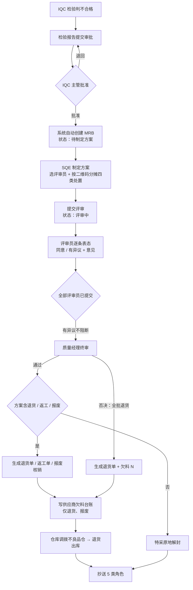

# MRB 流程修订方案（v3）

> 编写日期：2026-10-19
> 代码基线：`D:\WMS-20261019`（前端 `dist` 10-19 09:57 构建，后端 09:43）
> 范围：MRB 全链路（IQC 不合格 → 自动发起 → SQE 定方案 → 评审 → 终审 → 仓库执行 → 抄送）
> 本文只做「需求拆解 + 差距分析 + 方案设计」，不含代码改动。

---

## 一、需求梳理

把原始描述拆成 8 个可验收的环节：

| 编号 | 需求原文 | 拆解后的系统动作 | 责任角色 |
|---|---|---|---|
| R1 | IQC 检验不合格 → 提交报告审批 → IQC 主管批准报告 | 报告 `review_status=approved` 且 `final_result=fail` 时，自动建 MRB | 系统 |
| R2 | 自动触发 MRB | 建单后进入「待 SQE 制定方案」，不需要人工再去「待发起」点一次 | 系统 |
| R3 | SQE 选定评审人员 | 指派 ≥1 名评审员 | SQE |
| R4 | SQE 维护处理方案（退货/返工/特采/报废） | 建单阶段就要产出**处置明细**，而不是等到终审 | SQE |
| R5 | 可维护数量，**必须按仓库收料二维码维护**，弹窗、可批量选定 | 按收货二维码（六段码）逐箱分摊数量，支持多选批量 | SQE |
| R6 | 评审人员评审 | 评审员对 SQE 的方案表态（同意 / 有异议）+ 意见 | 评审员 |
| R7 | 质量经理终审（通过、否决） | 通过 = 按方案执行；否决 = 本单数量 N **全批退货**（退货单 + 欠料 + 调拨） | 质量经理 |
| R8 | 抄送 IQC 检验员、仓管员、仓库主管、计划主管、生产主管 | 终审后向 5 类角色账号推送消息 + 单据留抄送名单 | 系统 |
| R9 | 否决 → 判定不良品，仓库按不良品调拨流程调拨至不良品仓 | 否决即全批退货：生成调拨任务（数量 = 本单 N）+ 供应商退货单 | 仓管 |
| R10 | 通过 → 特采数量库存解锁 | 原地转良品、解除锁定、打特采标记，可发料（不搬库位） | 系统 |
| R11 | 通过 → 返工数量触发返工单，供应商返工后通知 IQC 复盘，复盘 OK 解锁可发料 | 生成返工单 → 返工完成 → 待重检 → IQC 判定 → 良品可发料 | 仓管 / IQC |
| R12 | 通过 → 退货则不良品调拨至不良品仓 | 生成退货单 + 调拨任务 | 仓管 |
| R13 | **判退货、报废的要触发供应商欠料补料** | 写 `supplier_debt` 欠料台账（退货、报废各一条），供应商补料 IQC PASS 时自动冲减 | 系统 / SQE |

**关键语义澄清（已确认）**

- R7 的「否决」= 本次评审不通过，**不是**「退回让 SQE 改方案」。一旦否决，本单数量 N 这批货**直接全批退货给供应商**，不再走其他处置。
- R5 的「二维码」= 收货时扫的六段码 `供应商*料号*生产日期*数量*批次号*流水号`，一箱一码，一码一数量。SQE 是在**箱**这一级分配处置，不是在物料/批次这一级拍总数。
- R10 的「解锁」= 原地解除 `locked` 并转回 `good`，不是「搬到良品仓再解锁」。
- R13 的「欠料补料」= 不是生成一张"请补料"的通知单，而是进**供应商欠料台账**，等供应商下次送货合格时由系统自动冲账。

---

## 二、现状盘点（代码事实）

### 2.1 已经做到的

| 能力 | 现状 | 位置 |
|---|---|---|
| IQC 不合格自动建 MRB | ✅ 已实现，事务外调用，失败仅记日志 | `server/modules/iqc/iqc.service.ts:2218-2233` |
| SQE 指派评审员 | ✅ `assignReviewers` | `mrb.service.ts:1593` |
| 评审员提交意见 | ✅ 但只能四选一（特采/退货/返工/报废） | `mrb.service.ts:1790` |
| 质量经理终审 | ✅ 但**由质量经理现场录入处置明细** | `mrb.service.ts:2039` |
| 特采解锁 | ✅ 改 `good` + `locked=false` + 打特采标记 | `mrb.service.ts:2341` |
| 返工单 + IQC 复盘 | ✅ 返工单有 `pending → reworking → pending_reinspect → passed/failed` | `rework.service.ts:195` |
| 退货单 | ✅ 生成 `supplier_return_order`，库存转 `returned` | `mrb.service.ts:2410` |
| 报废 | ✅ 核销归零，`stock_status='scrapped'` | `mrb.service.ts:2370` |
| 状态机 / SLA / 超时巡检 | ✅ 10 状态 + 停留时长 | `mrb.status.ts` |
| 供应商欠料台账 | ✅ 表、建账、自动冲减都有，但**只被生产退料 IQC 使用**，MRB 完全没接 | `supplier-debt.service.ts` |

### 2.2 与本方案冲突的事实（8 处）

**D1｜处置方案产生得太晚。**
现在 SQE 建单只填「本次评审数量 + 评审员」（`initiateMrb`，`mrb.service.ts:1414`），处置明细要等质量经理终审时在弹窗里现填（`finalApprove`，`2049`）。而新流程要求 SQE 在建单阶段就把 4 类处置和数量定死，评审员评的是**方案**，质量经理只做**通过/否决**。

**D2｜二维码维度完全不存在。**
全仓 MRB 代码与 `MrbList.tsx`（2411 行）搜不到 `labelNo` / `qr_content` / 二维码。当前数量是「批次级」的一个总数，没有任何箱级分摊。

**D3｜账上库存本来就不按箱管。**
收货时每箱有 `label_no`（`receipt.service.ts:373`），但库存唯一键是 `(material_id, location_id, batch_no, stock_status)`（`schema.ts:754`），同物料同库位同批次的第二箱会 `ON CONFLICT DO UPDATE` 累加到第一行，**标签号只保留第一箱的**。IQC 判不合格时更彻底：`finalizeLotInventory` 新建不良品行时直接把 `label_no` 置 `null` 并按批次合并（`iqc.service.ts:1122、1127`）。

> 结论：**箱级分摊只能做成"单据层的分摊凭证"，执行时按批次汇总扣减**。若要实现真正的箱级库存账，必须把唯一索引扩到 `label_no`，这涉及全仓 20+ 处 `onConflictDoUpdate`，属于独立重构，不在本次范围。这一点已按凭证级定稿（见 §八 Q7）。

**D4｜不合格品的物理位置前置了。**
IQC 主管一批准，库存就被搬到不良品仓（`iqc.service.ts:1111`）。这导致「仓库根据 MRB 结果调拨」在现状下无事可做——货早就在不良品仓了。定稿方案是：**货留在原收货库位（良品仓区域），账上标不良 + 锁定，MRB 定了再搬**。

**D5｜「否决」语义不符。**
现有 `rejectMrb`（`mrb.service.ts:2515`）只是把状态改成 `rejected`，**库存一行不动**，批次回到「待发起」等下一轮。新流程要求否决即**全批退货**：生成退货单、登记欠料、触发调拨。

**D6｜不良品调拨任务没有创建入口。**
`defective_move_task` 表存在，PDA 页面 `PdaDefectiveMove.tsx` 也在，但全仓只有「查列表」和「完成」（`defective-move.service.ts:88`），**没有任何地方创建任务**。这条链路是断的，本次要接上。

**D7｜没有任何通知/消息能力。**
全库无 `notice` / `message` / `notification` 表，前端无铃铛、无消息中心。R8 的「抄送」需要从零建。

**D8｜MRB 不产生供应商欠料。**
退货、报废在 MRB 里只是生成退货单/核销库存，**不写 `supplier_debt`**。而生产退料 IQC 发现来料不良时会写（`production-return-iqc.service.ts:243`），两套口径不一致。本次要把 MRB 的退货/报废也接进欠料台账。

---

## 三、目标流程



---

## 四、方案设计

### 4.1 关键决策：不合格品在 MRB 结束前「良品仓锁定」

**已定稿**：IQC 判不合格后，货**不搬库位**，留在原收货库位（属良品仓区域），账上做三件事：

| 字段 | 值 |
|---|---|
| `location_id` | **不变**（原收货库位） |
| `stock_status` | `defective`（不良品，口径不变） |
| `locked` | `true` |
| `lock_reason` | `IQC不合格待MRB(<批次号>)` |

一句话：**物理位置不动，账上定性为不良并锁死**。发料、领料、备料全部过滤 `locked=false`，所以货在良品仓也不会被误发。

这样设计后，MRB 各结果的落点如下：

| 终审结果 | 库存动作 | 是否搬仓 |
|---|---|---|
| 特采 | `defective → good`，`locked=false`，打特采标记 | **否，原地解封** |
| 返工 | `defective → rework`，`lock_reason=返工单号` | 否 |
| 退货 | 保持 `defective`，生成调拨任务 | 是，调拨至不良品仓后出库 |
| 报废 | 保持 `scrapped`（**数量不减**），生成调拨任务；入库后仓管确认销毁才核销归零 | 是，调拨至不良品仓后销毁 |
| 否决 | 本单数量 N 保持 `defective` + 锁定，生成退货单与调拨任务 | 是，调拨至不良品仓后出库 |

**改动点只有一个**：`iqc.service.ts` 的 `finalizeLotInventory`（约 1068 行）在判不合格时不再把 `location_id` 改成不良品仓，`label_no` 也不再置空（二维码要留着给 SQE 分摊用）。这是 B2 批次的全部工作。

**已知代价**：MRB 结束前，不良品仓的库存会偏少、收货区的不良品会偏多。库存查询要能区分「待调拨 / 已入不良品仓」，靠 `lock_reason` 前缀 + MRB 详情里的调拨任务状态展示即可，不加新字段。

**另外**：现有 `defective_move_task.completeTask` 要改三处，否则调拨任务要么查不到货、要么把标记冲掉、要么把报废行并进不良品行：

1. 取货条件从 `good + locked` 放宽为 `good / defective / scrapped + locked`（兼容存量任务）；
2. 目标状态跟着**来源行状态**走（`scrapped` 搬过去仍是 `scrapped`），不能一律写死 `defective`；
3. `lock_reason` 必须保留原值（`MRB-RETURN:<退货单号>` / `MRB-SCRAP:<单号>`），不能改成「IQC检验不合格」——退货出库与报废销毁都靠它定位库存行。

### 4.2 状态机

**不新增状态**（沿用 10 个，避免帮助文档、i18n、前端筛选全部要改），只调整语义：

| 状态 | 旧语义 | 新语义 | 变化 |
|---|---|---|---|
| `pending_review` | 待选定评审员 | **待 SQE 制定方案**（评审员 + 处置方案 + 二维码分摊） | 文案 + 校验增强 |
| `reviewing` | 评审中 | 不变，但评审内容变为「对方案表态」 | 评审结论枚举扩展 |
| `pending_approval` | 待质量主管资料预审 | **默认跳过**（IQC 主管已在报告审批环节把过关，重复预审无意义） | 加开关 `MRB_REQUIRE_PRE_APPROVAL=false` |
| `pending_final` | 待终审 | 不变 | — |
| `approved` / `pending_execute` / `closed` | — | 不变 | — |
| `rejected` | 驳回，库存不动，批次回到待发起 | **终审否决 = 全批退货**：本单 N 生成退货单 + 欠料 + 调拨任务 | 语义变更，需处理存量单据 |

> 存量单据处理：`rejected` 的历史单不做数据迁移。历史驳回单**没有**关联退货单，新否决单**一定有**——详情页按「是否有关联 `supplier_return_order`」区分「旧驳回 / 新否决」，避免误读。

状态迁移只改两处：

- `pending_approval` 从必经改为默认跳过 → `pending_review → reviewing → pending_final`
- `pending_final → rejected` 增加副作用（调拨任务），`MRB_TRANSITIONS` 本身不动。

### 4.3 数据模型

#### 新增表 1：`mrb_disposition_label`（二维码分摊明细）

| 字段 | 类型 | 说明 |
|---|---|---|
| `id` | uuid PK | |
| `mrb_id` | uuid NOT NULL | 冗余，便于按单查询 |
| `disposition_id` | uuid NOT NULL | 归属的处置行 |
| `receipt_id` | uuid NOT NULL | `receipt_order.id` |
| `receipt_no` | varchar(50) | 冗余展示 |
| `qr_content` | text | 六段码原文，界面直接显示 |
| `label_no` | varchar(100) | 收货标签号 |
| `quantity` | numeric(18,4) | 本箱分到本处置的数量 |
| `created_at/by, updated_at/by` | | |

索引：`(mrb_id)`、`(disposition_id)`、`unique(disposition_id, receipt_id)`。
**不设** `unique(mrb_id, receipt_id)`——一箱可以拆成 60 特采 + 40 返工，同一 `receipt_id` 出现在两行是合法业务。

约束（服务层校验）：Σ 同一 `receipt_id` 的分摊量 ≤ 该收货单数量。

#### `mrb_disposition` 扩展

- `exec_status` 增加枚举值 `planned`（SQE 已定、未执行）。终审通过后由 `planned → pending/done`，否决后由 `planned → cancelled`。
- 现有 `from_location_id / to_location_id` 在执行时写入，可用于追溯调拨来源。

#### `mrb_review` 扩展

- `plan_by` `user_profile`、`plan_time` `timestamptz(3)`：SQE 提交方案的时间（评审 SLA 起点）。
- `cc_sent_at` `timestamptz(3)`：抄送时间，防重复推送。

#### 新增表 2：`mrb_cc`（抄送名单快照）

`id / mrb_id / user_id / user_name / role_code / read_at / created_at`
唯一键 `(mrb_id, user_id)`。快照式存储，人员离职改名不影响历史单据展示。

#### 新增表 3：`sys_notice`（站内消息）

`id / user_id / title / content / biz_type('mrb'|'rework') / biz_id / is_read / read_at / created_at`
索引 `(user_id, is_read, created_at desc)`。

#### `defective_move_task` 扩展

- `mrb_id` uuid：来源 MRB
- `source` varchar(20)：`mrb_reject` / `mrb_return`
- `reason` text：展示用（"MRB 否决，全批退货至不良品仓"）
- 现有 `status`：`pending / completed`，补一个 `cancelled` 应对 MRB 撤销场景

### 4.4 二维码分摊规则

**数据来源**：`iqc_lot_receipt` → `receipt_order`，取该批次关联的所有收货单（一单 = 一箱 = 一码）。

| # | 规则 | 失败提示 |
|---|---|---|
| Q1 | 弹窗列出该批次全部二维码：二维码 / 箱号 / 数量 / 生产日期 / 已分配 / 未分配 | — |
| Q2 | 每箱可拆到多个处置，Σ 分摊 ≤ 箱数量 | `第 N 箱分配 120 超过箱内数量 100` |
| Q3 | 四类处置（特采 / 返工 / 退货 / 报废）合计 = 本次评审数量 N | `分摊合计 90 与评审数量 100 不一致` |
| Q4 | N ≤ 可评审量 M（沿用现有口径，`reviewableDefectiveCond`） | `本次评审数量需在 1 ~ 100 之间` |
| Q5 | 每类处置至少 1 箱，数量 > 0 | `返工处置未分配任何二维码` |
| Q6 | 支持勾选多行 + 「整箱分配为 X」批量操作；也支持逐格填数量 | — |
| Q7 | 提交后方案锁定，评审期间不可改；评审有异议时 SQE 可撤回重提（见 §4.8） | `评审已开始，如需修改请先撤回` |

**数量精度**：沿用 `toScaled/fromScaled`（×1000 整数），禁止浮点比较。

**一个必须说清的限制**：二维码分摊是**单据凭证**，不是库存账。终审执行时，系统按「处置类型 + 批次」汇总扣减库存行，不会去扣某一箱对应的库存行（因为账上根本没有箱级行）。追溯时通过 `mrb_disposition_label` 能查到"这 100 件里哪 3 箱判了退货"，但库存流水只有批次级记录。

### 4.5 终审与执行矩阵

质量经理终审时**不再录入处置明细**，只做两件事：看方案 + 通过/否决（可填备注）。

| 终审 | 处置 | 库存动作 | 下游单据 | 仓库动作 | MRB 落点 |
|---|---|---|---|---|---|
| 否决 | **等同全批退货** | 本单数量 N 保持 `defective` + 锁定，生成调拨任务 | 退货单 `pending_out` + **欠料记录 N** | 搬到不良品仓 → 按退货单出库 | `rejected` |
| 通过 | 特采 | `defective → good`，`locked=false`，`is_special_admit=true`，`special_admit_ref=单号`；**原地解封，不搬库位** | 无 | 无 | `approved` / `pending_execute` |
| 通过 | 返工 | `defective → rework`，`lock_reason=返工单号`，原地不动 | 返工单 | 供应商返工 → 完成 → IQC 复盘 | `pending_execute` |
| 通过 | 退货 | 保持 `defective`，生成调拨任务 | 退货单 `pending_out` + **欠料记录** | 调到不良品仓 → 按单出库 | `pending_execute` |
| 通过 | 报废 | 保持 `scrapped`（**数量不减**，锁死），生成调拨任务 | **欠料记录** | 调到不良品仓 → 点「报废销毁」核销归零 | `pending_execute` |

**执行顺序**（一次事务内）：
1. CAS 抢状态 `pending_final → 目标状态`
2. 按 `mrb_disposition` 逐行聚合数量，锁定并扣减候选库存行（复用现有 `finalApprove` 的分配器，`mrb.service.ts:2182-2278`）
3. 写库存流水（`mrb_special_admit` / `mrb_rework` / `mrb_return_freeze` / `mrb_scrap_freeze`，沿用现有 tx_type）
4. 生成下游单（退货单 / 返工单）
5. **按退货、报废数量生成供应商欠料记录**（见 §4.7）
6. 生成调拨任务（**退货 / 报废 / 否决**；来源库位已在不良品仓时跳过）
7. 写 `mrb_cc` + `sys_notice`
8. 提交事务

### 4.6 否决处理 = 全批退货（已定稿）

**业务定义**：否决不是「搁置待定」，也不是「把方案打回去让 SQE 改」。质量经理按否决，等于认定「SQE 给的处置方案不能用，这批货只能退给供应商」。所以**否决 = 全批退货，直接走退料流程，同样产生供应商欠料**。

**范围**：仅本单评审数量 N。M−N 的剩余量保持原状，不跟着退，后续可另开一单。

**实现策略（关键，避免写两套代码）**：

不新写一条「否决执行」分支，而是在事务里插一条**隐式处置行**，然后直接复用 `finalApprove` 的退货分支：

```
终审否决
  → mrb_disposition 中 SQE 已提交的方案行全部置 cancelled
  → 插入一条隐式处置：type='return', qty=N,
     remark='终审否决，全批转退货', disposition_id 正常生成
  → 走与「通过 + 退货」完全相同的执行代码
```

这样退货单生成、库存流水、调拨任务、欠料建账、抄送**全部复用同一条已经跑通的路径**，不会出现「通过退货有欠料、否决退货没欠料」这种双标 bug。

**执行动作**：

| 步骤 | 动作 |
|---|---|
| 1 | CAS 抢状态 `pending_final → rejected`（目标状态仍是 `rejected`，但下游动作按退货走） |
| 2 | 原方案处置行置 `cancelled`，插入隐式 `return` 处置（qty = N） |
| 3 | 库存保持 `defective` + 锁定，`lock_reason='MRB否决(<单号>)'` |
| 4 | 生成 `supplier_return_order`，`status='pending_out'`，`mrb_id` 关联，`remark='MRB <单号> 终审否决，全批退货'` |
| 5 | 写 `supplier_debt`：`origin_qty=N`，`source_type='mrb_reject'`，`source_id=mrb.id` |
| 6 | 生成 `defective_move_task`：`from_location=收货库位`、`to_location=不良品仓`、`source='mrb_reject'`、`qty=N` |
| 7 | 抄送 5 类角色（文案里写清"已转退货 + 欠料 N"） |

**仓库后续**：PDA 收到调拨任务 → 搬到不良品仓 → 退货单出库 → 货离场。供应商下次送货 IQC PASS，欠料自动冲减。

**前端要改文案**：终审弹窗的按钮从「否决」改成「**否决并全批退货**」，点击前二次确认，明示「将生成退货单 X 件，并记供应商欠料」。否则质量经理以为只是打个回票，结果仓库把货退了，会出事。

**否决后**：M−N 的剩余量仍在良品仓锁定，批次回到「可发起」状态，SQE 可另开一单评审。

### 4.7 退货 / 报废 → 供应商欠料补料

**好消息：这套机制系统里已经有了，不用新建。**

现有 `supplier_debt`（欠料台账）+ `supplier_debt_settlement`（冲减记录）两张表，目前由「生产退料 IQC 发现来料不良」时写入（`production-return-iqc.service.ts:243`）：

- 建账：`SupplierDebtService.createDebt()`，字段 `origin_qty / settled_qty / status(pending|settled) / source_type / source_id / source_no`
- 平账：收料 IQC **PASS** 时，按 `(供应商, 物料)` 自动冲减最早的 pending 欠料（`settleDebtOnReceipt`，带 `FOR UPDATE` 行锁 + `(debt_id, receipt_id)` 幂等）

所以接进 MRB 只需要在终审执行事务里多调一次建账，供应商下次送货合格时自动平账。前端已有「欠料台账」查询页面，零改造。

**接入规则**：

| 情形 | 是否建欠料 | 建账数量 | `source_type` | `source_id` / `source_no` |
|---|---|---|---|---|
| 方案判退货 | ✅ | 退货处置的数量合计 | `mrb_return` | MRB id / `mrb_no` |
| 方案判报废 | ✅ | 报废处置的数量合计 | `mrb_scrap` | MRB id / `mrb_no` |
| 终审否决（全批退货） | ✅ | 本单数量 N | `mrb_reject` | MRB id / `mrb_no` |
| 返工 | ❌ | —（供应商修好还回，不欠料） | — | — |
| 特采 | ❌ | —（让步接收，不欠料） | — | — |

三种 `source_type` 分开记，台账上一眼能看出这笔欠料是「方案判退」「方案判废」还是「整单被否」。

**几个实现细节**（都是踩过坑的点）：

1. `createDebt` 目前用 `this.db` 写，**不接受外部事务**。MRB 终审必须原子，要给方法加可选 `tx` 参数（照 `settleDebtOnReceipt` 的写法），否则会出现「MRB 回滚了但欠料留在账上」。
2. 同一张 MRB 的多笔欠料**分开各建一条**（退货、报废、否决各一条），不要合并，否则台账上看不出钱是怎么欠的。
3. 一条 MRB 可能同时有退货 + 报废，两次建账 `source_type` 不同，不会撞唯一键（`supplier_debt` 只在 `debt_no` 上有唯一约束）。
4. `supplier_code / supplier_name / material_code / material_name` 从 MRB 关联行取；取不到时用空串（表字段 NOT NULL），不能留 null。
5. 建账失败**不能静默**——要么整单回滚，要么记 `sys_notice` 给 SQE 补录。建议前者：终审是低频高权重操作，宁可让质量经理重试一次，也不能账实不符。

**业务闭环**：

```
① 方案判退货 100 → 欠料 +100（mrb_return）
② 终审否决，全批 300 → 欠料 +300（mrb_reject）
        ↓ 供应商补料 400，收货 → IQC PASS
        ↓ settleDebtOnReceipt 按供应商+物料依次冲减
欠料台账 400/400 → settled
```

注意：冲减是按「供应商 + 物料」匹配的，不区分来源。也就是说 MRB 产生的欠料，可能被该供应商任意一批同料号的合格来料冲掉——这符合"欠料补料"的业务本意，但要求 SQE 在退货时确认清楚供应商和料号，否则会张冠李戴。

### 4.8 抄送与通知

**触发时机**：终审完成（通过 / 否决都发）。

**对象**：

| 角色 | 角色码 | 取人规则 |
|---|---|---|
| IQC 检验员 | `iqc_inspector` | 优先取该批次的实际检验员（`iqc_lot.inspector_id`），而不是全角色广播 |
| 仓管员 | `wh_keeper` | 该角色全部启用账号 |
| 仓库主管 | `wh_manager` | 该角色全部启用账号 |
| 计划主管 | `plan_manager` | 该角色全部启用账号 |
| 生产主管 | `production_manager` | 该角色全部启用账号 |

**形态**：
1. `mrb_cc` 记录名单（详情页展示"已抄送：张三、李四……"）
2. `sys_notice` 每人一条，顶栏铃铛显示未读数，点击跳 MRB 详情
3. 消息内容按结果分两套文案（通过：处置摘要；否决：全批退货 N 件 + 已记欠料 + 退货单号 + 调拨任务号）

**不做**：邮件、企业微信、短信。系统没有这些通道，加就是另一个项目。

**额外一条**（你提到的"供应商返工后通知 IQC 复盘"）：返工单 `finishRework` 后，向该批次的 IQC 检验员 + IQC 主管发 `sys_notice`，`biz_type='rework'`。

### 4.9 接口清单

**新增**

| 方法 | 路径 | 说明 | 角色 |
|---|---|---|---|
| GET | `/api/mrb/lot-labels?lotId=` | 该批次全部收货二维码 + 已分摊量 | sqe/quality_manager/admin |
| POST | `/api/mrb/plan` | 保存并提交方案（评审员 + 处置明细 + 二维码分摊），`draft` 与 `submit` 二合一 | sqe |
| GET | `/api/mrb/plan/:mrbId` | 读方案（含分摊明细） | 登录即可 |
| GET | `/api/mrb/cc/:mrbId` | 抄送名单 | 登录即可 |
| GET | `/api/notices` | 我的消息列表（分页 + 未读筛选） | 登录即可 |
| GET | `/api/notices/unread-count` | 未读数（铃铛角标） | 登录即可 |
| POST | `/api/notices/:id/read` | 标记已读 | 登录即可 |
| POST | `/api/mrb/withdraw` | 撤回方案：`reviewing → pending_review`，方案保留、评审意见清空 | sqe（本单发起人）/ quality_manager / admin |
| POST | `/api/mrb/return-back` | 审批驳回：`pending_approval`/`pending_final → pending_review`，不动库存、不生成下游单 | 预审：iqc_manager；终审：quality_manager（admin 均可） |

**改造**

| 方法 | 路径 | 改动 |
|---|---|---|
| POST | `/api/mrb/submit-review` | `reviewResult` 允许 `agree` / `disagree`；旧四选一值保留兼容 |
| POST | `/api/mrb/final-approve` | 不再接收 `dispositions`（收到也忽略），改为读 `mrb_disposition`；新增 `decision: 'approve' \| 'reject'` 合并两个入口 |
| POST | `/api/mrb/reject` | 改为**全批退货**：插隐式 return 处置 → 生成退货单 + 欠料 + 调拨任务 + 抄送 |
| GET | `/api/mrb/detail/:id` | 返回 `dispositions[].labels`、`ccList`、`moveTasks`、`planBy/planTime` |
| GET | `/api/mrb/pending-lots` | 语义不变（自动建单后该批次不再出现在此，除非自动建单失败） |

**权限收口**（沿用 v2.1 的做法，服务层二次校验）：
- 方案提交：`sqe`（且必须是本单发起人）/ `admin`
- 终审：`quality_manager` / `admin`（移除 `iqc_manager`，已定稿）
- 调拨任务完成：`wh_keeper` / `wh_manager` / `admin`
- 返工重检：`iqc_inspector` / `iqc_manager` / `admin`（**现状任何登录用户都能调，需补**）

### 4.10 前端交互

**① 方案弹窗（新，替换现有「发起评审」弹窗）**

```
┌─────────────────────────────────────────────────────────────┐
│ MRB 方案制定 — MRB202610190001            批次 B20261001     │
│ 物料 MAT-001 电容 10uF   供应商 S001 三星   送检 300 PCS     │
├─────────────────────────────────────────────────────────────┤
│ 评审人员：[张三 ×] [李四 ×] [+ 添加]                          │
├─────────────────────────────────────────────────────────────┤
│ 处置方案（按收货二维码分摊）                                  │
│ ☑ 全选   ☑ 箱号        二维码              数量  特采 返工 退货 报废│
│ ☑      RC20261001001  S001*MAT-001*...*100  100  [100] 0   0   0 │
│ ☑      RC20261001002  S001*MAT-001*...*100  100   0  [100] 0   0 │
│ ☐      RC20261001003  S001*MAT-001*...*100  100   0   0   0   0 │
│ ─────────────────────────────────────────────────────────────  │
│ 合计：300 件 ｜ 特采 100 ｜ 返工 100 ｜ 退货 0 ｜ 报废 0 ｜ 未分配 100 │
│ 批量：[整箱设为 特采 ▾] [应用到选中 2 行]                      │
├─────────────────────────────────────────────────────────────┤
│ 不合格原因：…（自动带出 IQC 报告结论，可编辑）                 │
│                              [取消] [存草稿] [提交评审]        │
└─────────────────────────────────────────────────────────────┘
```

- 行内四个数量框，改任一格实时重算合计；
- 未分配 > 0 时提交按钮禁用，提示"还有 100 件未分配处置"；
- 单箱超分立即标红，不等到提交；
- 勾选多行 → 批量设为某处置（整箱数量）。

**② 评审弹窗**：从「四选一 + 意见」改为「方案摘要（只读）+ 同意/有异议 + 意见」。有异议时意见必填 ≥5 字。评审结论**只作为终审参考，不参与任何系统判定**，也不阻断流转——所有人提交即进入待终审，质量经理看到的是"谁有异议、异议是什么"，最终仍由他拍板。

**③ 终审弹窗**：只读展示方案（按处置分组 + 二维码明细可展开）、评审意见汇总（异议标红）、下游单预览（退货单 / 返工单 / 欠料条数）；底部两个按钮 `[否决并全批退货]`（必填理由，二次确认明示"将生成退货单 N 件并记供应商欠料"）`[通过]`。

**④ 详情页**：新增三个区块 —— 方案与二维码明细、评审意见、抄送名单 + 关联调拨任务/下游单状态。

**⑤ 铃铛**：`Layout.tsx` 顶栏加图标 + 未读角标，下拉显示最近 10 条，点击跳转。

**三语**：新增文案约 60 条，`zh/vi/en` 三份同步（现有每份 ~2387 行）。

---

## 五、实施拆分

按依赖顺序，每批可独立回归：

| 批次 | 内容 | 依赖 | 风险 |
|---|---|---|---|
| **B1 数据底座** | 4 张表/扩列 + 迁移 SQL + `schema.ts` 同步 + 调拨任务创建能力 | 无 | 低（纯新增） |
| **B2 库存落点改造** | IQC 不合格不再搬不良品仓；`defective_move_task.completeTask` 适配 `defective+locked` | B1 | **高**（影响 IQC 审批后的库存分布，见 §七） |
| **B3 方案与二维码** | `lot-labels` / `plan` 接口 + 状态机调整 + 方案弹窗 + 评审弹窗改造 | B1 | 中 |
| **B4 终审与执行** | 终审读方案 + 执行矩阵 + **否决转退货（复用退货分支）** + **退货/报废/否决欠料建账** + 权限收口 | B2、B3 | 中 |
| **B5 抄送通知** | `mrb_cc` / `sys_notice` / 铃铛 / 返工复盘通知 | B4 | 低 |
| **B6 回归** | 8 条端到端用例 + 三语文案 + 帮助文档更新 | 全部 | — |

**建议先做 B1 + B3（不动库存落点），确认交互与流程跑通后再做 B2。** 这样即使库存模型要回退，前面的工作不白费。

---

## 六、验收用例（端到端）

| # | 场景 | 预期 |
|---|---|---|
| T1 | IQC 判不合格 → 主管批准 | 自动生成 MRB，状态「待制定方案」，无需手工发起 |
| T2 | SQE 按 3 箱分配 100/100/100：特采 100、返工 100、报废 100 | 提交成功，方案落库 3 条处置 + 3 条二维码明细 |
| T3 | 某箱分 120（箱内 100） | 400，提示超分 |
| T4 | 分摊合计 280，评审数量 300 | 400，提示差额 |
| T5 | 2 名评审员，1 人同意 1 人有异议 | 评审完成 → 待终审，异议在终审页标红可见 |
| T6 | 终审通过（含返工） | 返工单生成，库存转 `rework`，MRB 待执行；返工完成 → IQC 复盘 pass → 库存 `good` 可发料 → MRB 结案 |
| T7 | 终审否决（全批退货） | 生成退货单 `pending_out`（数量 N）+ 欠料 `mrb_reject` N + 调拨任务，MRB `rejected`，5 类角色各收到 1 条消息 |
| T7-1 | 否决后仓库完成调拨、退货单出库 | 库存扣至 0，调拨任务 `completed`，欠料台账仍 `pending` 等待供应商补料 |
| T7-2 | 否决单与"通过+退货"单对比 | 退货单、欠料、调拨任务的字段结构完全一致，仅 `source_type` 与单据备注不同 |
| T8 | 仓库完成调拨任务 | 库存 `location=不良品仓`，任务 `completed`，MRB 详情显示已执行 |
| T9 | 全流程库存对账 | Σ(处置数量) = 本单数量；库存总量前后差值 = 0（报废核销、退货/否决出库的部分除外） |
| T10 | 终审通过，含退货 100 + 报废 50 | 欠料台账新增 2 条：`SD…0001` 退货 100（`source_type=mrb_return`）、`SD…0002` 报废 50（`mrb_scrap`），状态 `pending` |
| T11 | 供应商补料 100，收货 IQC 判 PASS | 退货那条欠料 `settled_qty=100`、`status=settled`；报废那条不受影响，仍 `pending` |
| T12 | 供应商补料 100，IQC 判 FAIL | 欠料不动，仍 `pending`（只有 PASS 才冲减） |
| T13 | 终审执行事务中途报错 | MRB 状态回滚、库存回滚、**欠料记录不残留**（验证 `createDebt` 已接入外部事务） |

---

## 七、风险清单

1. **B2 改动面被低估的风险**：IQC 不合格不再搬仓，会影响「不良品仓库存查询」「IQC 不合格统计」「PDA 不良品调拨」「供应商退货选货」四处。上线前必须逐处确认口径，否则会出现"货在收货区但系统里找不到"的投诉。
2. **箱级账的边界**：本方案的二维码分摊是凭证级，不是账级。如果业务要求"扫这箱必须扣这箱"，那就是库存主数据重构，工作量是本方案的数倍。必须提前说清，避免验收时扯皮。
3. **`rejected` 语义变更（影响放大）**：否决现在会真的生成退货单并扣库存，不再是"只改个状态"。存量单据 + 前端按钮文案 + 帮助文档三处都要改；终审按钮必须二次确认，否则质量经理以为只是驳回，仓库却把货退了。
4. **无版本控制**：仓库没有 git，`.bak` 文件散落。动手前必须建基线（`git init` 或整包备份），否则 B2 出问题无法快速回退。
5. **i18n 遗漏**：越南语/英语漏词条会直接显示 key 名（README 里已列为已知现象），三份必须同步。
6. **审批人自审**：现有 `final-approve` 允许 `iqc_manager`，若不收窄，同一人可能既批报告又终审 MRB，违背流程设计。
7. **欠料张冠李戴**：欠料冲减按「供应商 + 物料」匹配，不区分来源单。若供应商同一料号有多个在途批次，MRB 欠的 100 可能被另一批合格来料冲掉，账面上"已补"，实际没补。规避办法：SQE 建方案时核对料号；后续可在 `supplier_debt_settlement` 加"是否指定来源批次"字段做增强，本期先不做。
8. **退货单出库取货位置**：退货单原先默认从原库位扣，改造后货需先由调拨任务搬到不良品仓。若仓库未完成调拨就点退货出库，会出现"无库存可扣"。需在退货出库前校验关联调拨任务已完成，并给出明确提示。**否决路径同样受影响**——否决生成的退货单也依赖调拨先完成，不能因为是"否决单"就走捷径。

---

## 八、已定稿决策（2026-10-19 确认）

| # | 问题 | 定稿 |
|---|---|---|
| Q1 | 不合格品在 MRB 结束前放哪？ | **良品仓锁定**：库位不变（原收货库位），`defective` + `locked=true`，不搬不良品仓（§4.1） |
| Q2 | 否决范围与性质 | **本单评审数量 N，全批退货给供应商**（生成退货单 + 欠料），剩余量 M−N 不动（§4.6） |
| Q3 | 评审员职责 | **只发表意见，不作为最终依据**；终审仍由质量经理通过/否决（§4.2、§4.10） |
| Q4 | 特采库存落点 | **原地解封**：`defective → good` + 解锁，不搬库位 |
| Q5 | 抄送形式 | **轻量站内消息**：`sys_notice` + 顶栏铃铛，不做邮件/企微 |
| Q6 | 退货/报废的供应商责任 | **必须触发欠料补料**：写 `supplier_debt`，供应商补料 IQC 合格后自动冲减（§4.7） |
| Q7 | "按二维码维护数量"是凭证级还是账级？ | 仍按**凭证级**（一箱一码分摊，执行按批次汇总），这是库存模型决定的，非偏好 |
| Q8 | 资料齐全性预审 | 默认跳过，保留开关 |
| Q9 | 其他处置（退回客户/留样/暂存） | 保留但默认隐藏 |
| Q10 | 报废的库存落点 | **先调拨进不良品仓、再销毁**：终审只把库存冻结为 `scrapped` 并生成调拨任务，仓管确认销毁（`POST /api/mrb/disposition/:id/destroy`）才核销归零（§4.5） |

---

## 九、附：涉及文件（预估）

**后端**
- `server/database/schema.ts`（新增 4 表 / 扩列）
- `server/database/mrb-v3-20261019.sql`（迁移）
- `server/modules/mrb/mrb.service.ts`（方案、终审、否决、抄送，改动最大）
- `server/modules/mrb/mrb.controller.ts`（新增 7 端点）
- `server/modules/mrb/mrb.status.ts`（状态语义注释）
- `server/modules/mrb/dto/*`（`plan.dto.ts` 新增）
- `server/modules/iqc/iqc.service.ts`（`finalizeLotInventory`）
- `server/modules/defective-move/defective-move.service.ts`（创建任务 + 适配状态）
- `server/modules/supplier-debt/supplier-debt.service.ts`（`createDebt` 增加 `tx` 参数，供 MRB 终审事务复用）
- `server/modules/supplier-return/*`（退货单出库时从不良品仓取货）
- `server/modules/rework/rework.service.ts`（复盘通知 + 权限）
- `server/modules/system/*`（消息中心）

**前端**
- `client/src/pages/mrb/MrbList.tsx`（方案弹窗 + 终审改造，现 2411 行，建议拆分组件）
- `client/src/pages/mrb/MrbTask.tsx`（评审弹窗）
- `client/src/components/Layout.tsx`（铃铛）
- `client/src/api/mrb.ts`、`client/src/api/notice.ts`（新增）
- `client/src/i18n/locales/{zh,vi,en}.ts`（约 60 条）

**文档**
- 帮助文档 MRB 章节、`README.md` 流程说明

---

## 十、实施进度（2026-10-19）

### 已完成

| 批次 | 内容 | 落点 |
|---|---|---|
| B1 | 迁移 SQL（`mrb_cc` / `sys_notice` / `mrb_disposition_label` / `defective_move_task` 扩列 / `mrb_review` 加 `plan_by,plan_time,cc_sent_at`） | `server/database/mrb-v3-20261019.sql` |
| B2 | IQC 判不合格**不再搬库**：库位不变、`defective + locked + lock_reason='IQC不合格待MRB(<批次>)'`、`label_no` 保留 | `iqc.service.ts::finalizeLotInventory` |
| B2 | 调拨任务取货条件由 `good+locked` 放宽为 `good/defective/scrapped + locked`（兼容存量任务）；目标状态跟随来源行（`scrapped` 不被改成 `defective`）；`lock_reason` 保留原值（退货/报废靠它定位） | `defective-move.service.ts::completeTask` |
| B3 | SQE 方案：读二维码箱 → 四类处置按箱分摊 → 校验「逐箱不超量」+「合计等于 N」→ 存 `planned` | `mrb.service.ts::savePlan / getPlan / getLotLabels`、`MrbPlanDialog.tsx` |
| B3 | 终审读取 SQE 方案执行；前端改为**只读确认**（方案明细 + 二维码可展开 + 评审意见 + 下游单预览） | `mrb.service.ts::finalApprove`、`MrbList.tsx` |
| B3 | 评审员由「四选一处置」改为「同意 / 有异议」，有异议必填 ≥5 字 | `MrbTask.tsx`、`business-enums.ts` |
| B4 | 否决 = 全批退货：内部转调 `finalApprove(rejectMode)`，复用退货链；按钮改名「否决并全批退货」+ 后果二次确认 | `mrb.service.ts::rejectMrb`、`MrbList.tsx` |
| B5 | 抄送：`mrb_cc` 快照 + `sys_notice` 站内消息（IQC 检验员 + 仓管员 + 仓库主管 + 计划主管 + 生产主管） | `mrb.service.ts::writeCcAndNotices`、`notice/*`、`NoticeBell.tsx` |
| B5 | 消息接口：`GET /api/notices`、`/unread-count`、`POST /:id/read`、`/read-all` | `notice.controller.ts` |
| B6 | 退货 / 报废 / 否决 → 供应商欠料（`mrb_return` / `mrb_scrap` / `mrb_reject`） | `mrb.service.ts::writeDebtAndMoveTasks` |
| B7 | **报废改为「先调拨进不良品仓、再销毁」**：终审冻结为 `scrapped`（数量不减）→ 生成 `mrb_scrap` 调拨任务 → 仓管点「报废销毁」才核销归零 | `mrb.service.ts::finalApprove / destroyScrap`、`mrb.controller.ts::POST disposition/:id/destroy`、`MrbList.tsx` |
| B7 | 库存占用标记分族：`MRB-RETURN:<退货单号>` / `MRB-SCRAP:<mrbNo>` / `MRB-OTHER:<mrbNo>`，可评审量与良品待隔离量统一排除 `MRB-%`（防同一批货被两张单各算一次） | `mrb.status.ts`、`inventory.service.ts::assertNotMrbReserved` |
| B7 | 退货出库兜底匹配改认 v3 口径（`defective/returned` + `MRB-RETURN:<退货单号>`，不再按处置时库位），调拨搬库导致 `inventory_id` 失效时不再报「待退库存不足」 | `supplier-return.service.ts` |
| B8 | `MrbPlanDialog.tsx` 接三语（25 条 `mrb.plan*` 文案，处置名称复用 `MRB_DISPOSITION_LABEL_KEYS`） | `MrbPlanDialog.tsx`、`i18n/locales/{zh,en,vi}.ts` |

### 联调结论（curl + psql 实测）

| 场景 | 结果 |
|---|---|
| 通过（特采 100 / 返工 60 / 报废 40） | `pending_execute`；库存 `good/100 + 特采标记`（原地解封，未搬库）、`rework/60`、报废行 `scrapped/40`（**未核销**）+ 一条 `mrb_scrap` 调拨任务；欠料 `mrb_scrap 40` |
| 报废全流程（报废 120 + 退货 80） | 终审后：`scrapped/120` + `defective/80` **两行独立**（`MRB-SCRAP` / `MRB-RETURN`），两条调拨任务（`mrb_scrap` / `mrb_return`），明细均 `pending` |
| 报废：未调拨先销毁 | 409「报废库存尚未调入不良品仓：本明细需销毁 120，不良品仓现有 0」 |
| 报废：完成调拨后销毁 | 调拨完成后库存 `scrapped/120` 落在 `NG01-A-01-00-0001`（`lock_reason` 保留）；销毁后该行删除、流水 `mrb_scrap -120 / balance 0`、明细 `done`、MRB `closed` |
| 退货出库（人为置空 `inventory_id`） | 走标记兜底成功出库 80，MRB 两行均 `done` → `closed` |
| 否决（方案为特采 100 + 返工 100） | `rejected`；库存整批 200 `defective + locked`，`lock_reason=退货单号`；退货单 200；欠料 `mrb_reject 200`；调拨任务 200；原方案两行 `cancelled`，新增 `return 200` |
| 逐箱超量 | 400「收货箱 TEST-RC-001 分配合计 120 超过箱内数量 100」 |
| 合计不等于 N | 400「分摊合计 150 与本次评审数量 200 不一致」 |
| IQC 判不合格 | 库存 `ZZ-TEST-B2-LOC` 原地变 `defective + locked`，`lock_reason=IQC不合格待MRB(TEST-IQC-B2)`，`label_no` 保留；自动触发 MRB `MRB202610190001`（80 PCS，已自动指派 SQE） |
| 终审抄送 | 5 人入 `mrb_cc`（iqc_manager + 4 个岗位），5 条 `sys_notice`；正文明示物料/批次/结论/下游单号 |
| 消息接口 | `unread-count=1` → 标记已读 → `unread-count=0` |
| 返工：SQE 确认完成 | `pending → reworking → pending_reinspect`；`sys_notice` 发给本批检验员 + 全部 IQC 主管（实测：iqc_manager 收到「返工完成待复检」） |
| 返工：IQC 确认合格 | 库存 `rework/60` → `good/60 + locked=false`（良品仓），流水 `rework_in 60`；返工单 `passed`；处置 `done`、MRB `closed`；SQE 收到「返工复检合格」回执 |
| 返工：IQC 确认不合格 | 库存 → `defective/10 + locked=true`、`lock_reason=返工重检不合格（返工单号）`；返工单 `failed`；SQE + 全部质量经理收到「返工复检不合格，请重新发起 MRB」 |

### 返工完成 → IQC 复检 → 解锁（2026-10-19 补充定稿）

**流程**（三个角色各管一段，不可互相代点）：

| 步骤 | 动作 | 角色 | 状态变化 | 副作用 |
|---|---|---|---|---|
| 1 | 开始返工 | 仓管 / 仓库主管 / SQE / admin | `pending → reworking` | — |
| 2 | **SQE 确认返工完成** | SQE（质量经理兜底） | `reworking/pending → pending_reinspect` | 站内消息通知本批检验员 + IQC 主管复检 |
| 3 | **IQC 复检确认** | IQC 检验员 / IQC 主管（质量经理兜底） | `pending_reinspect → passed/failed` | 合格：库存 `good + unlocked`（可发料）、处置 done、MRB 收敛；不合格：`defective + locked`，通知 SQE 重开 MRB |

**为什么 `finish` 就是「SQE 确认」而不是新增一个状态**：返工在供应商处完成，只有 SQE 能对供应商的返工结果签字；仓管点「完成」没有业务依据。复用原状态机，`finish_by` 即签认人，存量单据零迁移。

**权限边界**（此前完全没有）：`start` / `finish` / `reinspect` 三个端点均挂 `@NeedRoles`；IQC 身份不能确认完工，SQE 身份不能提交复检结论。

**页面可见性**：`/rework`、`/rework/list` 之前不在任何角色的菜单权限里（DB 里全为空数组，前端兜底映射也漏了 `iqc_inspector`），实际只有 admin 能进。现已在 `rolePermissionsMap`、`syncRolePermissions.validPermissions` 与前端静态映射三处补齐；**存量库的 `sys_role.menu_permissions` 保持空数组**（空数组即走前端静态映射，不要写入半套权限，否则会覆盖兜底）。

### 不良品调拨单（2026-10-19 补充定稿）

**问题**：调拨任务在终审时确实建出来了，但仓库「不知道有这回事」——PC 端没有任何入口，
只有扫码 PDA 的一个列表；而且 PDA 查库位调的是不存在的 `/api/warehouse/locations`，
扫库位必失败。等于任务建了没人执行，退货出库 / 报废销毁全部卡在「查无此货」。

**落地**：

| 层 | 内容 |
|---|---|
| 入口 | 新增 PC 页面「库存 → 不良品调拨单」`/inventory/defective-move`；列表默认筛「待调拨」，标题旁显示待办数量 |
| 通知 | MRB 终审生成任务后，**在同一事务内**给全部 `wh_keeper` + `wh_manager` 推站内消息（`biz_type=defective_move`），正文含 MRB 单号、物料、批次、待调拨明细、原库位，点击直接跳调拨单页面 |
| 执行 | 页面选/扫不良品仓库位 → `POST /api/defective-move/:id/complete`；后端校验目标库位必须属于 `wh_type='defective'`，否则 400 |
| 权限 | `complete` 加 `@NeedRoles(wh_keeper, wh_manager, admin)`；此前任何登录账号都能搬库存 |
| 留痕 | 调拨写两条库存流水（`defective_move_out` / `defective_move_in`），`reference_no` = MRB 单号，`tx_no` = `DM-<任务ID前8位>` |
| 防错 | 找不到库存行、库存量小于任务量时返回 409，不再「静默把任务标完成」；行级 `FOR UPDATE` 防两人同时点完成 |
| PDA | 库位改为通过 `/api/defective-move/locations` **精确匹配**（原模糊查询会把 `...0001` 误配到 `...00010`）；顺带修掉按钮组件不支持的 `variant="secondary"` / `loading` 属性 |

**关键修复：任务来源决定候选库存状态。**
同批次可能同时存在「退货冻结行 `defective`」和「待销毁行 `scrapped`」。
最初沿用旧逻辑按「`scrapped` 排最前」找货，结果**退货任务把待销毁的 120 搬走了 80**。
现按 `source` 收窄：`mrb_scrap` 只认 `scrapped`；`mrb_return` / `mrb_reject` 只认 `defective` / `good`。
`lock_reason` 与 `stock_status` 在搬库时原样保留（下游退货出库、报废销毁靠它们定位货）。

**实测**（`TEST-MRB-SCRAP`：退货 80 + 报废 120，原库位 `TEST-GOOD-LOC`）：

| 场景 | 结果 |
|---|---|
| 终审生成任务 | 两条任务 `pending`，原库位 `TEST-GOOD-LOC`、目标 `NG01-A-01-00-0001`；`RJ061`（仓管）与 `RJ037`（仓库主管）各收到一条「不良品调拨待办：MRB TEST-MRB-SCRAP」 |
| SQE 调 complete | 403（角色守卫生效） |
| 目标选良品仓库位 | 400「目标库位必须属于不良品仓」 |
| 执行退货调拨 80 | 只搬 `defective/80`，`scrapped/120` 原地未动；`lock_reason=MRB-RETURN:...` 保留；流水 `out -80 / 0` + `in +80 / 80` |
| 执行报废调拨 120 | 搬到不良品仓后仍是 `scrapped/120`，`MRB-SCRAP:...` 保留，未与退货行合并 |
| 调拨后销毁 | 成功；`scrapped` 行删除、明细 `done` |
| 调拨后退货出库 | 成功；`defective/80` 出清、明细 `done`，MRB `closed` |
| 重复执行 / 已完成任务 | 400「该任务已完成」 |

### 不良品调拨 v2：强制扫码 + 手工制单（2026-10-19 补充定稿）

**问题**（上一版的执行方式等于「没有校验」）：

1. PC 端执行调拨是「选一个不良品仓库位 → 点确认」，服务端只校验库位是不是不良品仓，
   **完全不知道仓管员实际搬的是哪批货**。搬错物料、搬错批次，系统照样把任务标完成。
2. 只有 MRB 派生的任务能走调拨；良品仓在生产过程中发现不良（没有 MRB、没有来料批次）无单可依。

**落地**：

| 层 | 内容 |
|---|---|
| 单据统一 | `defective_move_task` 升级为「不良品调拨单」，新增 `move_no`（`DMT+日期-流水`，与手工单同一序列）、`inventory_id`（制单锁定行）、`from_stock_status`、`created_by` / `confirmed_by` / `confirmed_at` / `confirm_remark`、`scan_codes` / `scan_to_code` / `scan_at`；`lot_id`、`supplier_id` 放开非空 |
| 状态机 | `pending_confirm`（待主管确认）→ `pending`（已生效待执行）→ `completed`；`cancelled`（驳回 / 撤销 / 作废）。MRB 派生单终审即生效，直接 `pending` |
| 制单 | 仓管员选「良品仓、未锁定、可用量 > 0」的库存行 → 填数量与原因 → 生成 `pending_confirm`；制单**不锁库存**（制单即锁会让仓管员随手建单锁死正常发料） |
| 确认 | 仓库主管 `approve` → 行级 `FOR UPDATE` 复核可用量 → `locked=true` + `lock_reason=DEFECTIVE-MOVE:<单号>` → `pending`；`reject` → `cancelled`。制单人不能自批（`@NeedRoles(wh_manager, admin)`） |
| 作废 | 待确认由制单人撤销；已生效只能由仓库主管作废，并同步解锁来源行（只认本单的锁标记，不误清别人的占用） |
| 扫码执行 | `POST /api/defective-move/:id/complete` 只接受 `scannedCodes[]` + `toLocationCode`：①每个标签必须能解析且物料 + 批次与本单一致（六段码兼容 `*` 与 `|` 两种分隔符，也接受单扫物料码 / 批次号）；②库位码按 `location_code` **精确匹配** `wh_type='defective'` 且启用。**不再接受库位 ID 直传**，前端不允许下拉选库位 |
| 落库 | 手工单按 `inventory_id` 精确扣减（不按批次「优先排序」猜行）；MRB 单沿用按来源收窄状态 + 锁标记族定位。部分搬移时手工单释放来源行的占用锁；目标行 `defective` 且不长期锁定 |
| 页面 | 「库存 → 不良品调拨」`/inventory/defective-transfer` = 作业台（待处理列表 + 制单 + 主管确认 + 扫码执行）；「不良品调拨单」`/inventory/defective-move` = 台账（查询 + 详情 + 跳转执行）。原自由扫码接口 `POST /api/inventory/defective-transfer/confirm` 已下线 |
| 通知 | MRB 终审消息文案改为引导至「不良品调拨」扫码作业；`bizType=defective_move` 的铃铛跳转由调拨单页改为作业台。制单后给 `wh_manager` 推待确认消息，确认生效后回执制单人 |
| PDA | 增加「第一步扫货物标签（逐箱服务端校验）+ 第二步扫库位码」，尺寸与 PC 同一套接口、同一套校验 |

**实测**（`TEST-MRBV3-20261019`，良品仓 `TEST-GOOD-LOC` 库存 60）：

| 场景 | 结果 |
|---|---|
| 仓管制单 10 | 201 `DMT20261019-000001` / `pending_confirm` |
| 仓管自行确认 | 403（岗位分离） |
| 管理员确认生效 | 201 `pending`；库存行 `locked=t`、`lock_reason=DEFECTIVE-MOVE:DMT20261019-000001` |
| 扫错物料 / 错批次 | 400「物料不符：扫描的是 X，本单应为 Y」/「批次不符：…」 |
| 扫无法识别的码 | 400「条码无法匹配本单」 |
| 无扫码直接执行 | 400「请先扫描货物标签」 |
| 扫良品仓库位码 | 400「库位码 TEST-GOOD-LOC 不属于不良品仓」 |
| 正确扫码执行 | 201；源行剩 50 且解锁，目标 `NG01-A-01-00-0001` 新增 `defective/10` 未锁；流水 `out -10 / 50`、`in +10 / 10`，`reference_no` = 单号；单据 `completed` 并留存 `scan_codes` / `scan_to_code` |
| 重复执行 | 400「该任务已完成或已作废」 |
| 主管驳回 | `cancelled`，库存未动 |
| 已生效单由仓管作废 | 400「只有仓库主管可以作废」；管理员作废后来源行解锁 |
| MRB 派生单（`mrb_reject`，200 整行） | 扫码执行成功；整行换库位，`stock_status=defective`、`locked=t`、`lock_reason` 原值保留 |

### 单号追溯：MRB / 不良品调拨单挂靠 IQC 检验单号（2026-10-19 定稿）

**为什么不做「单号与检验单号完全一致」**（曾评估，已否决）：

| 场景 | 库里实证 | 纯复用后果 |
|---|---|---|
| 一检多单（作废/否决后重开） | `TEST-LOT-002` 同时挂 `MRB202610190002`、`MRB202610190003` | 同表重号，`mrb_no` 唯一索引直接冲突 |
| 一单多调拨（退货 + 报废） | `MRB TEST-MRB-SCRAP` 派生 `DMT202610190005`、`DMT202610190006` | 两张调拨单同号，仓库分不清搬哪批 |
| 未来分批调拨 | 同一处置可能分多次搬 | 同上 |

而且 `JY` / `MRB` / `NGDB` 前缀本身就是岗位与单据类型的标签：仓库看到 `JY…` 会去检验台账找，跨类型同号会让电话沟通、纸单归档全部失效。

**规则**（`server/common/utils/doc-no.util.ts`）：

| 单据 | 格式 | 示例 |
|---|---|---|
| IQC 检验单（母号） | `JY` + `YYYYMMDD` + 4 位流水 | `JY202610190001` |
| MRB | `<母号>-MRB`，同批次第 2 张起 `-MRB-02` | `JY202610190001-MRB`、`JY202610190001-MRB-02` |
| 不良品调拨（MRB 派生） | `<母号>-NGDB`，同一 MRB 第 2 张起 `-NGDB-02` | `JY202610190001-NGDB`、`JY202610190001-NGDB-02` |
| 不良品调拨（良品仓手工制单） | `NGDB` + `YYYYMMDD` + `-` + 6 位流水 | `NGDB20261019-000001` |

- 序号取「该批次已有 MRB 数 + 1」「该 MRB 已有调拨单数 + 1」，用 `pg_advisory_xact_lock` 在事务内串行取号，避免并发制单撞号。
- 取消/作废的单据仍占用序号（单号不复用），所以重开批次会出现 `-03`、`-04`，这是预期行为。
- 检验单号缺失（历史导入批次）时，MRB 回落 `MRB+日期+4 位流水`，不会阻断出单。
- 历史单据**不重编号**（已打印、已归档），只回填字段；`DMT…` 老号继续有效。

**配套字段**（`doc-no-trace-20261019.sql`）：`mrb_review.source_inspection_no`、`defective_move_task.source_inspection_no` 两列 + 索引。单号是给人看的，字段是给查询用的 —— 单号被手工补录、老单沿用旧号时，字段仍指向正确检验单。

**检索**：MRB 列表的单号搜索同时匹配 `mrb_no` / `source_inspection_no` / `iqc_lot.inspection_no`；不良品调拨列表的关键字同样支持检验单号。前端两处列表新增「来源检验单」列，详情弹窗展示来源检验单与 MRB 单号。

**实测**（本机）：

| 场景 | 结果 |
|---|---|
| 批次 `TEST-CC-LOT`（检验 `TEST-CC-IQC`，已有 2 张历史 MRB）发起 | `TEST-CC-IQC-MRB-03`，`inspectionNo=TEST-CC-IQC` |
| 作废后再发起 | `TEST-CC-IQC-MRB-04`（序号不复用） |
| MRB 已生成 2 张调拨单后再取号 | `TEST-SC-IQC-NGDB-03` |
| 手工制单 | `NGDB20261019-000005` |
| 反解 `extractInspectionNo` | `TEST-SC-IQC-NGDB-03 → TEST-SC-IQC`、`JY…-MRB-02 → JY…`（兼容母号自带 `-`） |
| 按检验单号搜 MRB 列表 | 命中该批次全部 4 张（含历史旧号单） |

### 发起即定方案 + 撤回 + 审批驳回（v3.1，2026-10-19 补充定稿）

**问题**（三个，同一个根因：状态机给了「评审中」却没有任何回头路）：

1. 发起弹窗只能填「本次评审数量」，四类处置数量要在另一个「制定方案」弹窗里补；
   而 `initiate(submit=true)` 会直接进 `reviewing`，产生**「评审中但方案 0 条」的死单**
   （实测 `MRB202610190002` 就是这种，只能作废重开）。
2. 进了 `reviewing` 想改方案，`savePlan` 提示「如需修改请先撤回」，但**撤回功能并不存在**，
   实际只有「作废」——单据直接终结，方案白填。
3. 审批节点只能「否决并全批退货」，不能退回 SQE 修改；而且预审节点默认被跳过，
   IQC 主管连审核入口都没有。

**落地**：

| 能力 | 做法 |
|---|---|
| 发起即定方案 | 发起弹窗直接嵌入「收货箱 × 特采/返工/退货/报废」表格（与方案弹窗同一组件 `MrbDispositionEditor`）；点提交时先 `initiate(submit=false)` 建单，再 `savePlan` 写方案，`submit=true` 才进评审。两步是因为分摊必须按「该单关联的收货箱」算，要先有单号 |
| 空方案保护 | `initiate(submit=true)` 一律先落 `pending_review`（待制定方案），不再直接进评审；`submitMrb` 增加方案完整性校验（至少一条处置且合计 = 评审数量） |
| 撤回 | 新增 `POST /api/mrb/withdraw`：`reviewing → pending_review`，限发起人 / 质量经理 / admin，原因 ≥5 字；方案保留，**已投评审意见清空**，改完重新提交重走评审 |
| 审批驳回 | 新增 `POST /api/mrb/return-back`：`pending_approval / pending_final → pending_review`，原因 ≥5 字；**不动库存、不生成下游单**，评审意见清空。岗位与节点强绑定：预审只能 IQC 主管，终审只能质量经理（admin 均可） |
| 预审启用 | `resolveSubmitTarget` 默认改为启用 IQC 主管审核（`MRB_REQUIRE_PRE_APPROVAL=false` 可关闭）。急件仍直接到终审 |
| 语义区分 | `rejected` = 终审「否决并全批退货」，终态；「驳回」= 退回修改，回到 `pending_review`，单据继续存活。状态标签同步改为「已否决（全批退货）」「待IQC主管审核」「待质量经理审批」「待制定方案」 |

**状态机增量**（`mrb.status.ts`）：

```
reviewing        → pending_review   （撤回）
pending_approval → pending_review   （预审驳回；不再回 draft）
pending_final    → pending_review   （终审驳回）
```

**数据库增量**（`mrb-v3.1-20261019.sql`，可重复执行）：
`withdraw_reason / withdraw_by / withdraw_time / return_reason / return_by / return_time / return_from`。

**实测**（curl + psql）：

| 场景 | 结果 |
|---|---|
| 空方案 `initiate(submit=true)` | 落 `pending_review`（不再是 `reviewing`） |
| 方案合计 100 ≠ 评审数量 200 | 400「分摊合计 100 与本次评审数量 200 不一致」 |
| 方案提交 | `reviewing`，两条处置 `planned` |
| 撤回 | `pending_review`，`withdraw_reason/by` 留痕，评审意见清空，方案保留 |
| 评审员提交 | `pending_approval`（预审默认启用生效） |
| IQC 主管驳回 | `pending_review`，`return_from=pending_approval`，意见清空，**库存 lock_reason 未变** |
| 质量经理在预审节点驳回 | 403「IQC 主管审核节点仅 IQC 主管可驳回」 |
| IQC 主管在终审节点驳回 | 403「质量经理审批节点仅质量经理可驳回」 |
| SQE 调驳回 | 403（控制器角色守卫） |
| 预审通过 → 质量经理驳回 | `pending_review`，`return_from=pending_final`，库存零变动 |

### 未做（本期明确不做）

- **欠料按批次精确匹配**（风险 #7）：仍按「供应商 + 物料」冲减，后续在 `supplier_debt_settlement` 加来源批次字段再收紧。
- **退货出库前强制校验调拨任务已完成**（风险 #8）：未加硬校验，改为「按 `MRB-RETURN:` 标记兜底取货」，调拨没做完就出库会因库存位置不符而取不到货（409），但不会提前报错。
- **返工复检不合格自动建 MRB**：按业务定稿只通知 SQE，由人判断是否重开，避免与原 MRB 已结案的事实冲突。

### 测试数据脚本

| 脚本 | 用途 |
|---|---|
| `server/database/_test-mrbv3-data.sql` | 造一张待制定方案的 MRB（两箱共 200 PCS） |
| `server/database/_test-mrbv3-cc.sql` | 造一张已提交方案、`pending_final` 的 MRB，直接调终审即可验证抄送 |
| `server/database/_test-iqc-b2.sql` | 造「待检库存 + 待审批 fail 报告」，验证 B2 库存落点 |
| `server/database/_test-mrbv3-scrap.sql` | 造「报废 120 + 退货 80」的 `pending_final` 单，并补一个测试良品仓 `TEST-WH-GOOD`，验证「先调拨再销毁」全链路 |
