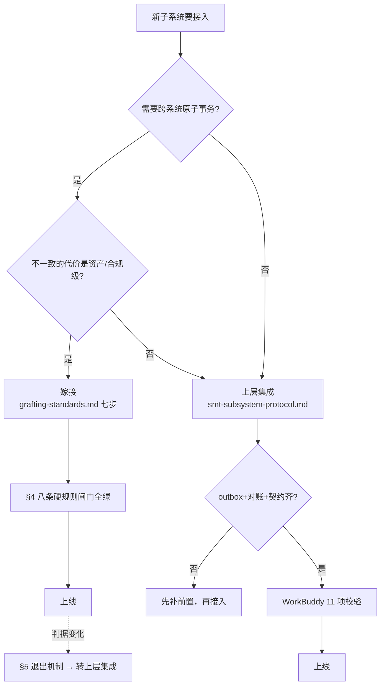

# 嫁接裁决标准（Graft-vs-Integrate Decision Standard）
> 文档路径：`docs/integration/grafting-protocol.md`
> 版本 1.0 · 2026-11-21 · 起草：opencode
> 定位：回答"一个子系统该**嫁接进主仓**还是**上层集成**"。**怎么嫁接**见 `docs/grafting-standards.md`（七步流程，本文不重复）；**怎么上层集成**见 `smt-subsystem-protocol.md`。
> ⚠ 本标准修订 `docs/grafting-standards.md` §13 的旧定调（"所有外部 App 必须吸收进枢纽"）→ 新政策：**共享事务才嫁接，其余上层集成**。§13 的枢纽地基（`integration_app`、健康视图、hub 管理界面）继续有效，两类路径都登记。

---

## 1. 一句话裁决规则

> **两个域之间需要跨系统原子事务吗？**
> **需要 → 嫁接；不需要 → 上层集成。**

"跨系统原子事务"= 一次业务操作必须同时改两个域的数据，且要么全成功、要么全不算（数据库事务级别的保证）。

## 2. 裁决细则（主规则不够时逐条过）

| # | 判据 | 倾向嫁接 | 倾向上层集成 |
|---|---|---|---|
| 1 | 原子事务 | 两域数据在同一事务里变更（如 IQC 写入→批次状态→库存可见） | 各自独立变更，容忍秒级延迟 |
| 2 | 一致性故障的代价 | 不一致 = 资产错误/合规问题 | 不一致可由对账兜底 |
| 3 | 写权威 | SMT 是该数据的唯一写入方 | 源系统保留写入权威，SMT 只读镜像 |
| 4 | 交互频率 | 每次工位操作都发生 | 批量/低频（分钟级即可） |
| 5 | 演进节奏 | 与 SMT 核心同版本发布 | 独立发布、独立停机窗口 |
| 6 | 团队归属 | 同一团队同一仓库 | 不同团队/供应商 |

**规则**：判据 1 或 2 命中"倾向嫁接"→ 嫁接；全部命中"倾向上层集成"→ 集成；介于中间 → 默认**上层集成**（集成的错误可以用对账修，嫁接的错误会把主仓拖烂），要嫁接必须给出判据 1 或 2 的具体场景并写入契约。

## 3. 本仓库现状映射（2026-11-21 裁定）

| 系统 | 路径 | 依据 |
|---|---|---|
| WMS 核心（库存/批次/IQC/收发存） | **嫁接，不迁** | 与 MES 共事务；holdout S3 验证的原子链 |
| MES 核心（工位/物料消耗/在制/工单） | **嫁接，不迁** | 写路径与 WMS 交织 |
| `mesrj/itf/*`（itf-routes、wmsmo-routes、wms-issue、wms-mo、param-store） | **上层集成（待外移）** | 已是核心内的适配器；无跨域原子事务；静态红来源 |
| OA（公告/考勤/文档/审批/日历/薪资） | **上层集成（分批外移）** | 域不共享事务；outbox 可用（权威表在 `oa.flow_webhook_outbox`，OA 池 search_path 解析；public 副本由 343/346 对齐）；SSO 留中心 JWT |
| AGV | **上层集成** | 状态遥测，秒级容迟 |
| 外部 ERP | **上层集成** | 主数据源，SMT 只读 |
| supplier-portal | 已是独立服务（:8098） | 维持现状 |

## 4. 嫁接合并的硬规则（在 §1 七步之上，逐条可机检）

嫁接 = 把外部代码合并进主仓。以下每条都对应一个已存在的闸门，**合并 PR 必须全绿**：

| # | 规则 | 为什么（都真实踩过） | 闸门 |
|---|---|---|---|
| 1 | 挂载点 = 原代码块所在行，不许挪 | 挂载点变 = 中间件顺序变；有效鉴权门禁之上的路由会 401/漏守卫 | `check:auth-order`（stranded=0 是底线） |
| 2 | 新 `/api/*` 路由一律挂 `api` router，不写 app 级 | `api` router 挂在 app 级之前，app 级同名路由的守卫永远不执行（10 个既有案例） | `check:route-shadowing`（dead_guards 不增） |
| 3 | 拆块时依赖闭包用 tsc 报错清单，不手维护；`server.js` 不在任何类型程序里 | 传进 register 函数的不存在标识符在 `app.listen` 前就 ReferenceError，`node --check` 查不出来 | `check:register-deps` + 启动后实调一条已移动路径 |
| 4 | 路由总数不许缩 | 拆分丢路由是静默事故 | `check:route-census`（total 只增不减） |
| 5 | 迁移 append-only，取号先 `ls` | 双通道号段冲突（311 已撞过一次） | `check:migrations` |
| 6 | 无硬删除；主数据三语 `name_zh/en/vi` | 仓库数据规矩 | code review |
| 7 | 动共享文件先锁（`.factory/locks/CLAIM-*`），server.js 只加不改 | 多 agent 并行 | 流程 |
| 8 | 契约先行：路径/信封/错误码/权限键先提案 | 后改契约 = 两边都改 | §1 第 2 步 |

## 5. 合并后的退出机制（un-graft）

嫁接不是终身监禁。当 §2 判据随演进变化（比如某域不再需要跨域原子事务），按以下顺序退出到上层集成：

1. **前置条件**：outbox 可用（权威表 `oa.flow_webhook_outbox`；接入前先 `select table_schema from information_schema.tables where table_name='flow_webhook_outbox'` 确认，勿假设 public）+ 该域对账跑通且零差异连续 2 周
2. 写该域的契约文件（`contracts/<subsystem>.md`，五必备小节）
3. 按集成协议搭增量拉取 + 指令下发，双跑期 ≥2 周（镜像与主数据每日对账）
4. 切读：消费方改读镜像 → 观察一周 → 停写主库表 → 代码出仓
5. 每一步都可独立回滚；`integration_app` 里该行 `direction`/`status` 同步更新

## 6. 两条路径对比（给决策者一页看懂）

| 维度 | 嫁接（合并进主仓） | 上层集成（独立部署 + HTTP） |
|---|---|---|
| 数据 | 同库同事务 | 源系统主库 + SMT 只读镜像（`ext_*`） |
| 一致性 | 事务保证 | 最终一致 + 对账告警 |
| 失败半径 | 一处崩全崩 | 域级熔断，互不拖累 |
| 复杂度去向 | 堆进主仓（server.js 已 4.3 万行） | 收敛到适配器 + 契约 + outbox |
| 前置条件 | 无（但闸门必须全绿） | outbox + 对账 + 契约三者齐备 |
| 适用 | 判据 1/2 命中 | 默认 |

## 7. 流程图

