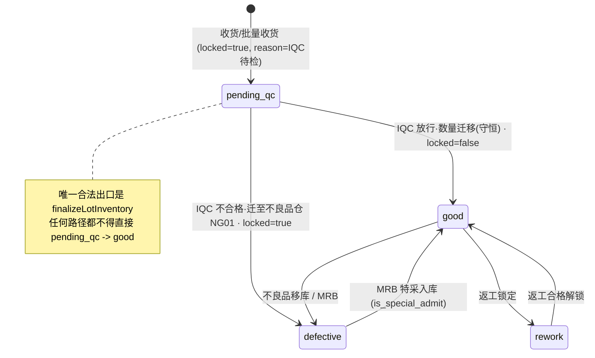
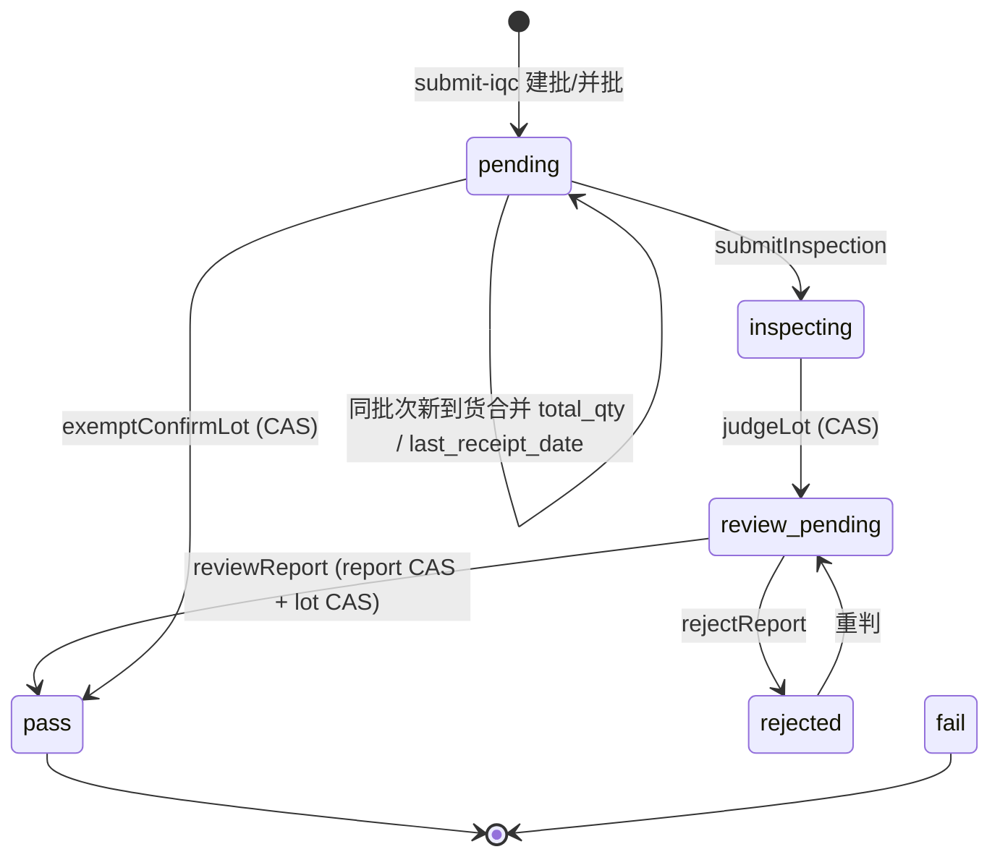

# F-11 系统设计：同批次再到货的 IQC 隔离 + F-10 唯一索引仲裁冲突

> 角色：架构师（高见远）　版本：v1.0（2026-10-17）　状态：**设计待评审，未改任何代码**
> 代码基线：`D:\WMS免安装版本` @ 当前工作区（已含 F-01 修复）
> 关联缺陷：F-01（已修，P0）、F-10（P1，本设计一并根治）

---

## 0. 结论摘要（TL;DR）

1. **F-01 的语义缺陷成立**：唯一索引 `(material_id, location_id, batch_no, stock_status)` 不含"待检"维度，`ON CONFLICT DO UPDATE` 只能把新到货累加进**已放行**行，`locked` 不被覆盖 → 新货未经检验即可领用。
2. **"把 `locked` 加进唯一索引"必须否决**（team-lead 的判断成立，已用实验证明：放行动作本身撞 23505），而且更根本的问题是把「锁状态变更」变成「唯一键变更」，全系统 12+ 处 lock/unlock 写入点都要改写。
3. **F-10 根因已定位并实证**：库中的 `idx_iqc_lot_merge_key` 是**无条件 UNIQUE**，而 `schema.ts:956` 已改成非唯一 `index()`——DDL 与代码漂移。`submitIqc` 的 `ON CONFLICT (...) WHERE <active谓词> DO NOTHING` 在"两个都可匹配的索引"下，PostgreSQL 选中的是**无条件唯一索引**作为仲裁索引（实测插入 0 行），于是新批次被静默吞掉 → 重查 active 批次为空 → `ConflictException` 409 整批回滚。
4. **推荐候选 A′**：待检库存改用**独立 `stock_status='pending_qc'`**，放行时把"报检数量"从待检行**按数量原子迁移**到 `good` 行（`DELETE…RETURNING → INSERT…ON CONFLICT DO UPDATE`），**inventory 唯一索引完全不动**；同时把 `iqc_lot` 的 active 去重键从 5 列收成 4 列（去掉 `receipt_date`）并改 `NULLS NOT DISTINCT`，实现"同物理批次只允许一个进行中检验单号"。
5. **放行必须做数量守恒**（不是整行搬迁）：`迁移量 == iqc_lot.total_qty`，多余部分留在 `pending_qc` 行等下次报检。这是"并发放行 vs 新到货"唯一能保证"新货绝不绕过检验"的写法（已用两连接交错实验验证两种交错顺序）。
6. 迁移**不需要停服**：全部幂等 DDL，表只有 63/26 行，重启（`start.bat` 会跑 `init-db.ts`）即为迁移窗口。

---

## 1. 现状核验（你给的三条判断，逐条验证）

### 1.1 判断①「唯一索引不含 locked → 只能合并进已放行行」— ✅ 成立

`receipt.service.ts:355-381`（`scanReceipt`）与 `586-613`（`batchReceipt`）：

```ts
.insert(inventory).values({ …, stockStatus: 'good', locked: true, lockReason: 'IQC待检' })
.onConflictDoUpdate({
  target: [materialId, locationId, batchNo, stockStatus],
  set: { quantity: sql`${inventory.quantity} + ${qty}::numeric` },  // ← 只累加数量
});
```

冲突时 `set` 不含 `locked/lock_reason`，所以：
* 命中"待检行" → 仍在待检，正确；
* 命中"已放行行"（`locked=false`）→ **数量增加但 `locked` 仍为 false** → 发料（`workorder.service.ts:1763/1807/…` 全部 `stock_status='good' AND locked=false`）立刻可领。**质量口子成立**。

### 1.2 判断②「locked 进唯一键 → 放行自相矛盾」— ✅ 成立（并附实验）

已实测（`_qa/_arch_q2.cjs` EXP2，临时表模拟）：

```
唯一索引 (m,l,b,status,locked)；已存在 released(locked=false,100) 与 pending(locked=true,50)
放行执行 UPDATE ... SET locked=false WHERE ... AND locked=true
→ 23505 duplicate key value violates unique constraint "t_lock_key"
```

放行原实现（`iqc.service.ts:806-820`）就是**原地 UPDATE `locked=false`**，所以"locked 进唯一键 + 现放行写法"= 必撞键、放行 500。

⚠️ 但要把话说准：撞键**不是**这条路的唯一问题，也不是"数学上不可能"。若把放行改写成"合并进 good 行 + 删除待检行"（本设计推荐的写法），locked 进唯一键也能不撞。**否决它的真正理由是**：

* `locked` 在系统里承载了 6 种语义（IQC待检 / 超期复检中 / 退货单 / 返工单 / IQC检验不合格 / 手工锁定），`lock/unlock` 写入点 12+ 处（见 §3.4）。键里带 `locked` ⇒ **每次加锁/解锁都可能与同键另一行冲突**（例：`inventory.service.ts:1380` 手工锁定、`591-599` 效期延期解锁、`rework.service.ts:264` 返工解锁）；
* 它无法表达"待检"这一**业务状态**（锁定 ≠ 待检；超期预警只锁不验）；
* 结论：**成本与风险远大于收益，且把状态机耦合进键结构**。否决。

### 1.3 判断③「iqc_lot 双索引 → 新批次被静默抑制 → 409」— ✅ 成立，根因与位置如下

数据库实况（`pg_indexes` 查询）：

```
idx_iqc_lot_merge_key   :: CREATE UNIQUE INDEX idx_iqc_lot_merge_key
                           ON public.iqc_lot USING btree (receipt_date, supplier_id, material_id, production_date, batch_no)
iqc_lot_active_dedup_uniq :: CREATE UNIQUE INDEX ... (receipt_date, supplier_id, material_id, production_date, batch_no)
                           WHERE status IN ('pending','inspecting','review_pending','rejected') AND batch_no IS NOT NULL AND receipt_date IS NOT NULL
```

而 `schema.ts:956` 写的是非唯一 `index("idx_iqc_lot_merge_key")` —— **schema 与库漂移**（某次把唯一索引改成普通索引时只改了 schema.ts，历史库上的 UNIQUE 索引从未被 DROP；`init-db.ts` 对非空库跳过 `drizzle-kit push`，因此永远不会自愈）。

失效链路（`receipt.service.ts`）：

1. `submitIqc` 查"进行中批次"（`865-890`，`.for('update')`）→ 无（同键只有终态 `pass/fail` 批次）；
2. 走新建分支 `929-961`，`ON CONFLICT (receipt_date,supplier_id,material_id,production_date,batch_no) WHERE <active 谓词> DO NOTHING`；
3. **仲裁索引推断**：PG 在"列匹配 + 谓词被 WHERE 蕴含"的索引里挑仲裁者，无条件的 UNIQUE 索引同样匹配。实测（`_qa/_arch_q2.cjs` EXP1）**插入返回 0 行** → 命中无条件唯一索引 → `DO NOTHING` 生效；
4. `inserted.length === 0` → 回落到"并发抢占"分支 `968-998` 重查 **active** 批次 → 查不到（终态批次不在 active 集合）→ `984-986` 抛 `ConflictException('IQC 批次正在被其他请求创建…')` → 事务回滚，**收货单/库存/批次全部回滚，接口 409**。

实验证据：

```
EXP1 插入 pending 到已存在 pass 的同键 → insertedRows = 0     ← 静默抑制
EXP1 表内实际行 = [{a:1,b:1,s:'pass'}]
```

补充风险：**仲裁索引的选择在"两个索引都匹配"时是不稳定的**（依赖索引列举顺序/版本），所以 F-10 甚至可能表现为"偶发"。这也是必须把无条件唯一索引删掉的第二个理由——不能依赖 PG 的仲裁顺序。

---

## 2. 候选方案

### 2.1 候选 A′（**推荐**）：独立 `stock_status='pending_qc'` + 放行按数量迁移 + 检验批次按键唯一

**核心模型**

```
inventory 一行 = (物料, 库位, 批次, 库存状态) 的一个"桶"
库存状态值域: good(良品·可判定) / pending_qc(待检) / defective(不良) / rework(返工)
唯一索引不变: (material_id, location_id, batch_no, stock_status)
⇒ 同 (物料,库位,批次) 天然允许「good 行 + pending_qc 行」共存，DB 层保证，不靠应用判断
```

* `pending_qc` 行同时保留 `locked=true, lock_reason='IQC待检'`（冗余标记，供现有 UI/列表零改动显示"锁定中"）；
* **可领用口径不变**：`stock_status='good' AND locked=false` —— `pending_qc` 被状态维度天然排除，**发料/领料代码一行都不用改**；
* **检验批次（iqc_lot）绑定的是"批次"而不是"库存行"**：`(supplier_id, material_id, production_date, batch_no)` 同时只允许一个 active 批次 ⇒ 用户要的"合并成一个检验单号"由 DB 部分唯一索引兜底。

**唯一索引最终定义（inventory，不变）**

```sql
-- 已存在，本方案不改：
CREATE UNIQUE INDEX inventory_material_id_location_id_batch_no_stock_status_key
  ON public.inventory USING btree (material_id, location_id, batch_no, stock_status);
-- 新增（本方案要求，消除 NULL 逃逸唯一索引的隐患）：
ALTER TABLE public.inventory ALTER COLUMN batch_no SET DEFAULT '';
UPDATE public.inventory SET batch_no='' WHERE batch_no IS NULL;
ALTER TABLE public.inventory ALTER COLUMN batch_no SET NOT NULL;
```

> 为什么必须 `batch_no NOT NULL`：PG 唯一索引里 `NULL` 互不相等，`ON CONFLICT` 永不命中 → 会产生重复行 + 重复到货不合并。现有代码已在 3 处手工兜底 `batchNo = xxx || ''`，把它变成 DB 约束才是铁律要求的"DB 兜底"。

**放行动作如何不撞键（逐步推演）**

放行 = 把 `lot.total_qty` 的**数量**从 `pending_qc` 桶迁到 `good` 桶。**全程不 UPDATE 键列**（`stock_status` 只在 INSERT 时写），所以不存在"改键撞键"：

```
步骤 0  CAS: UPDATE iqc_lot SET status='pass'
             WHERE id=:lot AND status IN ('pending','inspecting','review_pending','rejected')
             -- 影响 0 行 ⇒ 已放行/已判不合格 ⇒ 直接 409，杜绝重复放行
步骤 1  锁定源行: SELECT ... FROM inventory
             WHERE material_id=:m AND batch_no=:physical AND stock_status='pending_qc'
             ORDER BY location_id, id FOR UPDATE
步骤 2  守恒校验: SUM(quantity) >= lot.total_qty  ? 否则 409「待检库存不足，禁止放行」
步骤 3  逐行 take = LEAST(row.qty, remaining)
            remaining -= take
            若 take == row.qty  → DELETE FROM inventory WHERE id=row.id
            若 take <  row.qty  → UPDATE inventory SET quantity = row.qty - take WHERE id=row.id
                                  （行仍为 pending_qc/locked=true ⇒ 留给下一张检验单）
步骤 4  目标合并（每个 take 一次，原子）:
            INSERT INTO inventory(..., stock_status='good', locked=false, lock_reason=NULL, qty=take)
            ON CONFLICT (material_id, location_id, batch_no, stock_status)
            DO UPDATE SET quantity = inventory.quantity + EXCLUDED.quantity     -- 不覆盖 locked/lock_reason
步骤 5  收货单状态 → 'iqc_pass'（按 iqc_lot_receipt 关联，范围精确）
```

**中间态是否可能撞键**：不会。`pending_qc` 与 `good` 是**不同的键值**，步骤 4 的 INSERT 只在 `good` 键上竞争（`ON CONFLICT` 原子累加）；步骤 3 的 DELETE 释放 `pending_qc` 键。两条语句都在同一事务内，唯一索引锁是行级/键级，不存在"同键两行"的中间态。

**单语句压测已通过**（`_qa/_arch_q2.cjs` EXP3，临时表等价结构）：

```
放行合并结果行 = [{"id":1,"qty":"150"}]                # 100 released + 50 pending → 150
合并后全表      = [{m:1,l:1,b:'B1',s:'good',qty:150}]   # pending 行消失，不共存
重复放行影响行数 = 0                                    # 幂等
```

**为什么必须"按数量"而不是"整行搬迁"**：见 §5.2 的两种交错。若整行搬迁，`新到货先提交、放行后执行` 这一顺序会把新货一起放行（绕过检验）。按 `lot.total_qty` 守恒迁移后，多余部分永远留在 `pending_qc`。

**`receipt_date` 从检验批次键中去掉的理由**：库存桶键是 `(物料,库位,批次)`，与 `receipt_date` 无关。若检验批次键仍含 `receipt_date`，同批次隔日到货会产生**两个 active 批次共享同一个待检桶**：报检时"谁绑定这个桶"不确定、`total_qty` 与桶数量对不上、放行互相偷量。用户原话是"**合并成一个检验单号**"，所以键必须与库存桶对齐。`receipt_date` 保留为"首次收货日"，另加 `last_receipt_date`（最近到货日）供待检清单日期筛选与展示。

### 2.2 候选 B：新增独立维度列（`qc_state` / `qc_lot_id`）并纳入唯一索引

**DDL**

```sql
ALTER TABLE inventory ADD COLUMN qc_lot_id uuid;                       -- 仅待检行有值
CREATE UNIQUE INDEX uniq_inv_released ON inventory(material_id, location_id, batch_no)
  WHERE stock_status='good' AND qc_lot_id IS NULL;                     -- 已放行：一桶一行
CREATE UNIQUE INDEX uniq_inv_pending  ON inventory(qc_lot_id, material_id, location_id, batch_no)
  WHERE stock_status='pending_qc';                                     -- 待检：一个检验批次一桶
DROP INDEX inventory_material_id_location_id_batch_no_stock_status_key; -- 必须删
```

* **放行不撞键的方式**：把该 `qc_lot_id` 的行 `UPDATE stock_status='good', qc_lot_id=NULL`（改键）——**若同键已有 released 行则撞 `uniq_inv_released`**，所以仍需"合并+删除"写法；复杂度与 A′ 相同。
* **优势**：能做到"同一物理批次多个待检批次并存"（不同到货日各自独立检验单号）。**但这不是用户要的**（用户要合并成一个单号）。
* **代价（否决理由）**：
  1. 现有 4 处 `ON CONFLICT (…4列…)` 全部要改成**带谓词的部分索引冲突目标**（`receipt.service.ts:377/606`、`production-return-receipt.service.ts:422`、`inventory.service.ts:914/1167/1739`、`mrb.service.ts:1404`），每处谓词必须与索引谓词**字面等价**，写错就退化成 23505；
  2. 所有"按 (物料,库位,批次,状态) 取一条"的查询要追加 `qc_lot_id IS NULL`，否则 `.limit(1)` 会随机取到待检行（示例：`inventory.service.ts:682-693 verifySourceLocation`、`stock-take.service.ts:686-696`）。检索到 **30+ 处**，一处漏改就是"偶发库存不足/误移库"；
  3. 迁移面大（新列 + 2 个部分索引 + 删旧索引 + 冲突目标改写），不适合一个迭代内交付。

### 2.3 候选 C：库存行内子状态（`pending_qc_qty` 数量列，键完全不动）

```sql
ALTER TABLE inventory ADD COLUMN pending_qc_qty numeric NOT NULL DEFAULT 0;
-- 可领用 = quantity - pending_qc_qty；放行 = quantity 不动, pending_qc_qty -= take
```

* 优点：零索引变更、零并发键冲突、单个 UPDATE 即可放行（`pending_qc_qty = GREATEST(pending_qc_qty - :qty, 0)`）。
* 致命缺点：**"可领用"不再由状态维度表达**，必须改所有发料/领料/替代料/可用库存查询（`workorder.service.ts` 11 处、`substitution.service.ts:432/475`、`inventory.service.ts:616` …）把 `quantity` 换成 `quantity - pending_qc_qty`；漏一处就是"发了待检货"。此外库存列表里同一行脏合了两种品质状态，用户看不到"隔离"，与需求"与已经检验放行的隔离"直接冲突。**否决。**

### 2.4 被否决：把 `locked` 加进唯一索引（详见 §1.2）

### 2.5 方案对比

| 维度 | A′（推荐） | B | C |
|---|---|---|---|
| inventory 唯一索引变更 | **无** | 需删旧建 2 个部分索引 | 无 |
| 放行撞键风险 | 无（不同键值） | 有（需合并+删除） | 无 |
| 发料/领料查询改动 | **0 处** | 0 处（但需防随机取行） | 10+ 处必改 |
| 需要改的 `ON CONFLICT` 冲突目标 | 0 处 | 8 处 | 0 处 |
| 同批次多次到货合并成一个检验单号 | ✅（键收成 4 列） | ✅（但需改 submit 逻辑） | ✅ |
| 多待检批次并存 | ❌（不需要） | ✅ | ✅ |
| 盘点/看板可见性 | 需把 `pending_qc` 纳入（4 处） | 同理 | 天生可见 |
| 迁移成本 / 停服 | 极低 / 否 | 中高 / 建议短窗口 | 低 / 否 |
| 一个迭代可交付 | ✅ | ❌ | 语义不达标 |

---

## 3. 推荐方案细节

### 3.1 状态机

**inventory.stock_status**



**iqc_lot.status**（active 集合 `pending/inspecting/review_pending/rejected` 由部分唯一索引兜底）



### 3.2 放行/不合格迁移（`finalizeLotInventory` 双分支）

放行与不合格共用同一套"数量守恒迁移"，区别只是目标桶：

| 分支 | 判定条件 | 动作 |
|---|---|---|
| **L1 来料待检** | 存在 `stock_status='pending_qc'` 的该批次行 | 按 §2.1 五步迁移；目标 `good`（pass）或 `NG01/defective`（fail） |
| **L2 超期复检** | 无 `pending_qc` 行（库存本来就在 `good`，只是被锁） | pass：`UPDATE inventory SET locked=false,lock_reason=NULL WHERE material,batch,stock_status='good',locked=true AND lock_reason='超期复检中'`；fail：按同条件迁到 NG01（沿用现有逻辑但**把范围从 `(material,supplier,batch)` 收紧为 `lock_reason='超期复检中'`） |

> 现状 `iqc.service.ts:812-820 / 839-847` 的范围是 `(material_id, supplier_id, batch_no, stock_status='good', locked=true)`：**跨库位、跨批次的过度解锁**。库里已有 6 组"同 (物料,供应商,批次) 在两个库位各一条锁定行"（实测），只要其中一条属于别的收货批次，就会把别人的货一起解锁。L2 分支按 `lock_reason` 收紧即修掉这个问题。

### 3.3 影响面清单（逐项 file:line）

#### A. 必须修改（写入侧）

| 文件:行 | 现状 | 改成 |
|---|---|---|
| `receipt.service.ts:355-381` | upsert `stockStatus:'good'` + `locked:true` | `stockStatus:'pending_qc'`（键 `(m,l,b,'pending_qc')`，天然与已放行行隔离） |
| `receipt.service.ts:586-613` | 同上（批量收货） | 同上 |
| `receipt.service.ts:865-890` | 查 active 批次含 `receipt_date` | 去掉 `receipt_date` 条件（4 列 + active 状态 + `FOR UPDATE`） |
| `receipt.service.ts:929-961` | `ON CONFLICT(5列) WHERE active` | `ON CONFLICT(supplier_id,material_id,production_date,batch_no) WHERE status IN (active)`，谓词与索引谓词字面一致 |
| `receipt.service.ts:912-919 / 993-997` | 并批只更新 `totalQty/locationCodes/boxCount` | 追加 `lastReceiptDate = GREATEST(last_receipt_date, :newDate)`；`receiptDate` 仅在新建时写（=组内最早收货日） |
| `iqc.service.ts:799-896` | 解锁/迁不良：整行、按 material+supplier+batch | **重写为 L1 数量守恒迁移 + L2 按 lock_reason 收紧** |
| `iqc.service.ts:1758-1769` | lot 更新无状态守卫（注释说加了，实际 `.where(eq(id))`） | 加 `AND status IN (active)`，影响 0 行 → 409 |
| `iqc.service.ts:1328-1348` | `judgeLot` 无条件写 `review_pending` | 加 `AND status IN ('pending','inspecting','rejected')` + 影响行数校验 |
| `iqc.service.ts:1397-1412` | `exemptConfirmLot` 无 CAS（前置校验在事务外） | 事务内 `UPDATE ... WHERE id AND status IN (active)` + 影响行数校验 |
| `iqc.service.ts:312-327` | 超期推送直接 `insert(iqcLot)` | 追加 `onConflictDoNothing({target: 4列, where: active})`，0 行则跳过（不再 23505/500） |
| `inventory.service.ts:468-497` | 超期报检直接 `insert(iqcLot)` | 同上（幂等；重复推送跳过） |
| `inventory.service.ts:482-493` | 锁定库存 `locked=true, '超期复检中'` | 若该行已是 `pending_qc` 则不覆盖 lock_reason（`WHERE stock_status='good'`） |
| `inventory.service.ts:1400-1425` | 手工解锁任意行 | 加守卫：`stock_status='pending_qc'` 拒绝解锁（提示"待检库存不可解锁，请走 IQC 流程"） |
| `inventory.service.ts:591-599` | 效期延期后解锁（按 lock_reason 判断，OK） | 无改动，仅确认 `pending_qc` 不参与 |
| `schema.ts:716` | `batchNo` 可空 | `varchar(...).notNull().default('')` |
| `schema.ts:914-973` | `iqcLot` 无 `last_receipt_date`；无 active 唯一索引声明 | 加 `lastReceiptDate: date('last_receipt_date')`；加 `uniqueIndex('iqc_lot_active_dedup_uniq').on(supplierId,materialId,productionDate,batchNo).where(sql\`status in (...)\`)`（NULLS NOT DISTINCT 仅在 SQL 脚本中，注释说明） |
| `server/scripts/init-db.ts:54-63` | 补充脚本清单 | 追加 `'fix-iqc-pending-isolation-20261017.sql'`（放在 `fix-iqc-lot-dedup-20261008.sql` 之后、`provision-deploy-config` 之前） |

#### B. 只读口径：**必须把 `pending_qc` 纳入**（否则账面少货）

| 文件:行 | 用途 | 建议 |
|---|---|---|
| `dashboard.service.ts:205-210` | 库存总数量 | `inArray(stockStatus,['good','pending_qc'])`（物理在库口径）；另可加 `pendingQcQty` 指标（P2） |
| `dashboard.service.ts:118-126` | 效期预警/超期统计 | 同上增至两种状态 |
| `inventory.service.ts:176-182` | 效期预警列表 | 同上 |
| `stock-take.service.ts:25-30` | `SCOPE_STATUS` | `all: ['good','pending_qc','defective']`、`good: ['good','pending_qc']`（账面完整）；盘点**不改账**（已确认盘点只写快照/差异，不写 inventory），故不破坏数量守恒 |
| `inventory.service.ts:76` + 前端筛选 | 库存查询 | `pending_qc` 作为可选筛选项（前后端都已支持透传，只需前端下拉+文案） |
| `client/src/pages/inventory/InventoryQuery.tsx:77-110,174-180` | 状态徽标/筛选 | 新增 `pending_qc` → 「待检（IQC）」徽标 + 下拉项 |
| `client/src/i18n/locales/{zh,en,vi}.ts` | 文案 | 新增 `inventory.statusPendingQc` 三语文案 |

#### C. **明确不改**（并说明为什么安全）

| 文件:行 | 口径 | 为什么不用改 |
|---|---|---|
| `workorder.service.ts:1763,1807,1824,2072,2240,2288,2305,2339,2617,2661,2678` | 领料可用量 `good AND locked=false` | `pending_qc` 不属于 `good` → 天然排除 |
| `inventory.service.ts:616` | `getInventorySummary` 可用库存汇总 | 同上 |
| `material/substitution.service.ts:432,475` | 替代料可用量 | 同上 |
| `inventory.service.ts:867 / 1087` | 移库/调拨源 `good` | 待检货**不允许移库**（本迭代显式约束，见 §9 风险） |
| `inventory.service.ts:682-693` | 移库源校验 `good` | 同上（失败提示改为"待检库存不可移库"更友好，可选） |
| `mrb.service.ts:1063,1076-1082` | MRB 候选 `defective` + `good&locked` | 不合格批次此时已在 `defective`；`pending_qc` 不参与 MRB |
| `mrb.service.ts:1350-1411` | `upsertInventoryRow` | 只写 `good/defective/rework`，键不变 |
| `defective-move.service.ts:120-180` | 不良品移库 | 只碰 `good/defective` |
| `production-return-receipt.service.ts:395-428` | 产线退料入库 | `mapStockStatus(category)` 只产 `good/defective`，不走 IQC |
| `iqc.service.ts:251` | `syncExpiryStockToPending` 候选 | **保持只取 `good`**（否则会给待检库存重复推 EXP 批次）；放行后若已超期，下次打开清单会补推 |
| `rework.service.ts:227-294` | 返工按 `lock_reason=返工单号` 定位 | 与待检无关 |

### 3.4 `lock/unlock` 写入点全表（用于支撑 §1.2 的否决理由）

```
receipt.service.ts:373,598                        IQC待检（本方案改为 pending_qc，仍保留 locked=true）
iqc.service.ts:333,482-493                        超期复检中
iqc.service.ts:809-811, 872-879                   放行解锁 / 不合格锁定（本方案重写）
inventory.service.ts:1380,1421                    手工锁定 / 解锁（本方案加 pending_qc 守卫）
inventory.service.ts:591-599                      效期延期解锁
defective-move.service.ts:166-167                 IQC检验不合格
rework.service.ts:264,293                         返工解锁/锁定
supplier-return.service.ts:360-361                退货锁定/取消解锁
mrb.service.ts:1379,1399                          MRB 处置目标行
```

---

## 4. `iqc_lot` 索引处置

### 4.1 `idx_iqc_lot_merge_key` 必须删掉唯一性（保留同名普通索引）

* **是 F-10 的直接根因**（§1.3），必须处置：`DROP INDEX` + 以非唯一索引重建（`schema.ts:956` 已经是普通 `index()`，重建后与代码一致）。
* 两处都要处置：`schema.ts:956` 已是普通索引（无需再改，但要在注释里写明"曾因历史库残留 UNIQUE 导致 F-10"）；**SQL 脚本里负责 DROP 掉库上的 UNIQUE 版本**（幂等：判 `indexdef LIKE 'CREATE UNIQUE INDEX%'` 才 DROP）。

### 4.2 只保留 `iqc_lot_active_dedup_uniq` 是否够？——**不够**，当前定义有 3 个洞

```sql
-- 现状
CREATE UNIQUE INDEX iqc_lot_active_dedup_uniq ON iqc_lot(receipt_date, supplier_id, material_id, production_date, batch_no)
  WHERE status IN (...) AND batch_no IS NOT NULL AND receipt_date IS NOT NULL;
```

| 洞 | 后果 | 修法 |
|---|---|---|
| ① 含 `receipt_date` | 隔日到货产生第二个 active 批次 ⇒ 两个批次共享一个待检桶，放行互相偷量 | 键去掉 `receipt_date`（与库存桶对齐，满足"合并成一个检验单号"） |
| ② NULL 逃生 | `supplier_id` 或 `production_date` 为 NULL 时（`NULL` 在唯一索引里互不相等）→ 同键可建多条 active 批次，并发下虚增 | `NULLS NOT DISTINCT`（PG 15+，本库 PG 18 支持） |
| ③ 谓词含 `batch_no IS NOT NULL` | 无批次号的报检（`batch_no` 为 NULL）完全不受约束 | 谓词只保留 `status IN (active)`；`NULLS NOT DISTINCT` 已能约束 NULL |

**最终定义**

```sql
CREATE UNIQUE INDEX iqc_lot_active_dedup_uniq
  ON public.iqc_lot USING btree (supplier_id, material_id, production_date, batch_no)
  NULLS NOT DISTINCT
  WHERE (status IN ('pending','inspecting','review_pending','rejected'));
```

**迁移**：先按新键合并历史重复 active 批次（当前库里 0 组重复，实测），再 DROP/CREATE。

**⚠️ 实现注意**：`submitIqc` 里 `onConflictDoNothing` 的 `target` 与 `where` 必须与索引**完全对应**（列顺序不限，但谓词必须字面等价），否则退化为"仲裁索引推断失败 → 23505"。删除无条件唯一索引后，唯一可匹配的仲裁索引就是这一个，行为确定。上线前请用 `EXPLAIN`/重复提交做一次冒烟。

---

## 5. 并发不变量（本项目历史缺陷高发区）

### 5.1 必须成立的不变量

| ID | 不变量 | 强制手段（DB 优先） |
|---|---|---|
| **INV-1** | 每个 `(material_id, location_id, batch_no, stock_status)` 至多 1 行；`batch_no` 非空 | `inventory_material_id_location_id_batch_no_stock_status_key` + `batch_no NOT NULL` |
| **INV-2** | 每个 `(supplier_id, material_id, production_date, batch_no)` 至多 1 条 active 检验批次 | `iqc_lot_active_dedup_uniq`（4 列 + `NULLS NOT DISTINCT`） |
| **INV-3** | **可领用守恒**：可领用量 = `Σ qty (good ∧ locked=false)`；`pending_qc` 永远不可领用 | 状态维度（DB）——不依赖 `locked` 应用判断 |
| **INV-4** | **检验数量守恒**：每张检验单迁移量 **恒等于** `iqc_lot.total_qty`；迁移前校验 `Σ pending_qty ≥ total_qty` | 放行事务内 `FOR UPDATE` + 守恒校验（DB 行锁 + 应用断言） |
| **INV-5** | **待检总量守恒（账实）**：`Σ pending_qc(该批次) + Σ good(该批次) + Σ defective(该批次) + Σ rework(该批次) = Σ 累计收货 − Σ 其他出库` | INV-1/INV-4 + 所有写入点走 upsert；由 QA 用例断言 |
| **INV-6** | **无绕过**：不存在能让 `pending_qc` 变成 `good` 的路径，除 `finalizeLotInventory`（pass 且 CAS 成功） | 代码审查 + 单测断言（直接 `UPDATE stock_status` 的写法禁止出现） |
| **INV-7** | **状态机 CAS**：`iqc_lot.status` 只前进不回退；审批幂等由 `iqc_report.review_status` CAS | 两处 CAS + 影响行数校验 |
| **INV-8** | **并批不重复计量**：同一批收货单只归属一个检验批次（`iqc_lot_receipt` 唯一键），`total_qty` 只增一次 | `iqc_lot_receipt_lot_id_receipt_id_key` + `receipt.status` 状态推进 + advisory lock |

### 5.2 三类并发场景

#### 场景 1：并发送货（同料 + 同库位 + 同批次，多箱）

* **不变量**：最终 `pending_qc` 桶 qty = Σ 各箱数量；只有 1 行；不出现 409/500。
* **机制**：单条 `INSERT … ON CONFLICT (4列) DO UPDATE SET quantity = inventory.quantity + EXCLUDED.quantity`。PG 的 `ON CONFLICT DO UPDATE` 在冲突键上持有行锁并重新读取当前值，天然无丢失更新。
* **会失败的模式**：把 `set` 写成 `quantity = ${旧值}`（读改写）→ 丢失更新；把 `batch_no` 写成 `NULL` → 唯一索引不匹配 → 重复行。两者现在都被规避（前者已是 F-01 修复，后者由 `NOT NULL` 兜底）。

#### 场景 2：并发「放行」与「新到货」（**最关键**）

两种交错都必须满足：**放行量恒为 `lot.total_qty`，新到货永远留在 `pending_qc`**。

**交错 A：放行先取走待检行（未提交），收货随后阻塞** — 已实测（EXP4）：

```
A: BEGIN; DELETE FROM inventory WHERE ... stock_status='pending_qc';  -- 持行锁，qty=50，未提交
B: INSERT ... ('pending_qc', 30) ON CONFLICT(...) DO UPDATE ...        -- 阻塞在 A 的行锁上
A: INSERT ('good', 50) ON CONFLICT DO UPDATE; COMMIT
B: 解除阻塞 → 冲突行已消失 → 走 INSERT 分支，落一条新的 pending_qc 行 30; COMMIT
结果: good=150(100+50), pending_qc=30   ✅ 新货独立待检
```

**交错 B：收货先提交，放行后执行**

```
B: pending_qc 桶 50 → 80（qc 行数量被累加）
A: 若"整行搬迁" → 80 全进 good ❌ 新货绕过检验
A: 若"按 lot.total_qty=50 数量迁移" → good 100+50=150, pending_qc 剩 30 ✅
```

**必须的机制**：
1. 放行事务内先 `SELECT … ORDER BY location_id, id FOR UPDATE` 锁住源行（排序防死锁）；
2. **迁移量 = `lot.total_qty`，不是行数量**（唯一能覆盖交错 B 的写法）；
3. 剩余部分**保留 `pending_qc` + `locked=true`**，其对应收货单仍是 `received` 未提交 → 下次 `submit-iqc` 自动建新批次重新检验（数量与 `total_qty` 一致，闭环）。

**会失败的模式**：`UPDATE inventory SET stock_status='good' WHERE ...`（整行搬家）；用 `iqc_lot.total_qty` 之外的量放行；把放行放在事务外。

#### 场景 3：并发 `submit-iqc` / 并发 `review`

* **submit-iqc**：
  1. 分组键 `(supplier,material,production_date,batch_no)` **排序后**逐个 `pg_advisory_xact_lock(hashtextextended(key,881001))`（现有 `791-799` 已实现，键不含 `receipt_date`，与新索引对齐）；
  2. 加锁后 `SELECT … WHERE receipt.status='received' AND iqc_lot_receipt.id IS NULL … FOR UPDATE OF receipt_order` 重读（现有 `804-832`）；
  3. `INSERT … ON CONFLICT(4列) WHERE active DO NOTHING` → 0 行则回读 active 批次并累加（现有 `968-998`，F-10 修好后就只剩"真并发"一种情况才会走到这里）；
  4. 收货单状态 `received → pending_iqc` + `iqc_lot_receipt` 唯一键兜底，保证同一收货单不会被两张批次重复计数。
  * 不变量：`createdLotCount ≤ 1`（同键并发只建一张）、`total_qty` 不虚增、无 409。
  * 会失败的模式：只靠 SELECT 判重不加锁；`ON CONFLICT` 谓词与索引不一致；保留无条件唯一索引（现状）。

* **review（审批）**：
  1. `iqc_report.review_status` CAS（现有 `1742-1755`）——抢到的那一个才继续；
  2. `iqc_lot` 更新加 `status IN (active)` 守卫（**新增**，现状缺失）；
  3. `finalizeLotInventory` 迁移（守恒校验会二次兜底：已被迁移过则 `Σ pending < total_qty`）；
  4. 欠料冲减在同一事务内（现有 `1778-1789`）。
  * 不变量：库存只迁移一次、欠料只冲减一次、`409` 而不是 `500`。
  * 会失败的模式：`exemptConfirmLot` 与 `reviewReport` 并发（两条放行路径，现状 `exemptConfirmLot` 无 CAS → **必须补**）。

### 5.3 死锁分析（锁获取顺序）

固定顺序：**iqc_lot 行 → inventory 源行（按 `location_id, id` 升序）→ inventory 目标行（good/defective）**。
冲突矩阵：收料只写 `pending_qc` 键（与放行的目标 `good` 键不同）；领料/移库只碰 `good`（且移库禁止 `pending_qc`）；MRB 只碰 `defective/locked good`。**没有环**。

---

## 6. 迁移方案

### 6.1 新脚本 `server/database/fix-iqc-pending-isolation-20261017.sql`

遵守项目约定：纯 ASCII 标识符、`IF NOT EXISTS`、可被 `init-db.ts` 每次启动安全重跑、可在单个 `sql.unsafe()` 里执行（含 `BEGIN/COMMIT`）。

```sql
-- ============================================================
-- F-11 (2026-10-17): IQC pending isolation + F-10 arbiter fix
-- Idempotent: safe to run on every startup via server/scripts/init-db.ts
-- ============================================================
BEGIN;

-- ---------- 1. drop stale UNCONDITIONAL unique index (F-10 root cause) ----------
DO $$
BEGIN
  IF EXISTS (
    SELECT 1 FROM pg_indexes
     WHERE schemaname='public' AND indexname='idx_iqc_lot_merge_key'
       AND indexdef LIKE 'CREATE UNIQUE INDEX%'
  ) THEN
    DROP INDEX public.idx_iqc_lot_merge_key;
    RAISE NOTICE 'F-11: dropped stale UNIQUE idx_iqc_lot_merge_key';
  END IF;
END $$;

-- keep it as a plain (non-unique) index, aligned with schema.ts
CREATE INDEX IF NOT EXISTS idx_iqc_lot_merge_key
  ON public.iqc_lot USING btree (receipt_date, supplier_id, material_id, production_date, batch_no);

-- ---------- 2. rebuild active-dedup unique index (4 cols, NULLS NOT DISTINCT) ----------
DO $$
DECLARE def text;
BEGIN
  SELECT indexdef INTO def FROM pg_indexes
   WHERE schemaname='public' AND indexname='iqc_lot_active_dedup_uniq';
  IF def IS NOT NULL AND (
        def NOT LIKE '%NULLS NOT DISTINCT%'
     OR def NOT LIKE '%(supplier_id, material_id, production_date, batch_no)%'
  ) THEN
    DROP INDEX public.iqc_lot_active_dedup_uniq;
    RAISE NOTICE 'F-11: dropped obsolete iqc_lot_active_dedup_uniq';
  END IF;
END $$;

-- 2.1 merge historical duplicate ACTIVE lots (keep earliest; repoint children first)
WITH ranked AS (
  SELECT id,
         first_value(id) OVER w AS keep_id,
         row_number()   OVER w AS rn
    FROM public.iqc_lot
   WHERE status IN ('pending','inspecting','review_pending','rejected')
  WINDOW w AS (PARTITION BY supplier_id, material_id, production_date, batch_no
               ORDER BY _created_at ASC, id)
)
UPDATE public.iqc_lot_receipt lr
   SET lot_id = r.keep_id
  FROM ranked r
 WHERE lr.lot_id = r.id AND r.rn > 1
   AND NOT EXISTS (SELECT 1 FROM public.iqc_lot_receipt x
                    WHERE x.lot_id = r.keep_id AND x.receipt_id = lr.receipt_id);

WITH ranked AS (
  SELECT id, first_value(id) OVER w AS keep_id, row_number() OVER w AS rn
    FROM public.iqc_lot
   WHERE status IN ('pending','inspecting','review_pending','rejected')
  WINDOW w AS (PARTITION BY supplier_id, material_id, production_date, batch_no
               ORDER BY _created_at ASC, id)
)
UPDATE public.iqc_inspection_record rec
   SET lot_id = r.keep_id
  FROM ranked r
 WHERE rec.lot_id = r.id AND r.rn > 1;

-- report / draft have a UNIQUE(lot_id): repoint only when keeper has none
WITH ranked AS (
  SELECT id, first_value(id) OVER w AS keep_id, row_number() OVER w AS rn
    FROM public.iqc_lot
   WHERE status IN ('pending','inspecting','review_pending','rejected')
  WINDOW w AS (PARTITION BY supplier_id, material_id, production_date, batch_no
               ORDER BY _created_at ASC, id)
)
UPDATE public.iqc_report rp
   SET lot_id = r.keep_id
  FROM ranked r
 WHERE rp.lot_id = r.id AND r.rn > 1
   AND NOT EXISTS (SELECT 1 FROM public.iqc_report x WHERE x.lot_id = r.keep_id);

-- delete duplicate ACTIVE lots that no longer have any hard reference
WITH ranked AS (
  SELECT id, row_number() OVER w AS rn
    FROM public.iqc_lot
   WHERE status IN ('pending','inspecting','review_pending','rejected')
  WINDOW w AS (PARTITION BY supplier_id, material_id, production_date, batch_no
               ORDER BY _created_at ASC, id)
)
DELETE FROM public.iqc_lot l
 USING ranked r
 WHERE l.id = r.id AND r.rn > 1
   AND NOT EXISTS (SELECT 1 FROM public.iqc_report            x WHERE x.lot_id = l.id)
   AND NOT EXISTS (SELECT 1 FROM public.iqc_inspection_record  x WHERE x.lot_id = l.id)
   AND NOT EXISTS (SELECT 1 FROM public.mrb_review             x WHERE x.lot_id = l.id);

CREATE UNIQUE INDEX IF NOT EXISTS iqc_lot_active_dedup_uniq
  ON public.iqc_lot USING btree (supplier_id, material_id, production_date, batch_no)
  NULLS NOT DISTINCT
  WHERE (status IN ('pending','inspecting','review_pending','rejected'));

-- ---------- 3. iqc_lot.last_receipt_date ----------
ALTER TABLE public.iqc_lot ADD COLUMN IF NOT EXISTS last_receipt_date date;
UPDATE public.iqc_lot SET last_receipt_date = receipt_date WHERE last_receipt_date IS NULL;

-- ---------- 4. inventory.batch_no NOT NULL (kill NULL-escape on unique index) ----------
UPDATE public.inventory SET batch_no = '' WHERE batch_no IS NULL;
ALTER TABLE public.inventory ALTER COLUMN batch_no SET DEFAULT '';
ALTER TABLE public.inventory ALTER COLUMN batch_no SET NOT NULL;

-- ---------- 5. backfill: good+locked('IQC待检') -> pending_qc ----------
UPDATE public.inventory i
   SET stock_status = 'pending_qc',
       locked       = true,
       lock_reason  = 'IQC待检'
 WHERE i.stock_status = 'good'
   AND i.locked = true
   AND i.lock_reason = 'IQC待检'          -- 精确匹配：不碰超期复检中/返工/退货/手工锁定
   AND EXISTS (
     SELECT 1 FROM public.iqc_lot l
      WHERE l.material_id = i.material_id
        AND COALESCE(regexp_replace(l.batch_no, '-R[0-9]+$', ''), '') = i.batch_no
        AND l.status IN ('pending','inspecting','review_pending','rejected')
   );

-- ---------- 6. helper index for release lookup ----------
CREATE INDEX IF NOT EXISTS idx_inv_pending_qc
  ON public.inventory (material_id, batch_no) WHERE stock_status = 'pending_qc';

COMMIT;

-- ---------- 7. self-check output ----------
SELECT 'F11_MERGE_IDX|' || indexdef FROM pg_indexes
 WHERE schemaname='public' AND indexname='idx_iqc_lot_merge_key';
SELECT 'F11_ACTIVE_IDX|' || indexdef FROM pg_indexes
 WHERE schemaname='public' AND indexname='iqc_lot_active_dedup_uniq';
SELECT 'F11_PENDING_ROWS|' || count(*) FROM public.inventory WHERE stock_status='pending_qc';
```

**执行顺序约束**：必须在 `sync-schema-20261016.sql`（建 `inventory/iqc_lot`）之后、`provision-deploy-config` 之前。注册位置见 §3.3 A 表。

### 6.2 `schema.ts` 同步改动（3 处）

```ts
// 1) inventory.batchNo
batchNo: varchar("batch_no", { length: 100 }).notNull().default(''),

// 2) iqcLot 新增列（放在 receiptDate 附近）
/** 最近一次到货（并批）日期；receiptDate 保持"首次收货日"语义 */
lastReceiptDate: date("last_receipt_date"),

// 3) iqcLot 索引声明（active 去重，4 列）
//    ⚠️ 库上由 fix-iqc-pending-isolation-20261017.sql 创建并带 NULLS NOT DISTINCT；
//        drizzle-kit 0.44 不支持 NULLS NOT DISTINCT，此处仅声明为文档/空库建表用。
uniqueIndex("iqc_lot_active_dedup_uniq")
  .on(table.supplierId, table.materialId, table.productionDate, table.batchNo)
  .where(sql`status in ('pending','inspecting','review_pending','rejected')`),
```

### 6.3 停机评估

| 迁移项 | 锁 | 数据量 | 预计耗时 |
|---|---|---|---|
| `DROP/CREATE INDEX` on iqc_lot | 表级 SHARE | 26 行 | < 50 ms |
| `ALTER COLUMN batch_no SET NOT NULL` | ACCESS EXCLUSIVE | 63 行 | < 20 ms |
| 回填 UPDATE inventory | 行级 | 63 行 | < 20 ms |

**结论：无需停服**，随 `start.bat` 重启即完成（重启窗口内无并发请求）。若坚持"零风险"，可先备份 `pg_dump`（`backups/` 目录已有先例）。

### 6.4 ⚠️ 数据现状与团队信息不一致（需知会）

你给的背景是"`inventory`/`iqc_lot`/`receipt_order` 均 0 行"，实测（QA 正在跑回归）：

```
inventory   63 行 (good/locked=51, good/unlocked=11, defective=1)
iqc_lot     26 行 (pending 13, review_pending 6, pass 5, fail 2)
receipt     170 行
锁因分布: IQC待检 50 行 / 手工锁定 1 行 / 超期复检中 0 行 / IQC检验不合格 1 行
```

并且发现一处**现存账实偏差**：`IQC202610160009` 的 `total_qty=100`，而该批次锁定库存合计只有 90 → 说明当前"按 (material,supplier,batch) 整行解锁/迁移"的写法已经在制造偏差。**本方案的守恒校验会把它暴露为 409「待检库存不足，禁止放行」**，因此上线前需要：
1. QA 清理/核对在检批次（推荐：清空在检批次的测试数据，或在放行前人工核对）；
2. 或在 `finalizeLotInventory` 对差额提供**显式例外流程**（`remark` 记录 + 允许按实际库存放行）——**不建议**默认开启（会削弱铁律）。

---

## 7. 受影响文件清单 + 实现顺序

### 7.1 文件清单

| # | 文件 | 类型 | 批次 |
|---|---|---|---|
| 1 | `server/database/fix-iqc-pending-isolation-20261017.sql` | 新增 | T01 |
| 2 | `server/scripts/init-db.ts`（:54-63 注册） | 改 | T01 |
| 3 | `server/database/schema.ts`（:716、:914-973） | 改 | T01 |
| 4 | `server/modules/receipt/receipt.service.ts`（:355-381、:586-613、:865-890、:912-919、:929-961、:993-997） | 改 | T02 |
| 5 | `server/modules/iqc/iqc.service.ts`（:312-327 幂等、:347-376 日期筛选、:799-896 重写、:1328-1348、:1397-1412、:1758-1769） | 改 | T02/T03 |
| 6 | `server/modules/inventory/inventory.service.ts`（:468-497 幂等、:482-493 守卫、:1400-1425 守卫、:176-182 口径、:682-693 提示） | 改 | T03/T04 |
| 7 | `server/modules/dashboard/dashboard.service.ts`（:118-126、:205-210） | 改 | T04 |
| 8 | `server/modules/stock-take/stock-take.service.ts`（:25-30） | 改 | T04 |
| 9 | `client/src/pages/inventory/InventoryQuery.tsx`（:77-110、:174-180） | 改 | T04 |
| 10 | `client/src/i18n/locales/zh.ts` / `en.ts` / `vi.ts` | 改 | T04 |
| 11 | （可选）`server/modules/iqc/iqc.service.ts:504-560 getLotDetail`：展示"待检库存数量 vs 报检数量" | 改 | T04 |

### 7.2 实现顺序（T01→T04，≤5 任务）

```
T01 数据层与迁移   [无依赖]        SQL 脚本 + init-db 注册 + schema.ts
T02 收料与报检     [依赖 T01]      receipt.service.ts（4 段）+ 两条超期推送 insert 幂等
T03 放行与状态机   [依赖 T01]      iqc.service.ts finalize 重写 + 3 处 CAS + inventory 守卫
T04 读口径与前端   [依赖 T01,T02]  dashboard / 效期预警 / 盘点 scope / 库存查询 UI + i18n
（T05 由 QA 执行：验收用例 + 并发脚本 + 数据核对，不在工程师排期内）
```

T02 与 T03 无代码重叠（不同 service），可并行；但 **T03 放行依赖 T02 已写入 `pending_qc` 行**，联调顺序建议 T02 → T03。

---

## 8. 验收标准（可测断言，QA 可直接照写）

> 前置：清空测试数据或用全新区块链式批次号。所有断言针对**同一 (物料, 库位, 批次)**。

| ID | 场景 | 可测断言 |
|---|---|---|
| **AC-01** | 隔离共存 | 收货 100 → 提交报检 → 审批放行 ⇒ `inventory` 该批次 `good/locked=false/qty=100`。再收货 100 ⇒ 该批次出现 `pending_qc/locked=true/qty=100`，且 `good` 行仍为 100。`Σ good` 不因第二次收货增加。 |
| **AC-02** | 不可领用 | 承 AC-01（第二批未报检/未放行）：领料可用量查询 = 100；对该批次发起领料 101 ⇒ 失败；PDA 移库该批次 ⇒ 失败且提示"待检"；`getInventorySummary` 中该物料可用量 = 100。 |
| **AC-03** | F-10 不再复现 | 同批次先有 `status='pass'` 的老批次，再收货并 `POST /receipt/submit-iqc` ⇒ **HTTP 200**，`createdLotCount=1`，新批次 `status='pending'`；再次调用 ⇒ 200 且 `createdLotCount=0`（不得 409、不得 500）。 |
| **AC-04** | 合并成一个单号 | 同日同批次两箱（各 100）分别收货 → 一次 `submit-iqc` ⇒ 该批次只有 **1 条 active iqc_lot**，`total_qty=200`，`inspection_no` 非空且唯一。 |
| **AC-05** | 放行后合并、不共存 | 承 AC-04 放行 ⇒ `inventory` 该批次仅 1 行 `good/qty=200`，`pending_qc` 行数为 0；`SELECT count(*) WHERE stock_status IN ('good','pending_qc')` = 1。 |
| **AC-06** | 并发收货 | 10 并发同批次各 10（`scanReceipt`/`batchReceipt` 混合）⇒ 全部 2xx；最终 `pending_qc` 恰 1 行 `qty=100`；`iqc_lot.total_qty=100`；无 409/500。 |
| **AC-07** | 并发「放行 vs 新到货」 | 用注入延迟脚本跑两种交错（放行先取锁 / 收货先提交）⇒ 两种顺序下：`good.qty = 原已放行 + lot.total_qty`，`pending_qc.qty = 新到货量`，**任何情况下 `pending_qc` 都不为 0**（新货未被放行）。 |
| **AC-08** | 并发 review | 10 并发审批同一报告 ⇒ 1 个 2xx、9 个 409；库存只迁移一次（`good.qty` 等于 `total_qty`）；供应商欠料只冲减一次（查 `supplier_debt` 流水条数 = 1）。 |
| **AC-09** | 不合格流转 | 收货 100 → 判 `fail` → 审批 ⇒ 该批次在 NG01 有 `defective/qty=100`，良品仓该批次 `good` 与 `pending_qc` 均为 0；MRB 评审被自动创建（1 条）。 |
| **AC-10** | 免检确认 CAS | 免检物料批次 `exemptConfirm` ⇒ `pass` + `good` 可用；并发第二次调用 ⇒ 400/409，库存不重复迁移。 |
| **AC-11** | 超期复检回归 | 触发超期推送（库存 `good+locked`）→ 放行 ⇒ `locked=false`，**不产生** 409「待检库存不足」；同批次另一库位/另一锁因（如手工锁定）的行**不被解锁**。 |
| **AC-12** | 账实守恒 | 任意操作序列（收 100 → 放行 → 再收 100 → 判 fail → 放行剩余？）后断言 `Σ(pending_qc+good+defective+rework)(该批次) = Σ收货 − Σ其他出库`。 |
| **AC-13** | 迁移幂等 | 连续重启服务 3 次 ⇒ `init-db.ts` 全部 ✓；`idx_iqc_lot_merge_key` 不含 `UNIQUE`；`iqc_lot_active_dedup_uniq` 含 `NULLS NOT DISTINCT` 且列为 4 列；`inventory.batch_no` 为 NOT NULL；重复执行不产生新行/新对象。 |
| **AC-14** | 无绕过 | `grep -R "stock_status *= *'good'" server/modules` 中不得存在把 `pending_qc` 改成 `good` 的语句（除 `finalizeLotInventory`）；`UPDATE inventory SET stock_status` 仅出现在白名单 6 处。 |

---

## 9. 风险与明确不建议做的事

### 9.1 风险

| # | 风险 | 影响 | 缓解 |
|---|---|---|---|
| R1 | **并批到 `review_pending` 批次**：新到货并入已判定待审批的批次，`total_qty` 在判定后变化 | 抽样代表性/审批人看到的数量与实际判定时不同 | 并批时写入 `remark`（"报检期间新增到货 N"）+ `last_receipt_date`；审批页展示"报检数量/最近到货日"。若业务不接受，改为"该键存在 inspecting/review_pending 批次时拒绝并批并返回 409 提示"（**需业务决策**） |
| R2 | **待检库存不可移库**（本设计显式约束） | PDA 移库待检货会失败 | 现有 `doMoveSingle` 已按 `good` 取源，`pending_qc` 自动拒绝；把报错文案改为"待检库存需 IQC 放行后才可移库"。若业务必须移待检货，需另行设计（`qc_lot_id` 维度，候选 B） |
| R3 | **盘点不含/含待检** | 账面完整性 vs 差异调整语义 | 建议：快照**含** `pending_qc`（账面完整），差异调整**不改账**（本次确认盘点不写 inventory）；待检期间不盘盈亏 |
| R4 | **现存账实偏差**（`IQC202610160009` 100 vs 90） | 放行时 409 阻塞 | 上线前清理/核对在检批次（§6.4） |
| R5 | `NULLS NOT DISTINCT` 要求 PG 15+ | 旧环境（PG 14-）无法执行 | 本机 PG 18 ✅；`init-db` 若在旧库执行会报错 → 脚本先用 `DO` 块检测 `server_version_num >= 150000`，否则退化为不带 `NULLS NOT DISTINCT` 的索引并打印告警（**实现时加**） |
| R6 | `ON CONFLICT` 仲裁索引推断 | 谓词不一致 → 23505 | 谓词字面一致 + 冒烟用例（AC-03） |
| R7 | 合并测试数据（dedupe 块会 DELETE 重复 active 批次） | 误删在检批次 | 当前库 0 组重复（实测）；脚本对"有 report/record/mrb 引用"的重复行**不删**（保留 → 建索引失败并报错，暴露人工处理） |
| R8 | 收料不写 `inventory_transaction`（现存缺口） | 无法用流水对账 | 建议 P2：收料/放行/不合格流转补写流水（`tx_type='receipt_in'/'iqc_release'/'iqc_reject'`）。**不影响本次验收**（AC-12 用 inventory 聚合断言） |

### 9.2 明确不建议做的事

1. **不要**把 `locked` 加入 inventory 唯一索引（§1.2，实验 EXP2 + 12 处 lock/unlock 点）。
2. **不要**用"应用层先查后写"代替唯一约束（本项目历史缺陷高发根因，铁律禁止）。
3. **不要**在放行时 `UPDATE inventory SET stock_status='good'` 原地改状态（撞键 + 无守恒）。
4. **不要**保留 `idx_iqc_lot_merge_key` 的 UNIQUE 版本，也不要"两个索引都留"（仲裁索引不确定 → F-10 可能偶发）。
5. **不要**给 `pending_qc` 增加 `qc_state` 之类与 `stock_status` 并行的第二维度（双真相源，必然漂移）。
6. **不要**让 `syncExpiryStockToPending` 也扫 `pending_qc`（会给待检货重复推 EXP 批次）。
7. **不要**通过关闭全局异常过滤器/把 23505 吞掉来"修" F-10（病症在索引，不在异常映射）。
8. **不要**为避免 409 而在 dedupe 里静默删除在检批次（必须保留可审计痕迹）。

---

## 10. 需业务/主理人确认的问题（UNCLEAR）

1. **并批到"检验中/待审批"批次是否可接受**（R1）？推荐"接受 + 留痕"；若不可接受，改为 409 拒绝并提示等待。
2. **待检库存是否需要实物移库**（R2）？本设计禁止；若必须，则方案需升级为候选 B（增加 `qc_lot_id` 维度），工期 +0.5 迭代。
3. **盘点是否纳入待检库存**（R3）？推荐纳入快照、不调账。
4. **上线前在检批次数据的处理方式**（§6.4）：清理 or 人工核对？
5. `iqc_lot.receipt_date` 语义定为"首次收货日"、新增 `last_receipt_date` —— 前端待检清单是否需要展示两列？

---

## 附：图表

* 时序图：`docs/sequence-diagram.mermaid`
* 类图：`docs/class-diagram.mermaid`
* 实验脚本（我执行过的证据，临时文件，可直接删除）：`_qa/_arch_q1.cjs`…`_arch_q5.cjs`
